[English](README.md) | [中文](README.zh.md) | [繁體中文](README.tw.md) | [한국어](README.ko.md) | [日本語](README.ja.md) | [Deutsch](README.de.md) | [Français](README.fr.md)

---

**Das Projekt wird derzeit vollständig auf das 4A-Architektur-Framework und die domain-gesteuerte Gestaltung (DDD) überarbeitet. Ziel der Überarbeitung ist es, Geschäftslogik und technische Implementierung vollständig zu entkoppeln, die architektonische Plausibilität wiederherzustellen und die Wartbarkeit sowie Normativität des Codes zu verbessern, während das System gleichzeitig stärker elastisch erweiterbar wird. Der Aufwand der Überarbeitung ist enorm und befindet sich derzeit in einem schrittweisen Ersetzungsstadium. Der kürzlich gepushte Code und die gebauten Docker-Images befinden sich im Übergangsstadium, die Abhängigkeiten sind nicht verifiziert und instabil; eine direkte Nutzung wird nicht empfohlen. Normale Benutzer sollten auf eine stabile Version warten; Entwickler mit Quellcode-Debugging- und Änderungsfähigkeit können direkt auf dem Quellcode aufbauen und über zweiseitige Entwicklung Korrekturen für temporäre Mängel vornehmen.**

```bash
# Bereitstellung (Docker Compose empfohlen)
docker compose up -d --build
```

---

**Wichtiger Lizenzhinweis (2026-05-27)**

Alle bis zum 27.05.2026 eingereichten Codes des Projekts bleiben unter der MIT-Lizenz und können gemäß MIT-Protokollregeln frei verwendet, modifiziert und kommerziell verbreitet werden.
Ab dem 27.05.2026 werden alle neuen und geänderten Codes des Projekts einheitlich unter der Mozilla Public License 2.0 (MPL-2.0) Open-Source-Lizenz lizenziert. Nutzer müssen sich strikt an die offiziellen MPL-2.0-Protokollbestimmungen halten:
Wenn modifizierte Projektcodes in Binärpaketen, Images oder Bereitstellungsprogrammen extern verbreitet werden, müssen alle modifizierten Quelldateien open-sourced werden und gleichzeitig die ursprüngliche Projekt-Urheberrechtsangabe, die Lizenzdeklaration vollständig beibehalten werden; das Entfernen der Quelle und das Ausgeben als eigenes Produkt ist verboten;
Private On-Premise-Bereitstellung im Firmennetzwerk, interne Zweitveränderung zum Eigengebrauch sind erlaubt; Entgeltliche Dienstleistungen wie Bereitstellungssupport, technische Beratung und kundenspezifische Entwicklung auf Basis dieses Projekts sind erlaubt;
Das bloße Einpacken des Quellcodes als eigenständige kommerzielle Software oder Imageprodukte und der Verkauf ist verboten; der direkte Aufbau einer ähnlichen Konkurrenz-SaaS-Plattform zur kommerziellen Nutzung auf Basis dieses Projekts ist verboten.
Das Projekt bleibt dauerhaft Open Source und gehört der gesamten Open-Source-Technik-Community; es wird nicht von einem kommerziellen Unternehmen exklusiv aufgekauft. Technischer Austausch, Zweitentwicklung und Open-Source-Ökosystemaufbau unter Compliance-Voraussetzungen werden gefördert.

---

## 🎯 Wer nutzt es / Wer eignet sich dafür?

| Rolle | Typische Schmerzpunkte | Wie die Plattform löst |
| ----- | ---------------------- | ---------------------- |
| **Betriebstechniker** | Nachts durch Alarme geweckt, manuelles SSH-Debuggen | KI automatisch Root-Cause-Analyse → Freigabe-Push → One-Tap-Fix auf Handy |
| **SRE / DevOps** | Mehrere Tools im Wechsel, Informationssilos | Alarm + Diagnose + Ausführung + Genehmigung in einem geschlossenen Kreislauf |
| **IT-Leiter / CTO** | Betrieb hängt von Personen ab, Störungsbehandlung vom Glück | Automatisierte Inspektion + Selbstheilungsstrategien, befreien Menschen von Wiederholungsarbeit |
| **KMU-IT** | PagerDuty/Rundeck etc. zu teuer | Funktionsgleichwert, Open Source, kostenlos, Daten verlassen das Netzwerk nicht |
| **Sicherheits-/Compliance-Team** | Behebungsmaßnahmen ohne Genehmigung, ohne Audit | HITL-Human-Approval + lückenloser Audit-Trail + Befehlssicherheitsfilter |

---

## Warum dieses Projekt?

3 Uhr morgens, Server-CPU bei 99%. Traditioneller Ablauf:

```
Alarmbenachrichtigung → geweckt → VPN-Login → SSH drauf → Befehle eingeben → Dokumenten lesen → beheben → Bericht schreiben → schlafen
```

**Gesamter Prozess 30–60 Minuten, und Sie hätten weiterschlafen können.**

ITOps Agent Platform macht daraus:

```
Alarm ausgelöst → KI diagnostiziert automatisch → Behebungsbefehle generiert → Handy-Freigabe-Push → One-Tap-Ausführung → automatische Validierung → Bericht generiert
```

**Insgesamt 3 Minuten, Sie müssen nur auf Ihrem Handy auf "Zustimmen" klicken.**

---

## 🚀 Die ultimative Form des Betriebs: von Automatisierung zu Autonomie

ITOps Agent Platform ist nicht nur ein Betriebstool – es zielt auf **die ultimative Entwicklungsrichtung des IT-Betriebs**: vollständig autonome KI-Betriebsabläufe.

```
Manueller Betrieb  →  Skriptautomatisierung  →  Plattform  →  KI
  2000er            2010er                 2020er          2024+           jetzt & Zukunft
```

| Stufe | Merkmale | Rolle des Menschen |
| ----- | -------- | ------------------ |
| Manueller Betrieb | Befehle eingeben, auf Server einloggen | Ausführender |
| Skriptautomatisierung | Shell / Python teilautomatisiert | Skriptwartender |
| Plattform | Ansible / Prometheus / Terraform | Plattformbetreiber |
| KI-Unterstützung | Copilot-Vorschläge, Alarmanalyse | Entscheidender |
| **KI-Autonome Betriebe** | **Vollautomatisch: Erfassen → Diagnostizieren → Entscheiden → Ausführen → Validieren** | **Aufsichtsperson** |

### Warum die ultimative Form?

| Dimension | Traditioneller Ansatz | ITOps Agent Platform |
| --------- | --------------------- | -------------------- |
| Vorfallreaktion | Mensch: erkennen → lokalisieren → beheben (30–60 Min) | KI: automatisch erfassen → diagnostizieren → beheben (< 3 Min) |
| Betriebsgröße | 1 Person für 20–50 Maschinen | **1 Person für 500+ Knoten, KI übernimmt 80%+** |
| Wissenserhalt | In Köpfen von Seniors verstreut | **Wissensdatenbank + RAG, nie verloren** |
| Entscheidungsqualität | Hängt von individueller Erfahrung ab, instabil | **Multi-Agenten-Reasoning, prüfbar** |
| Grenzkosten | Mehr Maschinen ≈ mehr Personen | **Mehr Maschinen ≈ mehr Agenten, Kosten nahe Null** |

> **Dies ist kein Betriebstool; es ist das nächste Betriebssystem für den Betrieb.** Wenn Agenten autonom Alarmaufnahme, Root-Cause-Diagnose, Behebungsentscheidung, Befehlsausführung und Ergebnisprüfung abdecken können, hört Betrieb auf, "Menschen beobachten Systeme" zu sein, und wird zu "Menschen definieren Richtlinien, KI führt aus".

### Branchentrend: autonome KI-Betriebsabläufe sind unumkehrbar

- **Gartner** listet AIOps als strategischen Technologietrend, prognostiziert, dass KI-gesteuerte autonome Betriebe Standard werden
- **CNCF**: Cloud-native + KI-Fusion ist die Kernrichtung der nächsten Infrastruktur-Generation
- Betriebskosten steigen kontinuierlich – **KI-Agenten sind die einzige Möglichkeit, 10-faches Geschäftswachstum ohne 10-fache Personalsteigerung zu unterstützen**
- **Open Source + Multi-Agenten-Kollaboration** ist der Schlüssel, kommerzielle Monopole zu durchbrechen

### Unsere Positionierung

**ITOps Agent Platform ist das einzige Open-Source-AIOps-Projekt, das den vollständigen "Alarm → Diagnose → Entscheidung → Ausführung → Validierung"-Autonomiebetrieb tatsächlich implementiert hat.**

Langfristiges Ziel: KI-Agenten sollen 80% der Routine-Betriebsarbeiten übernehmen, damit Ingenieure sich auf Architektur, Richtlinien und kreative Arbeit konzentrieren können. **Dies ist nicht nur ein Open-Source-Projekt; es ist der Startpunkt der Betriebsbefreiungsbewegung.**

---

## ⏰ Warum jetzt?

Drei Trends treffen jetzt aufeinander und machen autonome KI-Betriebsabläufe von "Konzept" zu "Unvermeidlichkeit":

| Trend | Erklärung |
| ----- | --------- |
| **LLM-Fähigkeit überschreitet die Schwelle** | GPT-4o / DeepSeek / Doubao / Qwen haben produktionsreife Denkfähigkeiten, können Störungsdiagnose und Befehlsgenerierung |
| **Betriebskosten steigen unumkehrbar** | 10-faches IT-Wachstum kann nicht durch 10-fache Personalaufstockung begleitet werden; KI muss 80%+ der Routinearbeit übernehmen |
| **Open-Source-Ökosystem ist reif** | Docker / K8s / React / TypeScript / Node.js können Enterprise-Produkte unterstützen; Open Source ist nicht mehr "rudimentär" |

> **2026 ist das erste Jahr autonomer KI-Betriebsabläufe.** LLM-Fähigkeit + Betriebsprobleme + reifes Open-Source-Ökosystem treffen an diesem historischen Knoten zusammen. ITOps Agent Platform steht genau an diesem Punkt. Dieses Fenster zu verpassen bedeutet, eine Ära zu verpassen.

### Ein Markt von 40 Milliarden Dollar wird durch KI neu geschrieben

Globaler IT-Betriebsmarkt: **40 Milliarden Dollar (2025)**, prognostiziert über 70 Milliarden bis 2030. Jeder Paradigmenwechsel schafft einen neuen König:

- Cloud-Wende → AWS ($2 Billionen Marktkapitalisierung)
- Monitoring-Wende → Datadog ($40 Milliarden Marktkapitalisierung)
- Dev-Tooling-Wende → GitLab ($14 Milliarden IPO)
- **Betriebs-Wende → ?**

> **Die Frage ist nicht "ob", sondern "wer wird der GitLab dieser Spur werden".** Der Open-Source-AIOps-Führerplatz ist vakant – ein Gewinner-allein-Markt.

| GitLab damals | ITOps Agent Platform heute |
| ------------- | -------------------------- |
| Open-Source-Alternative zu GitHub | Open-Source-Alternative zu PagerDuty + Rundeck + Portainer |
| Anfangs nur grundlegendes CI/CD | 12 KI-Agenten + 68 API-Routen |
| Niemand glaubte, dass Code-Hosting $10 Milliarden wert ist | **Niemand glaubt, dass eine Betriebsplattform $10 Milliarden wert ist** |

> ITOps Agent Platform steht zu einem früheren Zeitpunkt auf einer viel größeren Spur.

### Drei unumkehrbare Rückenwinde

| Rückenwind | Warum unumkehrbar |
| ---------- | ----------------- |
| **Explosive KI-Fähigkeiten** | LLMs gingen von "Spielzeug" zu "produktionsreif" in 2 Jahren; nächster Schritt ist "autonome Entscheidungsfindung" |
| **Betriebs-Fachkräftemangel** | Ruhestandswelle erfahrener Ingenieure + Jugendliche weigern sich, 24-Stunden-Bereitschaft zu machen = KI ist der einzige Ausweg |
| **Open Source frisst Enterprise-Software** | GitLab, Confluent, Grafana, HashiCorp – 5 Open-Source-IPOs, die jeweils beweisen, dass Open Source kommerziell gewinnen kann |

> **Es geht nicht darum, ob man wählen soll, sondern wen.** Wenn sich diese drei Kurven schneiden, ist autonome KI-Betriebsführung mathematische Notwendigkeit.


---

## Complete loop in 5 minutes

```bash
# 1. Deploy (Docker required)
docker compose up -d --build

# 2. Open http://localhost:8080, default account admin/admin
# 3. Add a server → system auto-discovers containers and resources on host
# 4. Configure alert webhook → trigger test alert → watch AI analyze it
# 5. Click "auto-remediate" → approve on phone → done!
```

**Five minutes from zero to complete AI operations loop.**

---

## Was kann die Plattform konkret tun?

### Pfad 1️⃣  Smart Alerts → KI-Diagnose → Automatische Behebung

```
Prometheus / Zabbix Alarm → Webhook-Empfang
  → KI-Root-Cause-Analyse (natürliche Sprache Diagnosebericht)
    → automatisch generierte Behebungsbefehle + Risikobewertung
      → WeCom / DingTalk Genehmigungs-Push → One-Tap-Zustimmung auf Handy
        → SSH automatische Ausführung → Ergebnis-Validierung → Bericht
```

<details>
<summary><b>Erweitern: Welche Probleme löst dieser Flow</b></summary>

| Traditionell | Diese Plattform |
| ------------ | --------------- |
| Alarmsturm, mitten in der Nacht geweckt | KI dedupliziert und clustert Alarme |
| Manuelles SSH-Debuggen, Raten | KI analysiert Logs + Metriken, liefert NL-Diagnose |
| Dokumente durchsuchen für Behebungsschritte | Automatisch generierte strukturierte Behebungsbefehle (JSON) |
| Behebungen ohne Genehmigung, keine Verantwortlichkeit | Menschlicher Genehmigungsknoten, One-Tap-Handy-Genehmigung |
| Angst vor fehlgeschlagenen Behebungen ohne Rollback | Automatische Validierung, Alarm bei Fehler |

</details>

### Pfad 2️⃣  Visuelle Workflows → Geplante automatische Inspektionen

```
Drag-and-Drop Workflow (Agenten + Genehmigungen + bedingte Verzweigungen)
  → Cron-Trigger konfigurieren
    → automatische Inspektion vieler Server
      → Compliance-Berichte generieren
        → Anomalien lösen Alarme aus → Pfad 1️⃣
```

### Pfad 3️⃣  Einheitliches Container- und Virtualisierungsmanagement

```
Docker-Host / VMware vCenter / Proxmox VE / KVM-Node in einem Schritt hinzufügen
  → automatische Entdeckung aller Container und VMs
    → Echtzeit-CPU / Speicher / Netzwerk-Monitoring (WebSocket-Push)
      → Container-Log-Streaming
        → visuelle Docker-Compose-Orchestrierung
          → K8s-Cluster-Import und -Management (kubeconfig-Import + Cluster-Status)
            → Image-Registry-Integration (Harbor / ACR / Docker Hub)
```

### Pfad 4️⃣  Rechenzentrums- und Netzwerkinfrastruktur-Management

```
Subnetz-Planung → IP-Subnetz / VLAN-Management → automatische IP-Zuweisung / Reservierung / Freigabe
  → Rechenzentrum-Modellierung (Racks / PDUs / Gerätelebenszyklus / Stromversorgung)
    → 3D-Digital-Zwilling-Raum-Monitoring (WebGL Echtzeit-Rendering)
      → automatische Netzwerktopologie-Entdeckung (SNMP / LLDP / ARP)
```

---

## Wie unterscheidet es sich von ähnlichen Open-Source-Projekten?

| Fähigkeit | ITOps Agent | GrafanaOnCall | Portainer | UptimeKuma | Rundeck | Coolify |
| --------- | :---------: | :-----------: | :-------: | :--------: | :-----: | :-----: |
| Alarm-Eingang + Rauschreduktion | ✅ | ✅ | ❌ | ✅ | ❌ | ❌ |
| **KI-Multi-Agenten-Kollaboration** | **✅** | ❌ | ❌ | ❌ | ❌ | ❌ |
| **Alarm → Automatische Behebung geschlossen** | **✅** | ❌ | ❌ | ❌ | ❌ | ❌ |
| **Menschliche Genehmigung (HITL)** | **✅** | ❌ | ❌ | ❌ | ❌ | ❌ |
| Container/VM visuelles Management | ✅ | ❌ | ✅ | ❌ | ❌ | ✅ |
| K8s-Cluster-Management | ✅ | ❌ | ✅ | ❌ | ❌ | ❌ |
| IP-Subnetz / VLAN-Management | ✅ | ❌ | ❌ | ❌ | ❌ | ❌ |
| Rechenzentrumsraum-Modellierung | ✅ | ❌ | ❌ | ❌ | ❌ | ❌ |
| 3D-Raum-Digitalzwilling | ✅ | ❌ | ❌ | ❌ | ❌ | ❌ |
| Drag-and-Drop-Workflow-Editor | ✅ | ✅ | ❌ | ❌ | ✅ | ❌ |
| Web-SSH-Terminal | ✅ | ❌ | ✅ | ❌ | ❌ | ❌ |
| Wissensdatenbank + RAG | ✅ | ❌ | ❌ | ❌ | ❌ | ❌ |
| Geplante Aufgaben + automatische Berichte | ✅ | ❌ | ❌ | ❌ | ✅ | ❌ |
| Kostenanalyse + Autoscaling | ✅ | ❌ | ❌ | ❌ | ❌ | ❌ |
| **Lokale KI · Daten verlassen nicht das Netzwerk** | **✅** | ❌ | ❌ | ❌ | ❌ | ❌ |

> **Kurz gesagt**: Bestehende Open-Source-Tools decken jeweils nur einen Bereich ab – OnCall für Alarme, Portainer für Container. ITOps Agent verbindet sie alle und fügt ein **KI-Multi-Agenten-Gehirn** hinzu, um den echten "Alarm rein, Behebung fertig"-Kreislauf zu liefern.

### Vergleich mit kommerziellen Angeboten

Kostenlos und Open Source ist nicht der einzige Vorteil. Direktvergleich mit kostenpflichtigen Produkten:

| Fähigkeit | PagerDuty + Rundeck | ServiceNow ITOM | **ITOps Agent (kostenlos)** |
| --------- | :-----------------: | :-------------: | :-------------------------: |
| Jahreskosten (100 Knoten) | $50.000+ | $100.000+ | **$0** |
| Autonome KI-Diagnose | ❌ nur Alarm-Routing | ⚠️ extra Modul | **✅ Multi-Agenten-Reasoning** |
| Automatische Behebung geschlossen | ❌ manuell | ⚠️ individuelle Entwicklung | **✅ eingebaut** |
| Menschliche Genehmigung (HITL) | ❌ | ⚠️ individuell | **✅ nativer Push** |
| Container/VM/K8s-Management | ❌ | ❌ | **✅ eingebaut** |
| Daten bleiben on-premise | ❌ nur SaaS | ❌ nur SaaS | **✅ 100% lokal** |
| Open Source, kontrollierbar | ❌ geschlossen | ❌ geschlossen | **✅ MPL-2.0** |
| Community-getrieben | ❌ | ❌ | **✅** |

> **Ein Open-Source-Projekt macht das, was drei kommerzielle Produkte (PagerDuty + Rundeck + Portainer) zusammen nicht können. Und es ist kostenlos.**

---

## Architektur-Übersicht

```mermaid
graph TB
    subgraph Client["🖥️ Client layer"]
        Browser["🌐 Browser<br/>React 18 + Vite + Ant Design<br/>474 .tsx components · 23 DDD modules"]
    end

    subgraph Edge["🚪 Edge layer"]
        Nginx["Nginx reverse proxy<br/>static assets · gzip · HTTPS termination"]
    end

    subgraph Tech["4️⃣ Technology layer (core/)"]
        DI["DI container<br/>serviceContainer.ts<br/>topological init"]
        MW["Middleware<br/>auth(JWT+RBAC) · errorHandler<br/>rateLimiter · validation(Zod) · trace"]
        WS["WebSocket service<br/>Socket.IO 4.7<br/>realtime push · VNC proxy"]
    end

    subgraph App["2️⃣ Application layer (modules/)"]
        direction TB

        subgraph AIMcp["🤖 AI & tool protocol domain"]
            AiMod["ai/<br/>multi-agent · RCA · knowledge base<br/>agentToolRegistry 24 tools"]
            McpMod["mcp/<br/>MCP protocol · 6-layer securityGate<br/>toolRegistry 13+ platform + external server"]
            Bridge["agentMcpAdapter<br/>bridge (mcp ↔ agent)"]
        end

        subgraph AlertMon["🚨 Alerting & monitoring domain"]
            AlertsMod["alerts/<br/>ingest→filter→correlate→dedupe→notify<br/>AlertProcessor state machine"]
            MonMod["monitor/<br/>dashboard · big screen · reports · cost<br/>Prometheus · Zabbix"]
            LinkMod["linkage/<br/>linkage stats · patrol center<br/>(backend only)"]
        end

        subgraph InfraDom["🛠️ Infrastructure domain"]
            ServersMod["servers/<br/>SSH · remote desktop · terminal"]
            ContainersMod["containers/<br/>Docker multi-host · VMware/Proxmox/KVM<br/>three adapters + snapshot/migration"]
            K8sMod["kubernetes/<br/>K8sContext · Pod · Node"]
            NetworkMod["network/<br/>17 vendor adapters · SNMP · topology · VNC"]
            DcMod["dc/<br/>room · rack · device · power<br/>3D visualization · 5s realtime push"]
        end

        subgraph AutoDom["⚙️ Ops automation domain"]
            WfMod["workflow/<br/>WorkflowEngine state machine · task scheduling"]
            AutoMod["auto/<br/>remediation policy · autoscaling<br/>container/vm/k8s_deployment"]
            CfgMod["config-management/<br/>config templates · config repair · Compose"]
            ChgMod["change-management/<br/>change approval · ApprovalTicket"]
            ScriptsMod["scripts/<br/>scripts · terminal · AI commands"]
        end

        subgraph SysDom["🔐 System support domain"]
            AuthMod["auth/<br/>JWT + RBAC + login rate limit"]
            SettingsMod["settings/<br/>system settings · AI provider config<br/>replaces .env"]
            BackupMod["backup/<br/>auto backup · encryption · manual restore"]
            AuditMod["audit/<br/>audit log"]
            DBMod["database/<br/>DB connection management"]
            NotifyMod["notification/<br/>6 channels · templates · delivery"]
            ImpMod["import-export/<br/>CSV/JSON import export"]
            TLMod["tool-links/<br/>toolbox CRUD"]
        end
    end

    subgraph Biz["1️⃣ Business layer (state machines/rules/permissions)"]
        BizRules["workflow state machine · alert rules<br/>approval permissions · aggregate-root protection<br/>(never hardcoded in routes/repository)"]
    end

    subgraph Data["3️⃣ Data layer (repositories/)"]
        SQLite[("SQLite<br/>better-sqlite3 + WAL mode<br/>AES-256 encryption · 60 migrations<br/>31 top-level repos + 90 subdirs")]
    end

    subgraph Ext["🌍 External integration layer"]
        LLM["🤖 LLM model pool<br/>Doubao · DeepSeek · Qwen<br/>OpenAI · Zhipu · local models<br/>(providerAdapters functional abstraction)"]
        SSH["🖥️ SSH servers<br/>ssh2 · shell-quote"]
        Docker["🐳 Docker Engine API<br/>dockerode"]
        VMware["💻 VMware vSphere / KVM"]
        Prometheus["📊 Prometheus / Zabbix / Grafana<br/>alert webhooks"]
        K8sExt["☸️ Kubernetes API"]
        SnmpExt["📡 SNMP / NetFlow devices<br/>17 vendor adapters · net-snmp"]
        Notify["📬 Notification channels<br/>WeCom · Feishu · DingTalk<br/>Telegram · Email · Webhook"]
        McpExt["🔌 External MCP servers<br/>SSE / stdio transport"]
    end

    Browser --> Nginx
    Nginx --> App
    Browser <-->|"WebSocket realtime<br/>alerts · VNC · dc:status"| WS
    WS -.inject into DI.-> DI

    App --> Biz
    App --> Data
    App --> Tech

    AIMcp --> LLM
    AIMcp -.SSE/stdio.-> McpExt
    AlertsMod --> Prometheus
    MonMod --> Prometheus
    NetworkMod --> Prometheus
    DcMod --> Prometheus
    NotifyMod --> Notify
    ServersMod --> SSH
    ContainersMod --> Docker
    ContainersMod --> VMware
    K8sMod --> K8sExt
    NetworkMod --> SnmpExt
    AiMod --> LLM
    WfMod --> ScriptsMod
    AutoMod --> ContainersMod
    AutoMod --> K8sMod
    ScriptsMod --> ServersMod

    classDef biz fill:#fff4e1,stroke:#d2691e,stroke-width:2px;
    classDef tech fill:#e1f0ff,stroke:#1e5aa8,stroke-width:2px;
    classDef data fill:#e8f5e9,stroke:#2e7d32,stroke-width:2px;
    class BizRules biz
    class DI,MW,WS tech
    class SQLite data
```



> 📐 [Volle Architektur →](./docs/ARCHITECTURE_DIAGRAM.md)

---

| Wettbewerbsvorteil | Beschreibung |
| ------------------ | ------------ |
| **12-Agenten-Orchestrierung** | Kein einzelner KI-API-Aufruf, sondern ein verteiltes System aus Agentenrollen, Kollaboration und Schiedsverfahren |
| **Vollständiger Zustandsautomat** | Alarm → Diagnose → Entscheidung → Genehmigung → Ausführung → Validierung, 7-Knoten-Flow, in Produktion gehärtet |
| **Befehlssicherheits-Engine** | 7 gefährliche Befehlspolicy-Klassen + Rollenberechtigungsmatrix, hält KI-generierte Befehle sicher |
| **Multi-Modell-Fallback-Kette** | Automatischer Failover auf Backup-Modelle, KI-Service überlebt einzelnen Ausfallpunkt |
| **60 Datenbank-Migrationen** | Schema durchlief Dutzende von Iterationen – Engineering-Reife weit über Demo-Projekten |

### Skalierungsökonomik: Warum Open Source gewinnt

| Kennzahl | Traditioneller Betrieb SaaS | ITOps Agent Open-Source-Modell |
| -------- | :-------------------------: | :----------------------------: |
| Kundenakquise | Vertriebs-getrieben, $10.000+ pro Kunde | **≈ $0 (Community + Entwickler-Mundpropaganda)** |
| Grenzkosten | Wachsen linear mit Nutzern | **Fast null (Selbst-gehostet)** |
| Netzwerkeffekt | Schwach | **Stark (mehr Agenten → stärkere Plattform → größere Community)** |
| Ökosystem-Lock-in | Migrierbar bei Vertragsende | **Wissensdatenbank + Agenten-Marktplatz + Workflow-Vorlagen** |
| Kommerzielle Flexibilität | Abonnements nur | **Enterprise-Edition / Managed Cloud / Support / Marktplatz / Training** |

> Der Kernvorteil von Open Source ist Akquisitionseffizienz und Skalierbarkeit, bereits von Mainstream-Projekten bewiesen. Es bietet eine solide Basis für langfristige Nachhaltigkeit.

---

## 🗺️ Roadmap

| Phase | Kernziel |
| ----- | -------- |
| **v3.x Engineering** (jetzt) | Einheitliches Multi-Host-Container/VM/K8s-Management, Alarm → Behebung-Kreislauf |
| **v4.x Intelligenz** | Multi-Agenten-autonome Verhandlung, Cross-System-Korrelation, Selbstlernstrategien |
| **v5.x Autonomie** | Null-Touch-Betrieb, KI-gesteuerte Kapazitäts- und Kostenplanung |
| **v6.x Ökosystem** | Agenten-Marktplatz, Multi-Cluster-Föderation, Betriebs-Digitalzwilling |

> **Eine Roadmap ist nicht nur ein Zeitplan; sie ist eine Verpflichtung zur Zukunft des Betriebs.** Das Projekt iteriert kontinuierlich in Richtung vollständiger autonomer KI-Betriebsabläufe.

---

## Kernfunktionen

### 🤖 KI-getriebener Betrieb

- **12 voreingestellte Agenten**: Alarmbehandlung, Störungsdiagnose, Loganalyse, Systeminspektion, Änderungsausführung, Dokumentengenerierung, Compliance-Prüfung, Befehlsausführung, automatische Inspektion, Befehlsgenerierungsexperte, Netzwerkinspektionsexperte, Datenbankbetrieb
- **KI-Behebungskreislauf**: Alarm → KI-Analyse → Befehlsgenerierung → Genehmigung → Ausführung → Validierung
- **Root-Cause-Analyse**: KI-gesteuerte Alarmanalyse mit natürlicher Sprache Diagnosebericht und vollständiger Argumentationskette
- **KI Copilot**: Natürlicher Sprach-Betriebsassistent mit automatischer Systemzustandswahrnehmung
- **Wissensdatenbank + RAG**: 21 voreingestellte Einträge, semantische Suche in LLM-Kontext eingespeist

### 🔧 Visuelles Management

- **Workflow-Editor**: Drag-and-Drop, seriell/parallel/bedingt, 10 voreingestellte Templates
- **Web-SSH-Terminal**: xterm.js interaktives Terminal, automatische Größenanpassung, Sitzungsverwaltung
- **Container-Management**: Multi-Host Docker-Visualisierung (start/stop/logs/monitoring/Compose)
- **VM-Management**: VMware vSphere / Proxmox VE / KVM, Snapshots, Live-Migration
- **K8s-Management**: Cluster-Import via kubeconfig, vollständige Pod/Deployment/Service/Node-Lifecycle
- **Subnetz-Management**: IP-Subnetz / VLAN-Planung, automatische IP-Pools, Zuweisung/Reservierung/Freigabe, Massenoperationen
- **Rechenzentrum-Management**: Raum- und Rack-Modellierung, Gerätelebenszyklus-Tracking, PDU / USV Stromverwaltung
- **3D-Raum-Monitoring**: Three.js WebGL Digitaler Zwilling, Echtzeit-Gerätestatus
- **Dashboard im Großformat**: Vollbild-NOC-Monitoring-Zentrale

### 🏢 Enterprise-Funktionen

- **HITL-Genehmigung**: Menschliche Genehmigungsknoten in Workflows, WeCom/DingTalk-Push, mobile Genehmigung
- **Alarm-Rauschreduktion**: Intelligente Deduplizierung + Unterdrückung + Korrelation
- **Automatisches Skalieren**: CPU/Speicher-gesteuert, Abkühlfenster, Skalierungsverlauf
- **Kostenanalyse**: Container/VM-Kostenschätzung + Optimierungsvorschläge
- **Geplante Aufgaben**: Cron-Ausdrücke führen Workflows automatisch aus
- **Berichtssystem**: Automatisch generierte Markdown-Berichte

### 🔒 Sicherheit und Compliance

- **AES-256-GCM-Verschlüsselung**: Bankgeeignete Verschlüsselung für Server-Passwörter und SSH-Schlüssel
- **JWT Doppel-Token-Authentifizierung**: Access-Token (24h) + Refresh-Token (7d) mit automatischer Erneuerung
- **SSH-Befehlssicherheitsfilter**: 7 gefährliche Befehlspolicy-Klassen (rm -rf / mkfs / iptables -F …), rollenbasierte Sperre
- **Login-Schutz**: 30-Minuten-Sperre nach 5 Fehlschlägen, erzwungene Passwortkomplexität
- **Audit-Log**: Jede Operation nachvollziehbar
- **Nicht-Root-Betrieb**: Minimalberechtigte Docker-Container
- **Lokale KI**: Ollama / LM Studio / vLLM Unterstützung, Daten verlassen das Netzwerk nie

---

## Unterstützte KI-Modelle

Über einen einheitlichen Modellpool mit Primär-/Backup-Fallback-Ketten und unabhängigen Circuit-Breakern pro Anbieter verwaltet.

| Typ | Anbieter/Modell | Integration | Empfohlen für |
| --- | --------------- | ----------- | ------------- |
| **China Cloud** | Vulkan-Engine · Doubao | Native API | Stabil und schnell in China |
| **China Cloud** | Alibaba Cloud · Qwen | OpenAI-kompatibel | Enterprise-Workloads |
| **China Cloud** | DeepSeek | OpenAI-kompatibel | Code-Generierung, Denken |
| **China Cloud** | Zhipu AI (GLM-4) | OpenAI-kompatibel | Starke chinesische Verständnis |
| **China Cloud** | Moonshot · Kimi | OpenAI-kompatibel | Lange-Kontext-Verarbeitung |
| **China Cloud** | Baidu · ERNIE | OpenAI-kompatibel | Chinesische Unternehmen |
| **China Cloud** | 01.AI (Yi) / Baichuan | OpenAI-kompatibel | Open Modelle |
| **Global Cloud** | OpenAI (GPT-4o) / Anthropic Claude | Native API | Netzwerke außerhalb Chinas |
| **Selbst-gehostet** | Ollama / LM Studio / vLLM | OpenAI-kompatibel | **Daten 100% On-Premise** |

> ✅ Einheitlicher Modellpool   ✅ Fallback-Ketten   ✅ Unabhängige Circuit-Breaker   ✅ Drag-and-Drop-Reihenfolge   ✅ Verbindungstests

---

## Schnellstart

### Option 1: Docker Compose

```bash
docker compose up -d --build
# Frontend: http://localhost:8080
# Health check: http://localhost:3001/health
```

### Option 2: Lokale Entwicklung (Hot Reload)

```bash
npm run dev
# Frontend: http://localhost:3000
# Backend: http://localhost:3001
```

**Standard-Administrator**: `admin` / `admin` (Passwortänderung bei erstem Login erzwungen)

---

## Technologie-Stack

| Schicht | Technologie |
| ------- | ----------- |
| Frontend | React 18 + TypeScript + Vite 5 + Tailwind CSS 3 |
| Zustandsverwaltung | Zustand + React Query |
| Workflow-Editor | @xyflow/react |
| Backend | Node.js + Express 4 + TypeScript |
| Datenbank | SQLite (better-sqlite3, WAL-Modus) |
| Echtzeit | Socket.io 4 |
| Fernverbindungen | SSH2 |
| Container-Operationen | Dockerode |
| Bereitstellung | Docker + Docker Compose + Nginx |

---

## Projektstruktur

```
├── backend/src/
│   ├── app.ts                    # Express Einstieg
│   ├── routes/                   # 68 API-Routen-Module
│   ├── services/                 # 72 Geschäftsdienste
│   ├── models/                   # Datenbank + 60 Migrationen
│   ├── presets/                  # Voreingestellte Daten (Agenten / Workflows / Wissen)
│   ├── middleware/               # 6 Middleware (Authentifizierung / Rate-Limiter / Validierung …)
│   ├── websocket/                # Socket.IO Echtzeit
│   └── utils/                    # Dienstprogramme
├── frontend/src/
│   ├── pages/                    # 63 Seitenkomponenten
│   ├── components/               # Gemeinsame Komponenten (DataRoom3D / Workflow-Editor …)
│   ├── contexts/                 # React-Kontexte (Authentifizierung / Thema / Toast)
│   └── lib/                      # Axios-Wrapper / Helfer
├── docker/                       # Produktions-Docker-Konfig + Nginx
├── docs/                         # Technische Dokumentation
├── .github/workflows/            # CI (docker-build.yml)
├── docker-compose.yml            # Produktions-Orchestrierung
└── package.json                  # Workspace-Skripte
```

---

## Dokumentation

| Dokument | Beschreibung |
| -------- | ------------ |
| [Bereitstellungsanleitung](./docs/DEPLOYMENT.md) | Detaillierte Bereitstellungsschritte |
| [API-Referenz](./docs/API.md) | Vollständige API-Oberfläche |
| [Architektur](./docs/ARCHITECTURE.md) | Systemarchitektur |
| [Entwicklungsleitfaden](./docs/DEVELOPMENT.md) | Lokale Einrichtung |
| [Workflow-Anleitung](./docs/WORKFLOW_GUIDE.md) | Workflow-Orchestrierung |
| [Automatische Behebungsplanung](./docs/AUTO_REMEDIATION_DESIGN.md) | Alarmautomatische Behebung |
| [Netzwerkgeräte-Inspektion](./docs/NETWORK_DEVICE_INSPECTION.md) | Netzwerkgeräte-Funktionen |
| [Testanleitung](./docs/TEST_GUIDE.md) | Funktionstests |
| [Projektvision](./项目愿景与社区共建.md) | Vision und Mitwirkung |

---

## Autor

**Tan Ce** – Unabhängiger Entwickler | AIOps-Entdecker

- 🌐 Website: [ITOpsAgentinfo](https://www.zjzwfw.cloud/ITOpsAgentinfo)
- 📝 Blog: [zjzwfw.cloud](https://www.zjzwfw.cloud/)
- 📧 E-Mail: <huawei_network@foxmail.com>
- 💬 WeChat-Offizieller Account: **IT Online**

<p align="left">
  
</p>

---

## 🙏 Mitwirkende

|                                                            Avatar                                                             |      Name / Handle      |     Rolle      | Beitrag |
| :---------------------------------------------------------------------------------------------------------------------------: | :---------------------: | :------------: | :------ |
|  | 热心市民高先生 | WeChat-Mitwirkender | Test-Feedback |
|  |          @林           | WeChat-Mitwirkender | Test-Feedback |
|                              |        尔东辰        | WeChat-Mitwirkender | Test |
|           |    xiezhiliang89    | GitHub-Mitwirkender | Test |

<a href="https://github.com/qinshihu/itops-agent-platform/graphs/contributors">
  
</a>

---

## 🌍 Community-Vision: Mehr als Code, eine Bewegung

ITOps Agent Platform ist nicht nur ein Open-Source-Projekt; es ist eine **Betriebsingenieur-Befreiungsbewegung**.

Wir glauben:

- **Betrieb sollte keine 24/7-Körperarbeit sein** – es sollte Richtlinien-Design und Architektur-Innovation sein
- **KI sollte Ingenieure nicht ersetzen** – sie sollte die Wiederholungsarbeit ersetzen, die Ingenieure nicht machen wollen
- **Open-Source-Communities** können bessere Produkte bauen als kommerzielle Software
- **Jeder Betriebstechniker verdient Erleichterung von Alarmstürmen** – Zeit mit der Familie zu verbringen, das zu tun, was sie wirklich lieben

> Wenn Sie auch glauben, dass die Zukunft des Betriebs autonome KI ist, schließen Sie sich uns an. **Sterne sind die größte Anerkennung für ein Open-Source-Projekt, und jedes Issue bringt diese Vision näher.**

---

## 🔭 Langfristige Vision

> **"Wir bauen das autonome Betriebssystem für den Betrieb."**

> 50 Millionen Betriebstechniker weltweit verwalten 400 Milliarden Dollar IT-Infrastruktur. Heute stehen sie immer noch um 3 Uhr morgens auf, um Server manuell zu reparieren.

> Was wir tun, ist den Betrieb von "Menschen bedienen Werkzeuge" zu "Menschen definieren Richtlinien, KI führt aus" zu verschieben. Keine Funktionserweiterung – ein Paradigmenwechsel.

> Das Projekt entwickelt sich kontinuierlich weiter; folgen Sie uns. Jeder Stern ist eine Stimme für die Zukunft.

---

## 🤝 Mitwirken

Alle Arten von Mitwirkung sind willkommen!

- 🐛 [Bug melden](https://github.com/qinshihu/itops-agent-platform/issues/new?template=bug_report.yml)
- 💡 [Feature anfordern](https://github.com/qinshihu/itops-agent-platform/issues/new?template=feature_request.yml)
- 📝 [Dokumentation verbessern](https://github.com/qinshihu/itops-agent-platform/issues/new?template=docs_update.yml)
- 🔒 [Sicherheitsproblem melden](SECURITY.md)

Siehe den [Mitwirkungsleitfaden](CONTRIBUTING.md) für Details.

---

## ⭐ Projekt unterstützen

Wenn dieses Projekt Ihnen geholfen hat, geben Sie uns einen **Stern** ⭐, damit mehr Leute es finden!

<p align="center">
  <a href="https://github.com/qinshihu/itops-agent-platform">
    
  </a>
  &nbsp;&nbsp;
  <a href="https://github.com/qinshihu/itops-agent-platform/fork">
    
  </a>
</p>

> 🌟 **Mehr Sterne → höhere Chance auf GitHub Trending → mehr Entwickler schließen sich dem Bau an. Jeder Stern ist die größte Ermutigung!**

---

## 📄 Lizenz

[MPL-2.0](./LICENSE) © Tan Ce