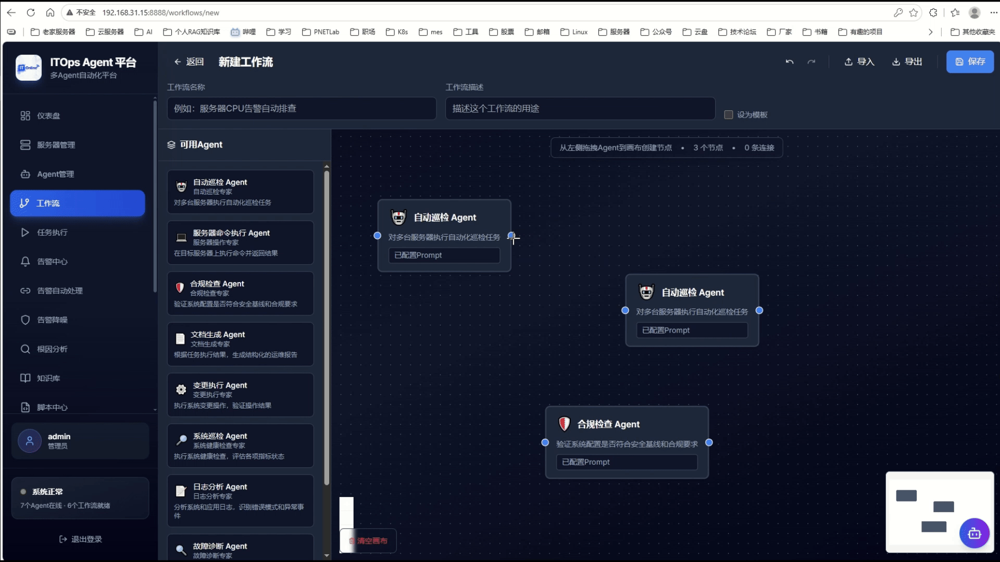
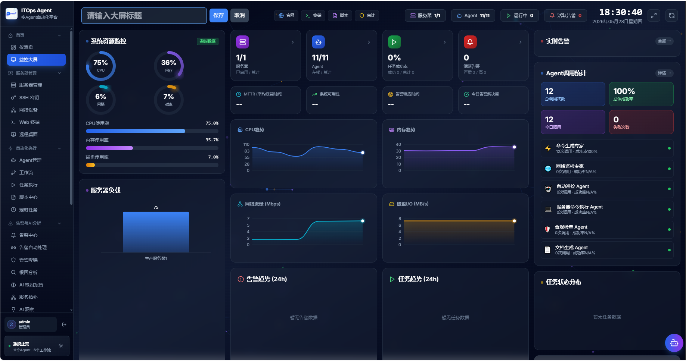

[English](README.md) | [中文](README.zh.md) | [繁體中文](README.tw.md) | [한국어](README.ko.md) | [日本語](README.ja.md) | [Deutsch](README.de.md) | [Français](README.fr.md)

---

**Le projet fait actuellement l'objet d'une refonte complète basée sur le framework d'architecture 4A et le Design piloté par le domaine (DDD). L'objectif de cette refonte est de découpler complètement la logique métier de l'implémentation technique, de rétablir la cohérence architecturale, d'améliorer la maintenabilité et la conformité du code, tout en donnant au système une plus grande capacité d'extension élastique. La charge de travail de la refonte est immense et le remplacement progressif est en cours. Le code récemment poussé et les images Docker construites sont dans un état transitoire, avec des dépendances non vérifiées et instables, et ne sont pas recommandés pour une utilisation directe. Les utilisateurs réguliers devraient attendre la version stable ; les développeurs capables de déboguer et de modifier le code source peuvent directement s'appuyer dessus, et les corrections de défauts temporaires sont les bienvenues.**

```bash
# Déploiement (Docker Compose recommandé)
docker compose up -d --build
```

---

**Avis important de changement de licence (2026-05-27)**

Tout le code soumis au projet avant le 27 mai 2026 reste sous licence MIT et peut être utilisé, modifié et distribué commercialement librement selon les règles du protocole MIT.
À partir du 27 mai 2026, tout le code nouveau et modifié du projet est placé sous la licence open source Mozilla Public License 2.0 (MPL-2.0). Les utilisateurs doivent strictement respecter les dispositions du protocole officiel MPL-2.0 :
Si vous diffusez à l'extérieur des paquets binaires, des images ou des programmes de déploiement contenant du code modifié de ce projet, vous devez publier tous les fichiers sources modifiés en open source, et conserver en même temps l'avis de droit d'auteur et la déclaration de licence du projet original — il est interdit d'effacer la source et de se faire passer pour votre propre produit ;
Le déploiement privé sur réseau d'entreprise, la modification interne pour usage propre sont autorisés ; la fourniture de services de déploiement, de débogage, de conseil technique et de développement personnalisé basés sur ce projet est autorisée ;
Il est strictement interdit d'emballer simplement le code source de ce projet, de le distribuer sous forme de produit logiciel ou image fermé en tant que logiciel commercial indépendant ; il est strictement interdit de construire directement une plateforme SaaS concurrente du même type basée sur ce projet pour une exploitation commerciale.
Ce projet restera open source pour toujours, appartient à toute la communauté open source technique, et ne sera pas racheté en exclusivité par une entreprise commerciale. Nous encourageons les échanges techniques, le développement secondaire et la construction de l'écosystème open source dans le respect de la conformité.

---

## 🎯 Qui l'utilise / À qui s'adresse-t-il ?

| Rôle | Point de douleur typique | Comment la plateforme résout le problème |
| ---- | ---------------------- | ---------------------------------------- |
| **Ingénieur d'exploitation** | Réveillé la nuit par des alertes, débogage SSH manuel | Diagnostic automatique de la cause racine par IA → approbation push → réparation en un clic sur mobile |
| **SRE / DevOps** | Plusieurs outils, silos d'information | Alerte + diagnostic + exécution + approbation en boucle fermée unique |
| **Responsable informatique / CTO** | L'exploitation dépend des personnes, la réponse aux incidents tient du hasard | Inspections automatisées + stratégies d'auto-guérison, libérant les personnes des tâches répétitives |
| **PME informatique** | Ne peut pas se permettre PagerDuty/Rundeck etc. | Équivalence fonctionnelle, open source, gratuit, données ne sortant pas du réseau |
| **Équipe sécurité/conformité** | Opérations de réparation sans approbation, sans audit | Approbation humaine (HITL) + audit complet de la chaîne + filtrage de sécurité des commandes |

---

## Pourquoi ce projet ?

3 heures du matin, le CPU du serveur à 99%. Le processus traditionnel :

```
Notification d'alerte → réveillé → connexion VPN → SSH → commandes de diagnostic → lecture de docs → réparation → rapport → se rendormir
```

**Processus entier 30-60 minutes, alors que vous auriez pu continuer à dormir.**

ITOps Agent Platform transforme ce processus en :

```
Déclenchement d'alerte → diagnostic automatique de cause racine par IA → génération de commandes de réparation → push d'approbation mobile → exécution en un clic → validation automatique → rapport généré
```

**3 minutes au total, vous devez juste cliquer sur "Accepter" sur votre mobile.**

---

## 🚀 La forme ultime de l'exploitation : de l'automatisation à l'autonomie

ITOps Agent Platform n'est pas seulement un outil d'exploitation, il cible **la direction ultime de l'évolution de l'exploitation informatique** : l'exploitation entièrement autonome par IA.

```
Exploitation manuelle  →  Automatisation par script  →  Plateformisation  →  IA
  années 2000             années 2010              années 2020       2024+           maintenant & futur
```

| Étape | Caractéristiques | Rôle de l'humain |
| ----- | ---------------- | ---------------- |
| Exploitation manuelle | Saisie de commandes, connexion aux serveurs | Exécutant |
| Automatisation par script | Shell / Python semi-automatisé | Mainteneur de scripts |
| Plateformisation | Ansible / Prometheus / Terraform | Opérateur de plateforme |
| Assistance IA | Suggestions Copilot, analyse d'alertes | Décideur |
| **Exploitation autonome IA** | **Automatique complète : Percevoir → Diagnostiquer → Décider → Exécuter → Valider** | **Superviseur** |

### Pourquoi est-ce la forme ultime ?

| Dimension | Approche traditionnelle | ITOps Agent Platform |
| --------- | ----------------------- | -------------------- |
| Réponse aux incidents | Humain : détecter → localiser → réparer (30-60 min) | IA : détecter automatiquement → diagnostiquer → réparer (< 3 min) |
| Échelle de l'exploitation | 1 personne pour 20-50 machines | **1 personne pour 500+ nœuds, l'IA gère 80%+** |
| Rétention des connaissances | Dans la tête des seniors, documents éparpillés | **Base de connaissances + RAG, jamais perdu** |
| Qualité des décisions | Dépend de l'expérience individuelle, instable | **Raisonnement multi-agents, auditable** |
| Coût marginal | Plus de machines ≈ plus de personnes | **Plus de machines ≈ plus d'agents, coût tendant vers zéro** |

> **Ce n'est pas un outil d'exploitation ; c'est le prochain système d'exploitation pour l'exploitation.** Lorsque les agents peuvent couvrir autonomement la prise d'alerte, le diagnostic de cause racine, la décision de réparation, l'exécution de commandes et la vérification du résultat, l'exploitation n'est plus "les humains surveillent les systèmes" mais "les humains définissent les politiques, l'IA exécute".

### Tendance de l'industrie : l'exploitation autonome par IA est irréversible

- **Gartner** classe l'AIOps comme tendance technologique stratégique, prédit que les opérations autonomes pilotées par IA deviendront la norme
- **CNCF** : Cloud-native + fusion IA est la direction centrale de la prochaine génération d'infrastructure
- Les coûts de main-d'œuvre d'exploitation augmentent continuellement — **les agents IA sont le seul moyen de supporter une croissance d'activité 10x sans augmentation de 10x du personnel**
- **Open source + collaboration multi-agents** est la clé pour briser les monopoles commerciaux

### Notre positionnement

**ITOps Agent Platform est le seul projet open source AIOps qui implémente réellement la boucle autonome complète "Alerte → Diagnostic → Décision → Exécution → Validation".**

Objectif à long terme : laisser les agents IA prendre en charge 80% du travail d'exploitation courant, libérant les ingénieurs pour l'architecture, les politiques et le travail créatif. **Ce n'est pas seulement un projet open source ; c'est le point de départ du mouvement de libération de l'exploitation.**

---

## ⏰ Pourquoi maintenant ?

Trois tendances convergent au même moment, rendant l'exploitation autonome par IA, de "concept" à "inévitable" :

| Tendance | Explication |
| -------- | ----------- |
| **Capacité LLM franchit le seuil** | GPT-4o / DeepSeek / Doubao / Qwen ont désormais une capacité de raisonnement de qualité production, capables de diagnostic de panne et de génération de commandes |
| **Coût de la main-d'œuvre d'exploitation augmente irréversiblement** | Une croissance informatique 10x ne peut pas être soutenue par 10x plus de personnel ; l'IA doit prendre en charge 80%+ du travail courant |
| **Écosystème open source mature** | Docker / K8s / React / TypeScript / Node.js peuvent supporter des produits d'entreprise ; l'open source n'est plus "rudimentaire" |

> **2026 est la première année de l'exploitation autonome par IA.** La capacité LLM + les problèmes d'exploitation + l'écosystème open source mature convergent sur ce nœud historique. ITOps Agent Platform se trouve précisément à ce point. Manquer cette fenêtre, c'est manquer une ère.

### Un marché de 40 milliards de dollars réécrit par l'IA

Marché mondial de l'exploitation informatique : **40 milliards de dollars (2025)**, prévu pour dépasser 70 milliards d'ici 2030. Chaque changement de paradigme crée un nouveau roi :

- Virage cloud → AWS (2 billions de dollars de capitalisation boursière)
- Virage monitoring → Datadog (40 milliards de dollars de capitalisation boursière)
- Virage outils Dev → GitLab (14 milliards de dollars d'IPO)
- **Virage exploitation → ?**

> **La question n'est pas "si cela va arriver" mais "qui deviendra le GitLab de cette voie".** La place de leader open source AIOps est vacante — un marché winner-take-all.

| GitLab à l'époque | ITOps Agent Platform aujourd'hui |
| ----------------- | -------------------------------- |
| Alternative open source à GitHub | Alternative open source à PagerDuty + Rundeck + Portainer |
| Initialement seulement CI/CD de base | 12 agents IA + 68 routes API |
| Personne ne croyait que l'hébergement de code valait 10 milliards | **Personne ne croit qu'une plateforme d'exploitation vaille 10 milliards** |

> ITOps Agent Platform se trouve à un stade plus précoce sur une voie beaucoup plus grande que l'époque de GitLab.

### Trois vents favorables irréversibles

| Vent favorable | Pourquoi irréversible |
| -------------- | --------------------- |
| **Explosion des capacités IA** | Les LLM sont passés de "jouet" à "qualité production" en 2 ans ; le prochain pas est la "prise de décision autonome" |
| **Pénurie de personnel d'exploitation** | Vague de départs à la retraite des ingénieurs vétérans + les jeunes refusent l'astreinte 24h/24 = l'IA est la seule issue |
| **L'open source dévore les logiciels d'entreprise** | GitLab, Confluent, Grafana, HashiCorp — 5 IPO open source, chacune prouvant que l'open source peut gagner commercialement |

> **La question n'est pas de choisir ou non, mais de choisir qui.** Lorsque ces trois courbes se croisent, l'exploitation autonome par IA est une nécessité mathématique.






---

## Boucle complète en 5 minutes

```bash
# 1. Déployer (Docker requis)
docker compose up -d --build

# 2. Ouvrir http://localhost:8080, compte par défaut admin/admin
# 3. Ajouter un serveur → le système découvre automatiquement les conteneurs et ressources de l'hôte
# 4. Configurer un webhook d'alerte → déclencher une alerte de test → regarder l'IA analyser
# 5. Cliquer sur "réparer automatiquement" → approuver sur votre téléphone → terminé !
```

**5 minutes, du zéro à une boucle d'exploitation IA complète.**

---

## Ce que la plateforme peut réellement faire

### Chemin 1️⃣  Alertes intelligentes → Diagnostic IA → Réparation automatique

```
Prometheus / Zabbix alerte → réception webhook
  → Analyse de cause racine par IA (rapport de diagnostic en langage naturel)
    → Commandes de réparation automatiquement générées + évaluation des risques
      → Push d'approbation WeCom / DingTalk → approbation en un clic sur mobile
        → SSH exécute la réparation automatiquement → valide le résultat → génère le rapport
```

<details>
<summary><b>Développer : quels problèmes ce flux résout-il</b></summary>

| Traditionnel | Cette plateforme |
| ------------ | ---------------- |
| Tempête d'alertes, réveillé la nuit | IA dédoublonne et regroupe les alertes |
| Débogage SSH manuel, à tâtons | IA analyse les logs + métriques, fournit un diagnostic en NL |
| Chercher les étapes de réparation dans les docs | Commandes de réparation structurées générées automatiquement (JSON) |
| Réparations sans approbation, pas de responsabilité | Nœud d'approbation humaine, approbation en un clic sur mobile |
| Craindre les réparations échouées sans rollback | Validation automatique, alerte en cas d'échec |

</details>

### Chemin 2️⃣  Workflows visuels → Inspections automatiques planifiées

```
Workflow éditeur drag-and-drop (agents + approbations + branches conditionnelles)
  → configurer déclencheur Cron
    → exécution d'inspection automatique sur plusieurs serveurs
      → génération de rapports de conformité
        → anomalies déclenchent des alertes → chemin 1️⃣
```

### Chemin 3️⃣  Gestion unifiée des conteneurs et de la virtualisation

```
Ajouter un hôte Docker / VMware vCenter / Proxmox VE / KVM en une étape
  → découverte automatique de tous les conteneurs et VMs
    → monitoring temps réel CPU / mémoire / réseau (push WebSocket)
      → streaming des logs des conteneurs
        → orchestration Docker Compose visuelle
          → import et gestion de clusters K8s (import kubeconfig + état du cluster)
            → intégration du registre d'images (Harbor / ACR / Docker Hub)
```

### Chemin 4️⃣  Gestion de l'infrastructure réseau et des centres de données

```
Planification de sous-réseaux → gestion des sous-réseaux IP / VLAN → allocation / réservation / libération automatique d'IP
  → modélisation du centre de données (racks / PDUs / cycle de vie des équipements / gestion de l'alimentation)
    → monitoring 3D jumeau numérique de la salle (rendu WebGL temps réel)
      → découverte automatique de topologie réseau (SNMP / LLDP / ARP)
```

---

## En quoi se distingue-t-il des projets open source similaires ?

| Capacité | ITOps Agent | GrafanaOnCall | Portainer | UptimeKuma | Rundeck | Coolify |
| -------- | :---------: | :-----------: | :-------: | :--------: | :-----: | :-----: |
| Ingestion d'alertes + réduction du bruit | ✅ | ✅ | ❌ | ✅ | ❌ | ❌ |
| **Collaboration multi-agents IA** | **✅** | ❌ | ❌ | ❌ | ❌ | ❌ |
| **Boucle fermée alerte → réparation automatique** | **✅** | ❌ | ❌ | ❌ | ❌ | ❌ |
| **Approbation humaine (HITL)** | **✅** | ❌ | ❌ | ❌ | ❌ | ❌ |
| Gestion visuelle conteneurs/VM | ✅ | ❌ | ✅ | ❌ | ❌ | ✅ |
| Gestion de clusters K8s | ✅ | ❌ | ✅ | ❌ | ❌ | ❌ |
| Gestion sous-réseaux IP / VLAN | ✅ | ❌ | ❌ | ❌ | ❌ | ❌ |
| Modélisation de salles de centre de données | ✅ | ❌ | ❌ | ❌ | ❌ | ❌ |
| Jumeau numérique 3D de salle | ✅ | ❌ | ❌ | ❌ | ❌ | ❌ |
| Éditeur de workflows drag-and-drop | ✅ | ✅ | ❌ | ❌ | ✅ | ❌ |
| Terminal Web SSH | ✅ | ❌ | ✅ | ❌ | ❌ | ❌ |
| Base de connaissances + RAG | ✅ | ❌ | ❌ | ❌ | ❌ | ❌ |
| Tâches planifiées + rapports automatiques | ✅ | ❌ | ❌ | ❌ | ✅ | ❌ |
| Analyse des coûts + autoscaling | ✅ | ❌ | ❌ | ❌ | ❌ | ❌ |
| **IA locale · données ne sortent pas du réseau** | **✅** | ❌ | ❌ | ❌ | ❌ | ❌ |

> **En une ligne** : les outils open source existants couvrent chacun une tranche — OnCall pour les alertes, Portainer pour les conteneurs. ITOps Agent les relie tous et ajoute un **cerveau multi-agents IA**, livrant le véritable cycle "alerte entrée, réparation terminée".

### Comparaison avec les offres commerciales

Gratuit et open source n'est pas le seul avantage. Comparaison directe avec les produits payants :

| Capacité | PagerDuty + Rundeck | ServiceNow ITOM | **ITOps Agent (gratuit)** |
| -------- | :-----------------: | :-------------: | :-----------------------: |
| Coût annuel (100 nœuds) | $50 000+ | $100 000+ | **$0** |
| Diagnostic autonome par IA | ❌ routage d'alertes seulement | ⚠️ module supplémentaire | **✅ raisonnement multi-agents** |
| Boucle fermée de réparation automatique | ❌ manuel | ⚠️ développement spécifique | **✅ intégré** |
| Approbation humaine (HITL) | ❌ | ⚠️ spécifique | **✅ push natif** |
| Gestion conteneurs/VM/K8s | ❌ | ❌ | **✅ intégré** |
| Données sur site | ❌ SaaS uniquement | ❌ SaaS uniquement | **✅ 100% local** |
| Open source, contrôlable | ❌ fermé | ❌ fermé | **✅ MPL-2.0** |
| Piloté par la communauté | ❌ | ❌ | **✅** |

> **Un projet open source fait ce que trois produits commerciaux (PagerDuty + Rundeck + Portainer) réunis ne peuvent pas faire. Et c'est gratuit.**

---

## Aperçu de l'architecture

```mermaid
graph TB
    subgraph Client["🖥️ Client layer"]
        Browser["🌐 Browser<br/>React 18 + Vite + Ant Design<br/>474 .tsx components · 23 DDD modules"]
    end

    subgraph Edge["🚪 Edge layer"]
        Nginx["Nginx reverse proxy<br/>static assets · gzip · HTTPS termination"]
    end

    subgraph Tech["4️⃣ Technology layer (core/)"]
        DI["DI container<br/>serviceContainer.ts<br/>topological init"]
        MW["Middleware<br/>auth(JWT+RBAC) · errorHandler<br/>rateLimiter · validation(Zod) · trace"]
        WS["WebSocket service<br/>Socket.IO 4.7<br/>realtime push · VNC proxy"]
    end

    subgraph App["2️⃣ Application layer (modules/)"]
        direction TB

        subgraph AIMcp["🤖 AI & tool protocol domain"]
            AiMod["ai/<br/>multi-agent · RCA · knowledge base<br/>agentToolRegistry 24 tools"]
            McpMod["mcp/<br/>MCP protocol · 6-layer securityGate<br/>toolRegistry 13+ platform + external server"]
            Bridge["agentMcpAdapter<br/>bridge (mcp ↔ agent)"]
        end

        subgraph AlertMon["🚨 Alerting & monitoring domain"]
            AlertsMod["alerts/<br/>ingest→filter→correlate→dedupe→notify<br/>AlertProcessor state machine"]
            MonMod["monitor/<br/>dashboard · big screen · reports · cost<br/>Prometheus · Zabbix"]
            LinkMod["linkage/<br/>linkage stats · patrol center<br/>(backend only)"]
        end

        subgraph InfraDom["🛠️ Infrastructure domain"]
            ServersMod["servers/<br/>SSH · remote desktop · terminal"]
            ContainersMod["containers/<br/>Docker multi-host · VMware/Proxmox/KVM<br/>three adapters + snapshot/migration"]
            K8sMod["kubernetes/<br/>K8sContext · Pod · Node"]
            NetworkMod["network/<br/>17 vendor adapters · SNMP · topology · VNC"]
            DcMod["dc/<br/>room · rack · device · power<br/>3D visualization · 5s realtime push"]
        end

        subgraph AutoDom["⚙️ Ops automation domain"]
            WfMod["workflow/<br/>WorkflowEngine state machine · task scheduling"]
            AutoMod["auto/<br/>remediation policy · autoscaling<br/>container/vm/k8s_deployment"]
            CfgMod["config-management/<br/>config templates · config repair · Compose"]
            ChgMod["change-management/<br/>change approval · ApprovalTicket"]
            ScriptsMod["scripts/<br/>scripts · terminal · AI commands"]
        end

        subgraph SysDom["🔐 System support domain"]
            AuthMod["auth/<br/>JWT + RBAC + login rate limit"]
            SettingsMod["settings/<br/>system settings · AI provider config<br/>replaces .env"]
            BackupMod["backup/<br/>auto backup · encryption · manual restore"]
            AuditMod["audit/<br/>audit log"]
            DBMod["database/<br/>DB connection management"]
            NotifyMod["notification/<br/>6 channels · templates · delivery"]
            ImpMod["import-export/<br/>CSV/JSON import export"]
            TLMod["tool-links/<br/>toolbox CRUD"]
        end
    end

    subgraph Biz["1️⃣ Business layer (state machines/rules/permissions)"]
        BizRules["workflow state machine · alert rules<br/>approval permissions · aggregate-root protection<br/>(never hardcoded in routes/repository)"]
    end

    subgraph Data["3️⃣ Data layer (repositories/)"]
        SQLite[("SQLite<br/>better-sqlite3 + WAL mode<br/>AES-256 encryption · 60 migrations<br/>31 top-level repos + 90 subdirs")]
    end

    subgraph Ext["🌍 External integration layer"]
        LLM["🤖 LLM model pool<br/>Doubao · DeepSeek · Qwen<br/>OpenAI · Zhipu · local models<br/>(providerAdapters functional abstraction)"]
        SSH["🖥️ SSH servers<br/>ssh2 · shell-quote"]
        Docker["🐳 Docker Engine API<br/>dockerode"]
        VMware["💻 VMware vSphere / KVM"]
        Prometheus["📊 Prometheus / Zabbix / Grafana<br/>alert webhooks"]
        K8sExt["☸️ Kubernetes API"]
        SnmpExt["📡 SNMP / NetFlow devices<br/>17 vendor adapters · net-snmp"]
        Notify["📬 Notification channels<br/>WeCom · Feishu · DingTalk<br/>Telegram · Email · Webhook"]
        McpExt["🔌 External MCP servers<br/>SSE / stdio transport"]
    end

    Browser --> Nginx
    Nginx --> App
    Browser <-->|"WebSocket realtime<br/>alerts · VNC · dc:status"| WS
    WS -.inject into DI.-> DI

    App --> Biz
    App --> Data
    App --> Tech

    AIMcp --> LLM
    AIMcp -.SSE/stdio.-> McpExt
    AlertsMod --> Prometheus
    MonMod --> Prometheus
    NetworkMod --> Prometheus
    DcMod --> Prometheus
    NotifyMod --> Notify
    ServersMod --> SSH
    ContainersMod --> Docker
    ContainersMod --> VMware
    K8sMod --> K8sExt
    NetworkMod --> SnmpExt
    AiMod --> LLM
    WfMod --> ScriptsMod
    AutoMod --> ContainersMod
    AutoMod --> K8sMod
    ScriptsMod --> ServersMod

    classDef biz fill:#fff4e1,stroke:#d2691e,stroke-width:2px;
    classDef tech fill:#e1f0ff,stroke:#1e5aa8,stroke-width:2px;
    classDef data fill:#e8f5e9,stroke:#2e7d32,stroke-width:2px;
    class BizRules biz
    class DI,MW,WS tech
    class SQLite data
```



> 📐 [Architecture complète →](./docs/ARCHITECTURE_DIAGRAM.md)

---

| Fossé compétitif | Description |
| ---------------- | ----------- |
| **Orchestration de 12 agents** | Pas un seul appel d'API IA, mais un système distribué de rôles d'agents, collaboration et arbitrage |
| **Machine à états de bout en bout** | Alerte → Diagnostic → Décision → Approbation → Exécution → Validation, flux 7-nœuds éprouvé en production |
| **Moteur de sécurité des commandes** | 7 classes de politiques de commandes dangereuses + matrice de permissions par rôle, maintient les commandes générées par l'IA en sécurité |
| **Chaîne de basculement multi-modèles** | Basculement automatique sur les modèles de secours, le service IA survit à un point de défaillance unique |
| **60 migrations de base de données** | Schéma évolué à travers des dizaines d'itérations — maturité d'ingénierie bien au-delà des projets de démonstration |

### Économie d'échelle : pourquoi l'open source gagne

| Mesure | Exploitation SaaS traditionnelle | Modèle open source ITOps Agent |
| ------ | :------------------------------: | :----------------------------: |
| Acquisition client | Piloté par les ventes, $10 000+ par client | **≈ $0 (communauté + bouche à oreille des développeurs)** |
| Coût marginal | Croît linéairement avec les utilisateurs | **Presque zéro (auto-hébergé)** |
| Effet de réseau | Faible | **Fort (plus d'agents → plateforme plus forte → plus grande communauté)** |
| Verrouillage de l'écosystème | Migrable à la fin du contrat | **Base de connaissances + marché d'agents + modèles de workflows** |
| Flexibilité commerciale | Abonnements uniquement | **Édition entreprise / Cloud managé / Support / Marché / Formation** |

> L'avantage principal de l'open source est l'efficacité d'acquisition et l'évolutivité, déjà prouvé par les projets mainstream. Il offre une base solide pour la durabilité à long terme.

---

## 🗺️ Feuille de route

| Phase | Objectif principal |
| ----- | ------------------ |
| **v3.x Ingénierie** (maintenant) | Gestion unifiée conteneurs/VM/K8s multi-hôtes, boucle alerte → réparation |
| **v4.x Intelligence** | Négociation autonome multi-agents, corrélation inter-systèmes, stratégies auto-apprenantes |
| **v5.x Autonomie** | Exploitation sans contact, planification de capacité et de coûts pilotée par l'IA |
| **v6.x Écosystème** | Marché d'agents, fédération multi-clusters, jumeau numérique d'exploitation |

> **Une feuille de route n'est pas seulement un calendrier ; c'est un engagement envers l'avenir de l'exploitation.** Le projet continue d'itérer vers l'exploitation entièrement autonome par IA.

---

## Fonctionnalités principales

### 🤖 Exploitation pilotée par l'IA

- **12 agents prédéfinis** : traitement des alertes, diagnostic de panne, analyse de logs, inspection système, exécution de changements, génération de documents, vérification de conformité, exécution de commandes, inspection automatique, expert de génération de commandes, expert d'inspection réseau, exploitation de bases de données
- **Boucle de réparation par IA** : alerte → analyse par IA → génération de commandes de réparation → approbation → exécution → validation
- **Analyse de cause racine** : analyse d'alertes pilotée par l'IA avec rapport de diagnostic en langage naturel et chaîne de raisonnement complète
- **Copilote IA** : assistant d'exploitation en langage naturel avec perception automatique de l'état du système
- **Base de connaissances + RAG** : 21 entrées prédéfinies, récupération sémantique injectée dans le contexte LLM

### 🔧 Gestion visuelle

- **Éditeur de workflows** : drag-and-drop, séquentiel/parallèle/branches conditionnelles, 10 modèles prédéfinis
- **Terminal Web SSH** : terminal interactif xterm.js, ajustement automatique, gestion de sessions
- **Gestion des conteneurs** : visualisation Docker multi-hôte (démarrer/arrêter/logs/monitoring/Compose)
- **Gestion des VM** : VMware vSphere / Proxmox VE / KVM, snapshots, migration en direct
- **Gestion K8s** : import de clusters via kubeconfig, cycle de vie complet Pod/Deployment/Service/Node
- **Gestion des sous-réseaux** : planification des sous-réseaux IP / VLAN, pools IP automatiques, allocation/réservation/libération, opérations en masse
- **Gestion des centres de données** : modélisation des salles et racks, suivi du cycle de vie des équipements, gestion d'alimentation PDU/UPS
- **Monitoring 3D de salle** : jumeau numérique Three.js WebGL, état des équipements en temps réel
- **Dashboard grand écran** : centre de monitoring NOC plein écran

### 🏢 Fonctionnalités entreprise

- **Approbation HITL** : nœuds d'approbation humaine dans les workflows, push WeCom/DingTalk, approbation mobile
- **Réduction du bruit des alertes** : dédoublonnage intelligent + suppression + corrélation
- **Autoscaling** : piloté par CPU/mémoire, fenêtres de refroidissement, historique de scaling
- **Analyse des coûts** : estimation des coûts conteneurs/VM + suggestions d'optimisation
- **Tâches planifiées** : expressions Cron exécutent les workflows automatiquement
- **Système de rapports** : génération automatique de rapports Markdown

### 🔒 Sécurité et conformité

- **Chiffrement AES-256-GCM** : chiffrement de niveau bancaire pour les mots de passe serveurs et clés SSH
- **Authentification JWT double token** : token d'accès (24h) + token de rafraîchissement (7d) avec renouvellement automatique
- **Filtre de sécurité des commandes SSH** : 7 classes de politiques de commandes dangereuses (rm -rf / mkfs / iptables -F …), blocage par rôle
- **Protection de connexion** : verrouillage de 30 min après 5 échecs, complexité de mot de passe forcée
- **Journal d'audit** : chaque opération traçable
- **Exécution non-root** : conteneurs Docker à privilèges minimaux
- **IA locale** : support Ollama / LM Studio / vLLM, données ne quittent jamais le réseau

---

## Modèles d'IA supportés

Gérés via un pool de modèles unifié avec chaînes de basculement primaire/sauvegarde et disjoncteurs indépendants par fournisseur.

| Type | Fournisseur/Modèle | Intégration | Recommandé pour |
| ---- | ------------------ | ----------- | --------------- |
| **Cloud Chine** | Doubao de Vulcan Engine | API native | Stable et rapide en Chine |
| **Cloud Chine** | Qwen d'Alibaba Cloud | Compatible OpenAI | Charges de travail entreprise |
| **Cloud Chine** | DeepSeek | Compatible OpenAI | Génération de code, raisonnement |
| **Cloud Chine** | GLM-4 de Zhipu AI | Compatible OpenAI | Fort compréhension du chinois |
| **Cloud Chine** | Kimi de Moonshot | Compatible OpenAI | Traitement de contexte long |
| **Cloud Chine** | ERNIE de Baidu | Compatible OpenAI | Entreprises chinoises |
| **Cloud Chine** | 01.AI (Yi) / Baichuan | Compatible OpenAI | Modèles open |
| **Cloud mondial** | OpenAI (GPT-4o) / Anthropic Claude | API native | Réseaux hors Chine |
| **Auto-hébergé** | Ollama / LM Studio / vLLM | Compatible OpenAI | **Données 100% sur site** |

> ✅ Pool de modèles unifié   ✅ Chaînes de basculement   ✅ Disjoncteurs indépendants   ✅ Réorganisation par glisser-déposer   ✅ Tests de connectivité

---

## Démarrage rapide

### Option 1 : Docker Compose

```bash
docker compose up -d --build
# Frontend : http://localhost:8080
# Santé : http://localhost:3001/health
```

### Option 2 : Développement local (Rechargement à chaud)

```bash
npm run dev
# Frontend : http://localhost:3000
# Backend : http://localhost:3001
```

**Administrateur par défaut** : `admin` / `admin` (changement de mot de passe forcé au premier login)

---

## Stack technologique

| Couche | Technologie |
| ------ | ----------- |
| Frontend | React 18 + TypeScript + Vite 5 + Tailwind CSS 3 |
| Gestion d'état | Zustand + React Query |
| Éditeur de workflows | @xyflow/react |
| Backend | Node.js + Express 4 + TypeScript |
| Base de données | SQLite (better-sqlite3, mode WAL) |
| Temps réel | Socket.io 4 |
| Connexions distantes | SSH2 |
| Opérations conteneurs | Dockerode |
| Déploiement | Docker + Docker Compose + Nginx |

---

## Structure du projet

```
├── backend/src/
│   ├── app.ts                    # Point d'entrée Express
│   ├── routes/                   # 68 modules de routes API
│   ├── services/                 # 72 services métier
│   ├── models/                   # Base de données + 60 migrations
│   ├── presets/                  # Données prédéfinies (agents / workflows / connaissances)
│   ├── middleware/               # 6 middlewares (authentification / limitation de taux / validation …)
│   ├── websocket/                # Socket.IO temps réel
│   └── utils/                    # Utilitaires
├── frontend/src/
│   ├── pages/                    # 63 composants de pages
│   ├── components/               # Composants partagés (DataRoom3D / Éditeur de workflows …)
│   ├── contexts/                 # Contextes React (Authentification / Thème / Toast)
│   └── lib/                      # Wrapper Axios / Aide
├── docker/                       # Configuration Docker de production + Nginx
├── docs/                         # Documentation technique
├── .github/workflows/            # CI (docker-build.yml)
├── docker-compose.yml            # Orchestration de production
└── package.json                  # Scripts workspace
```

---

## Documentation

| Document | Description |
| -------- | ----------- |
| [Guide de déploiement](./docs/DEPLOYMENT.md) | Étapes de déploiement détaillées |
| [Référence API](./docs/API.md) | Surface API complète |
| [Architecture](./docs/ARCHITECTURE.md) | Architecture système |
| [Guide de développement](./docs/DEVELOPMENT.md) | Configuration locale |
| [Guide de workflows](./docs/WORKFLOW_GUIDE.md) | Orchestration de workflows |
| [Conception de réparation automatique](./docs/AUTO_REMEDIATION_DESIGN.md) | Réparation automatique d'alertes |
| [Inspection de périphériques réseau](./docs/NETWORK_DEVICE_INSPECTION.md) | Fonctionnalités des périphériques réseau |
| [Guide de test](./docs/TEST_GUIDE.md) | Tests fonctionnels |
| [Vision du projet](./项目愿景与社区共建.md) | Vision et co-construction |

---

## Auteur

**Tan Ce** — Développeur indépendant | Explorateur AIOps

- 🌐 Site web : [ITOpsAgentinfo](https://www.zjzwfw.cloud/ITOpsAgentinfo)
- 📝 Blog : [zjzwfw.cloud](https://www.zjzwfw.cloud/)
- 📧 E-mail : <huawei_network@foxmail.com>
- 💬 Compte WeChat officiel : **IT Online**

<p align="left">
  
</p>

---

## 🙏 Contributeurs

| Avatars | Nom / pseudo | Rôle | Contribution |
| ------- | ------------ | ---- | ------------ |
|  | 热心市民高先生 | Contributeur WeChat | Retour de test |
|  | @林 | Contributeur WeChat | Retour de test |
|  | 尔东辰 | Contributeur WeChat | Test |
|  | xiezhiliang89 | Contributeur GitHub | Test |

<a href="https://github.com/qinshihu/itops-agent-platform/graphs/contributors">
  
</a>

---

## 🌍 Vision communautaire : plus que du code, un mouvement

ITOps Agent Platform n'est pas seulement un projet open source ; c'est un **mouvement de libération des ingénieurs d'exploitation**.

Nous croyons :

- **L'exploitation ne devrait pas être un travail physique 24/7** — elle devrait être une conception de politique et une innovation architecturale
- **L'IA ne devrait pas remplacer les ingénieurs** — elle devrait remplacer le travail répétitif que les ingénieurs ne veulent pas faire
- **Les communautés open source** peuvent créer de meilleurs produits que les logiciels commerciaux
- **Chaque ingénieur d'exploitation mérite d'être libéré des tempêtes d'alertes** — pour passer du temps avec sa famille, poursuivre ce qu'il aime vraiment

> Si vous aussi croyez que l'avenir de l'exploitation est l'autonomie par IA, rejoignez-nous. **Les étoiles sont la plus grande reconnaissance qu'un projet open source puisse recevoir, et chaque issue rapproche cette vision.**

---

## 🔭 Vision à long terme

> **"Nous construisons le système d'exploitation autonome pour l'exploitation."**

> 50 millions d'ingénieurs d'exploitation dans le monde gèrent 400 milliards de dollars d'infrastructure informatique. Aujourd'hui, ils se réveillent encore à 3h du matin pour réparer des serveurs manuellement.

> Ce que nous faisons est de passer de "les humains opèrent des outils" à "les humains définissent les politiques, l'IA exécute". Ce n'est pas une amélioration de fonctionnalité — c'est un changement de paradigme.

> Le projet continue d'évoluer ; suivez-nous. Chaque étoile est un vote pour l'avenir.

---

## 🤝 Contribuer

Toutes les formes de contribution sont les bienvenues !

- 🐛 [Signaler un bug](https://github.com/qinshihu/itops-agent-platform/issues/new?template=bug_report.yml)
- 💡 [Demander une fonctionnalité](https://github.com/qinshihu/itops-agent-platform/issues/new?template=feature_request.yml)
- 📝 [Améliorer la documentation](https://github.com/qinshihu/itops-agent-platform/issues/new?template=docs_update.yml)
- 🔒 [Signaler un problème de sécurité](SECURITY.md)

Voir le [guide de contribution](CONTRIBUTING.md) pour plus de détails.

---

## ⭐ Soutenir le projet

Si ce projet vous a aidé, donnez-nous une **Étoile** ⭐ pour que plus de gens puissent le trouver !

<p align="center">
  <a href="https://github.com/qinshihu/itops-agent-platform">
    
  </a>
  &nbsp;&nbsp;
  <a href="https://github.com/qinshihu/itops-agent-platform/fork">
    
  </a>
</p>

> 🌟 **Plus d'étoiles → plus de chances d'apparaître sur GitHub Trending → plus de développeurs rejoignent la construction. Chaque étoile est la plus grande encouragement !**

---

## 📄 Licence

[MPL-2.0](./LICENSE) © Tan Ce