[English](README.md) | [中文](README.zh.md) | [繁體中文](README.tw.md) | [한국어](README.ko.md) | [日本語](README.ja.md) | [Deutsch](README.de.md) | [Français](README.fr.md)

---

**이 프로젝트는 4A 아키텍처 프레임워크와 DDD(도메인 주도 설계)를 기반으로 전체 리팩토링을 진행 중입니다. 이번 리팩토링은 비즈니스 로직과 기술 구현을 완전히 분리하고, 아키텍처의 합리성을 재정립하며, 코드 유지보수성과 규범성을 향상시키는 동시에 시스템에 더 강력한 탄력적 확장 능력을 부여하는 것을 목표로 합니다. 리팩토링 작업량이 방대하여 현재 점진적 대체 단계에 있습니다. 최근 푸시된 코드와 빌드된 Docker 이미지는 과도기 상태이며, 검증되지 않은 의존성이 혼재되어 있어 직접 사용을 권장하지 않습니다. 일반 사용자는 안정 버전 출시를 기다려 주시기 바라며, 소스 코드 디버깅 및 수정 능력이 있는 개발자는 소스 코드를 기반으로 직접 이차 개발을 진행할 수 있고, 일시적 결함 수정을 도와주시면 환영합니다.**

```bash
# 배포 (Docker Compose 권장)
docker compose up -d --build
```

---

**중요 라이선스 변경 공지 (2026-05-27)**

본 프로젝트 2026년 5월 27일 이전에 제출된 모든 코드는 여전히 MIT 라이선스를 따르며, MIT 프로토콜 규칙에 따라 자유롭게 사용, 수정, 상업적 배포가 가능합니다.
2026년 5월 27일부터 본 프로젝트의 모든 신규 및 수정된 코드는 Mozilla Public License 2.0(MPL-2.0) 오픈소스 라이선스를 채택하며, 사용자는 MPL-2.0 공식 프로토콜 제약을 엄격히 준수해야 합니다:
본 프로젝트 수정 코드를 포함한 바이너리 패키지, 이미지, 배포 프로그램을 외부 배포할 경우, 모든 수정된 소스 파일을 오픈소스화해야 하며, 동시에 원본 프로젝트 저작권, 라이선스 선언을 완전하게 보존해야 하고, 출처를 지우고 자사 제품인 것처럼 가장하는 행위는 금지됩니다;
기업 내부망 프라이빗 배포, 내부 이차 개조 자사용 허용; 본 프로젝트 기반 배포 디버깅, 기술 컨설팅, 맞춤 개발 등 인력 유료 서비스 허용;
본 프로젝트 소스 코드를 단순 래핑한 후, 클로즈드 소스로 패키징하여 독립 상업용 소프트웨어, 이미지 제품으로 외부 판매 금지; 본 프로젝트 직접 기반으로 동일 유형 경쟁 SaaS 플랫폼 구축 및 상업 운영 금지.
본 프로젝트는 영구적으로 오픈소스이며, 전체 오픈소스 기술 커뮤니티에 귀속되며, 어떠한 상업 회사도 독점 인수할 수 없습니다. 준수 전제 하의 기술 교류, 이차 개발 및 오픈소스 생태계 건설을 장려합니다.

---

## 🎯 누가 사용 중인가 / 누가 적합한가?

| 역할 | 대표적 고통점 | 본 플랫폼의 해결 방식 |
| ---- | ------------ | -------------------- |
| **운영 엔지니어** | 새벽에 알림으로 깨서 수동 SSH 디버깅 | AI 자동 근본 원인 진단 → 승인 푸시 → 휴대폰 원탭 수정 |
| **SRE / DevOps** | 여러 도구 왔다갔다, 정보 사일로 | 알림+진단+실행+승인 일체형 폐루프 |
| **IT 관리자 / CTO** | 운영은 사람에 의존, 장애 대응은 운에 의존 | 자동화 순찰 + 자가 치유 전략, 사람을 반복 노동에서 해방 |
| **중소기업 IT** | PagerDuty/Rundeck 등 상용 소프트웨어 구매 불가 | 기능 대비, 오픈소스 무료, 데이터 외부 유출 없음 |
| **보안/컴플라이언스 팀** | 수정 작업에 승인/감사 없음 | HITL 인적 승인 + 전 과정 감사 + 명령 보안 필터링 |

---

## 왜 이 프로젝트가 필요한가?

새벽 3시, 서버 CPU가 99%로 치솟았습니다. 전통적인 프로세스:

```
알림 통지 → 잠에서 깸 → VPN 로그인 → SSH 접속 → 명령어로 진단 → 문서 검색 → 수정 → 보고서 작성 → 다시 잠
```

**전체 과정 30-60분, 사실은 계속 잘 수 있었습니다.**

ITOps Agent Platform이 이 프로세스를 다음과 같이 바꿉니다:

```
알림 발생 → AI 자동 근본 원인 진단 → 수정 명령 생성 → 휴대폰으로 승인 푸시 → 원탭 실행 → 자동 검증 → 보고서 생성
```

**전체 3분, 휴대폰에서 "동의"만 누르면 됩니다.**

---

## 🚀 운영의 궁극적 형태: 자동화에서 자율화로

ITOps Agent Platform은 단순한 운영 도구가 아닙니다. **IT 운영의 궁극적 진화 방향**인 AI 완전 자율 운영을 지향합니다.

```
수동 운영 → 스크립트 자동화 → 플랫폼화 → AI
  2000s        2010s              2020s         2024+           now & future
```

| 단계 | 특징 | 사람의 역할 |
| ---- | ---- | ---------- |
| 수동 운영 | 명령어 입력, 서버 접속 | 실행자 |
| 스크립트 자동화 | Shell / Python 반자동화 | 스크립트 유지보수자 |
| 플랫폼화 | Ansible / Prometheus / Terraform | 플랫폼 운영자 |
| AI 보조 | Copilot 제안, 알림 분석 | 의사결정자 |
| **AI 자율 운영** | **완전 자동: 감지 → 진단 → 결정 → 실행 → 검증** | **감독자** |

### 왜 이것이 궁극적 형태인가?

| 차원 | 전통 방식 | ITOps Agent Platform |
| ---- | --------- | -------------------- |
| 사고 대응 | 사람: 탐지 → 위치 → 수정 (30-60분) | AI: 자동 감지 → 진단 → 수정 (< 3분) |
| 운영 규모 | 1명이 20-50대 관리 | **1명이 500+ 노드 관리, AI가 80%+ 업무 담당** |
| 지식 보존 | 시니어 머리 속, 산재된 문서 | **지식베이스 + RAG, 영원히 잃지 않음** |
| 의사결정 품질 | 개인 경험 의존, 불안정 | **다중 에이전트 추론, 감사 가능** |
| 한계 비용 | 기계 늘면 사람 늘음 | **기계 늘면 에이전트 늘음, 비용 0에 수렴** |

> **이것은 운영 도구가 아니라, 차세대 운영 운영체제입니다.** 에이전트가 알림 수신, 근본 원인 진단, 수정 결정, 명령 실행, 결과 검증을 자율적으로 커버할 수 있을 때, 운영은 더 이상 "사람이 시스템을 지켜보는 것"이 아니라 "사람이 정책을 정하고 AI가 실행하는 것"이 됩니다.

### 업계 트렌드: 자율 AI 운영은 불가역적입니다

- **Gartner**는 AIOps를 전략적 기술 트렌드로 선정, AI 주도 자율 운영이 표준이 될 것으로 예측
- **CNCF**: 클라우드 네이티브 + AI 융합이 차세대 인프라의 핵심 방향
- 운영 인건비 지속 상승 — **AI 에이전트가 10배 비즈니스 성장을 10배 인력 증가 없이 지원하는 유일한 방법**
- **오픈소스 + 다중 에이전트 협업**이 상용 소프트웨어 독점을 깨는 핵심 경로

### 우리의 포지셔닝

**ITOps Agent Platform은 "알림 → 진단 → 결정 → 실행 → 검증" 완전 자율 폐루프를 실제로 구현한 유일한 오픈소스 AIOps 프로젝트입니다.**

장기 목표: AI 에이전트가 80% 일상 운영 업무를 담당하게 하여, 엔지니어가 아키텍처, 정책, 창의적 업무에 집중할 수 있게 함. **이것은 단순한 오픈소스 프로젝트가 아니라, 운영 해방 운동의 기점입니다.**

---

## ⏰ 왜 지금인가?

세 가지 트렌드가 지금 이 순간에 수렴하여, 자율 AI 운영을 "개념"에서 "필연"으로 만들었습니다:

| 트렌드 | 설명 |
| ----- | ---- |
| **LLM 능력 임계점 돌파** | GPT-4o / DeepSeek / Doubao / Qwen이 프로덕션급 추론 능력 보유, 장애 진단 및 명령 생성 가능 |
| **운영 인건비 상승 불가역** | 10배 IT 성장을 10배 인력으로 따라갈 수 없음, AI가 80%+ 일상 업무 담당해야 함 |
| **오픈소스 생태계 성숙** | Docker / K8s / React / TypeScript / Node.js가 기업 제품 지원 가능, 오픈소스는 더 이상 "초보적" 상태가 아님 |

> **2026년은 자율 AI 운영의 원년입니다.** LLM 능력 + 운영 고통 + 성숙한 오픈소스 생태계가 수렴하는 역사적 노드에 ITOps Agent Platform이 있습니다. 이 창을 놓치면 한 시대를 놓치는 것입니다.

### 4,000억 달러 시장이 AI에 의해 규칙이 다시 쓰이고 있습니다

글로벌 IT 운영 시장: **4,000억 달러 (2025년)**, 2030년 7,000억 달러 돌파 예상. 매번 패러다임 전환마다 새로운 왕자가 탄생합니다:

- 클라우드 전환 → AWS ($2조 시가총액)
- 모니터링 전환 → Datadog ($400억 시가총액)
- 개발 도구 전환 → GitLab ($140억 IPO)
- **운영 전환 → ?**

> **문제는 "일어날 것인가"가 아니라 "누가 이 트랙의 GitLab이 될 것인가"입니다.** 오픈소스 AIOps 리더 자리는 공석 — 승자 독식 시장.

| GitLab 당시 | ITOps Agent Platform 오늘 |
| ---------- | ------------------------- |
| GitHub 대안 오픈소스 | PagerDuty + Rundeck + Portainer 대안 오픈소스 |
| 초기엔 기본 CI/CD만 | 12개 AI 에이전트 + 68개 API 라우트 |
| 코드 호스팅이 $100억 가치 될 줄 아무도 모름 | **운영 플랫폼이 $100억 가치 될 줄 아무도 모름** |

> ITOps Agent Platform은 GitLab 시대보다 더 큰 규모의 트랙에서 더 이른 단계에 있습니다.

### 세 가지 불가역적 순풍

| 순풍 | 왜 불가역적인가 |
| ---- | --------------- |
| **AI 능력 폭발적 성장** | LLM이 "장난감"에서 "프로덕션급"으로 2년 만에 진화; 다음은 "자율 의사결정" |
| **운영 인재 격차** | 베테랑 엔지니어 은퇴 물결 + 청년층 24시간 온콜 기피 = AI가 유일한 출구 |
| **오픈소스가 엔터프라이즈 소프트웨어를 삼킴** | GitLab, Confluent, Grafana, HashiCorp 등 5개 오픈소스 IPO, 각각 오픈소스가 상업적으로 이길 수 있음을 입증 |

> **선택 여부가 아니라, 누구를 선택할 것인가입니다.** 세 곡선이 교차할 때, 자율 AI 운영은 수학적 필연입니다.


---

## 완전한 폐루프 5분 만에 체험하기

```bash
# 1. 배포 (Docker 필요)
docker compose up -d --build

# 2. http://localhost:8080 접속, 기본 계정 admin/admin
# 3. 서버 추가 → 시스템이 호스트의 컨테이너와 리소스 자동 발견
# 4. 알림 웹훅 설정 → 테스트 알림 발생 → AI 분석 관찰
# 5. "자동 수정" 클릭 → 휴대폰에서 동의 → 완료!
```

**5분 만에 제로에서 완전한 AI 운영 폐루프로.**

---

## 이 플랫폼이 실제로 할 수 있는 일?

### 경로 1️⃣  스마트 알림 → AI 진단 → 자동 수정

```
Prometheus / Zabbix 알림 → 웹훅 수신
  → AI 근본 원인 분석 (자연어 진단 보고서)
    → 자동 생성된 수정 명령 + 위험 평가
      → WeCom / DingTalk 승인 푸시 → 휴대폰 원탭 승인
        → SSH 자동 실행 수정 → 결과 검증 → 보고서 생성
```

<details>
<summary><b>펼치기: 이 프로세스가 해결하는 고통점</b></summary>

| 전통 방식 | 이 플랫폼 |
| --------- | --------- |
| 알림 폭풍, 새벽에 깸 | AI 중복 제거 + 클러스터링 + 억제 |
| 수동 SSH 디버깅, 추측 | AI가 로그 + 메트릭 분석, 자연어 진단 제공 |
| 문서 뒤져서 수정 단계 찾기 | 구조화된 수정 명령 자동 생성 (JSON) |
| 승인 없는 수정, 무책임 | 인적 승인 노드, 휴대폰 원탭 승인 |
| 수정 실패 시 롤백 두려움 | 자동 검증, 실패 즉시 알림 |

</details>

### 경로 2️⃣  시각적 워크플로 → 예약 자동 순찰

```
드래그 앤 드롭 워크플로 (에이전트 + 승인 + 조건 분기)
  → Cron 트리거 설정
    → 여러 서버 자동 순찰 실행
      → 컴플라이언스 보고서 생성
        → 이상 발생 시 알림 → 경로 1️⃣ 진입
```

### 경로 3️⃣  통합 컨테이너 및 가상화 관리

```
Docker 호스트 / VMware vCenter / Proxmox VE / KVM 노드 한 번에 추가
  → 모든 컨테이너와 VM 자동 발견
    → 실시간 CPU / 메모리 / 네트워크 모니터링 (WebSocket 푸시)
      → 컨테이너 로그 스트리밍
        → 시각적 Docker Compose 오케스트레이션
          → K8s 클러스터 가져오기 및 관리 (kubeconfig 가져오기 + 클러스터 상태)
            → 이미지 레지스트리 연동 (Harbor / ACR / Docker Hub)
```

### 경로 4️⃣  데이터센터 및 네트워크 인프라 관리

```
서브넷 계획 → IP 서브넷 / VLAN 관리 → 자동 IP 할당 / 예약 / 해제
  → 데이터센터 모델링 (랙 / PDU / 장치 수명주기 / 전원 관리)
    → 3D 디지털 트윈 룸 모니터링 (WebGL 실시간 렌더링)
      → 자동 네트워크 토폴로지 발견 (SNMP / LLDP / ARP)
```

---

## 비슷한 오픈소스 프로젝트와 무엇이 다른가?

| 기능 | ITOps Agent | GrafanaOnCall | Portainer | UptimeKuma | Rundeck | Coolify |
| ---- | :---------: | :-----------: | :-------: | :--------: | :-----: | :-----: |
| 알림 수신 + 노이즈 억제 | ✅ | ✅ | ❌ | ✅ | ❌ | ❌ |
| **AI 다중 에이전트 협업** | **✅** | ❌ | ❌ | ❌ | ❌ | ❌ |
| **알림 → 자동 수정 폐루프** | **✅** | ❌ | ❌ | ❌ | ❌ | ❌ |
| **인적 승인 (HITL)** | **✅** | ❌ | ❌ | ❌ | ❌ | ❌ |
| Docker/VM 시각적 관리 | ✅ | ❌ | ✅ | ❌ | ❌ | ✅ |
| K8s 클러스터 관리 | ✅ | ❌ | ✅ | ❌ | ❌ | ❌ |
| IP 서브넷 / VLAN 관리 | ✅ | ❌ | ❌ | ❌ | ❌ | ❌ |
| 데이터센터 룸 모델링 | ✅ | ❌ | ❌ | ❌ | ❌ | ❌ |
| 3D 룸 디지털 트윈 | ✅ | ❌ | ❌ | ❌ | ❌ | ❌ |
| 드래그 앤 드롭 워크플로 에디터 | ✅ | ✅ | ❌ | ❌ | ✅ | ❌ |
| Web SSH 터미널 | ✅ | ❌ | ✅ | ❌ | ❌ | ❌ |
| 지식베이스 + RAG | ✅ | ❌ | ❌ | ❌ | ❌ | ❌ |
| 예약 작업 + 자동 보고서 | ✅ | ❌ | ❌ | ❌ | ✅ | ❌ |
| 비용 분석 + 자동 스케일링 | ✅ | ❌ | ❌ | ❌ | ❌ | ❌ |
| **로컬 AI · 데이터 외부 유출 없음** | **✅** | ❌ | ❌ | ❌ | ❌ | ❌ |

> **한 줄로**: 기존 오픈소스 도구는 각자 한 조각만 커버 — OnCall은 알림, Portainer는 컨테이너, Rundeck은 실행. ITOps Agent는 이들을 모두 연결하고 **AI 다중 에이전트 브레인**을 추가하여 진정한 "알림 입력 → 수정 완료"를 실현합니다.

### 상용 제품과의 비교

무료 오픈소스만이 장점이 아닙니다. 유료 제품과 정면 대결:

| 기능 | PagerDuty + Rundeck | ServiceNow ITOM | **ITOps Agent (무료)** |
| ---- | :-----------------: | :-------------: | :-------------------: |
| 연간 비용 (100 노드) | $50,000+ | $100,000+ | **$0** |
| 자율 AI 진단 | ❌ 알림 라우팅만 | ⚠️ 추가 모듈 | **✅ 다중 에이전트 추론** |
| 자동 수정 폐루프 | ❌ 수동 | ⚠️ 커스텀 개발 필요 | **✅ 내장** |
| 인적 승인 (HITL) | ❌ | ⚠️ 커스텀 필요 | **✅ 네이티브 푸시** |
| 컨테이너/VM/K8s 관리 | ❌ | ❌ | **✅ 내장** |
| 데이터 온프레미스 유지 | ❌ SaaS 전용 | ❌ SaaS 전용 | **✅ 100% 로컬** |
| 오픈소스, 제어 가능 | ❌ 클로즈드 | ❌ 클로즈드 | **✅ MPL-2.0** |
| 커뮤니티 주도 | ❌ | ❌ | **✅** |

> **세 개의 상용 제품(PagerDuty + Rundeck + Portainer)을 합쳐도 못하는 것을, 하나의 오픈소스 프로젝트가 해냅니다. 게다가 무료입니다.**

---

## 아키텍처 개요

```mermaid
graph TB
    subgraph Client["🖥️ Client layer"]
        Browser["🌐 Browser<br/>React 18 + Vite + Ant Design<br/>474 .tsx components · 23 DDD modules"]
    end

    subgraph Edge["🚪 Edge layer"]
        Nginx["Nginx reverse proxy<br/>static assets · gzip · HTTPS termination"]
    end

    subgraph Tech["4️⃣ Technology layer (core/)"]
        DI["DI container<br/>serviceContainer.ts<br/>topological init"]
        MW["Middleware<br/>auth(JWT+RBAC) · errorHandler<br/>rateLimiter · validation(Zod) · trace"]
        WS["WebSocket service<br/>Socket.IO 4.7<br/>realtime push · VNC proxy"]
    end

    subgraph App["2️⃣ Application layer (modules/)"]
        direction TB

        subgraph AIMcp["🤖 AI & tool protocol domain"]
            AiMod["ai/<br/>multi-agent · RCA · knowledge base<br/>agentToolRegistry 24 tools"]
            McpMod["mcp/<br/>MCP protocol · 6-layer securityGate<br/>toolRegistry 13+ platform + external server"]
            Bridge["agentMcpAdapter<br/>bridge (mcp ↔ agent)"]
        end

        subgraph AlertMon["🚨 Alerting & monitoring domain"]
            AlertsMod["alerts/<br/>ingest→filter→correlate→dedupe→notify<br/>AlertProcessor state machine"]
            MonMod["monitor/<br/>dashboard · big screen · reports · cost<br/>Prometheus · Zabbix"]
            LinkMod["linkage/<br/>linkage stats · patrol center<br/>(backend only)"]
        end

        subgraph InfraDom["🛠️ Infrastructure domain"]
            ServersMod["servers/<br/>SSH · remote desktop · terminal"]
            ContainersMod["containers/<br/>Docker multi-host · VMware/Proxmox/KVM<br/>three adapters + snapshot/migration"]
            K8sMod["kubernetes/<br/>K8sContext · Pod · Node"]
            NetworkMod["network/<br/>17 vendor adapters · SNMP · topology · VNC"]
            DcMod["dc/<br/>room · rack · device · power<br/>3D visualization · 5s realtime push"]
        end

        subgraph AutoDom["⚙️ Ops automation domain"]
            WfMod["workflow/<br/>WorkflowEngine state machine · task scheduling"]
            AutoMod["auto/<br/>remediation policy · autoscaling<br/>container/vm/k8s_deployment"]
            CfgMod["config-management/<br/>config templates · config repair · Compose"]
            ChgMod["change-management/<br/>change approval · ApprovalTicket"]
            ScriptsMod["scripts/<br/>scripts · terminal · AI commands"]
        end

        subgraph SysDom["🔐 System support domain"]
            AuthMod["auth/<br/>JWT + RBAC + login rate limit"]
            SettingsMod["settings/<br/>system settings · AI provider config<br/>replaces .env"]
            BackupMod["backup/<br/>auto backup · encryption · manual restore"]
            AuditMod["audit/<br/>audit log"]
            DBMod["database/<br/>DB connection management"]
            NotifyMod["notification/<br/>6 channels · templates · delivery"]
            ImpMod["import-export/<br/>CSV/JSON import export"]
            TLMod["tool-links/<br/>toolbox CRUD"]
        end
    end

    subgraph Biz["1️⃣ Business layer (state machines/rules/permissions)"]
        BizRules["workflow state machine · alert rules<br/>approval permissions · aggregate-root protection<br/>(never hardcoded in routes/repository)"]
    end

    subgraph Data["3️⃣ Data layer (repositories/)"]
        SQLite[("SQLite<br/>better-sqlite3 + WAL mode<br/>AES-256 encryption · 60 migrations<br/>31 top-level repos + 90 subdirs")]
    end

    subgraph Ext["🌍 External integration layer"]
        LLM["🤖 LLM model pool<br/>Doubao · DeepSeek · Qwen<br/>OpenAI · Zhipu · local models<br/>(providerAdapters functional abstraction)"]
        SSH["🖥️ SSH servers<br/>ssh2 · shell-quote"]
        Docker["🐳 Docker Engine API<br/>dockerode"]
        VMware["💻 VMware vSphere / KVM"]
        Prometheus["📊 Prometheus / Zabbix / Grafana<br/>alert webhooks"]
        K8sExt["☸️ Kubernetes API"]
        SnmpExt["📡 SNMP / NetFlow devices<br/>17 vendor adapters · net-snmp"]
        Notify["📬 Notification channels<br/>WeCom · Feishu · DingTalk<br/>Telegram · Email · Webhook"]
        McpExt["🔌 External MCP servers<br/>SSE / stdio transport"]
    end

    Browser --> Nginx
    Nginx --> App
    Browser <-->|"WebSocket realtime<br/>alerts · VNC · dc:status"| WS
    WS -.inject into DI.-> DI

    App --> Biz
    App --> Data
    App --> Tech

    AIMcp --> LLM
    AIMcp -.SSE/stdio.-> McpExt
    AlertsMod --> Prometheus
    MonMod --> Prometheus
    NetworkMod --> Prometheus
    DcMod --> Prometheus
    NotifyMod --> Notify
    ServersMod --> SSH
    ContainersMod --> Docker
    ContainersMod --> VMware
    K8sMod --> K8sExt
    NetworkMod --> SnmpExt
    AiMod --> LLM
    WfMod --> ScriptsMod
    AutoMod --> ContainersMod
    AutoMod --> K8sMod
    ScriptsMod --> ServersMod

    classDef biz fill:#fff4e1,stroke:#d2691e,stroke-width:2px;
    classDef tech fill:#e1f0ff,stroke:#1e5aa8,stroke-width:2px;
    classDef data fill:#e8f5e9,stroke:#2e7d32,stroke-width:2px;
    class BizRules biz
    class DI,MW,WS tech
    class SQLite data
```



> 📐 [전체 아키텍처 다이어그램 →](./docs/ARCHITECTURE_DIAGRAM.md)

---

| 해자 | 설명 |
| ---- | ---- |
| **12 에이전트 오케스트레이션** | 단일 AI API 호출이 아닌, 에이전트 역할, 협업, 중재의 분산 시스템 |
| **전 과정 상태 머신** | 알림 → 진단 → 결정 → 승인 → 실행 → 검증, 프로덕션에서 단련된 7-노드 흐름 |
| **명령 안전 엔진** | 7가지 위험 명령 정책 클래스 + 역할 권한 매트릭스, AI 생성 명령 안전 유지 |
| **다중 모델 폴백 체인** | 백업 모델로 자동 페일오버, AI 서비스 단일 장애점 생존 |
| **60 데이터베이스 마이그레이션** | 수십 번의 반복을 거친 스키마 진화 — 데모 프로젝트를 훨씬 넘어선 엔지니어링 성숙도 |

### 확장 경제학: 왜 오픈소스가 이기는가

| 지표 | 전통 운영 SaaS | ITOps Agent 오픈소스 모델 |
| ---- | :------------: | :-----------------------: |
| 고객 획득 | 영업 주도, 고객당 $10,000+ | **≈ $0 (커뮤니티 + 개발자 입소문)** |
| 한계 비용 | 사용자 수에 선형 증가 | **약 0 (셀프 호스팅)** |
| 네트워크 효과 | 약함 | **강함 (더 많은 에이전트 → 더 강한 플랫폼 → 더 큰 커뮤니티)** |
| 생태계 락인 | 계약 종료 시 이전 가능 | **지식베이스 + 에이전트 마켓플레이스 + 워크플로 템플릿** |
| 상업적 유연성 | 구독만 | **엔터프라이즈 에디션 / 관리형 클라우드 / 지원 / 마켓플레이스 / 교육** |

> 오픈소스의 핵심 장점은 획득 효율성과 확장성으로, 주류 프로젝트들에 의해 이미 입증되었습니다. 장기 지속 가능성의 탄탄한 기반을 제공합니다.

---

## 🗺️ 로드맵

| 단계 | 핵심 목표 |
| ---- | --------- |
| **v3.x 엔지니어링** (현재) | 통합 다중 호스트 컨테이너/VM/K8s 관리, 알림 → 수정 폐루프 |
| **v4.x 지능화** | 다중 에이전트 자율 협상, 교차 시스템 상관관계, 자가 학습 전략 |
| **v5.x 자율화** | 제로터치 운영, AI 주도 용량 및 비용 계획 |
| **v6.x 생태계화** | 에이전트 마켓플레이스, 다중 클러스터 연합, 운영 디지털 트윈 |

> **로드맵은 단순한 일정표가 아니라, 미래에 대한 약속입니다.** 프로젝트는 완전 자율 AI 운영을 향해 지속적으로 반복합니다.

---

## 핵심 기능

### 🤖 AI 주도 운영

- **12개 프리셋 에이전트**: 알림 처리, 장애 진단, 로그 분석, 시스템 순찰, 변경 실행, 문서 생성, 컴플라이언스 검사, 명령 실행, 자동 순찰, 명령 생성 전문가, 네트워크 순찰 전문가, 데이터베이스 운영
- **AI 수정 폐루프**: 알림 → AI 분석 → 수정 명령 생성 → 승인 → 실행 → 검증
- **근본 원인 분석**: AI 주도 알림 분석, 자연어 진단 보고서 + 완전한 추론 체인
- **AI Copilot**: 자연어 운영 어시스턴트, 시스템 상태 자동 인지
- **지식베이스 + RAG**: 21개 프리셋 항목, 의미 검색을 LLM 컨텍스트에 주입

### 🔧 시각적 관리

- **워크플로 에디터**: 드래그 앤 드롭, 직렬/병렬/조건 분기, 10개 프리셋 템플릿
- **Web SSH 터미널**: xterm.js 대화형 터미널, 자동 크기 조정, 세션 관리
- **컨테이너 관리**: 다중 호스트 Docker 시각화 (시작/중지/로그/모니터링/Compose)
- **VM 관리**: VMware vSphere / Proxmox VE / KVM, 스냅샷, 라이브 마이그레이션
- **K8s 관리**: kubeconfig로 클러스터 가져오기, 전체 Pod/Deployment/Service/Node 수명주기
- **서브넷 관리**: IP 서브넷 / VLAN 계획, 자동 IP 풀, 할당/예약/해제, 대량 작업
- **데이터센터 관리**: 룸과 랙 모델링, 장치 수명주기 추적, PDU/UPS 전원 관리
- **3D 룸 모니터링**: Three.js WebGL 디지털 트윈, 실시간 장치 상태
- **대화면 대시보드**: 전체 화면 NOC 모니터링 센터

### 🏢 엔터프라이즈 기능

- **HITL 승인**: 워크플로 내 인적 승인 노드, WeCom/DingTalk 푸시, 모바일 승인
- **알림 노이즈 감소**: 스마트 중복 제거 + 억제 + 상관관계
- **자동 스케일링**: CPU/메모리 기반, 쿨다운 윈도우, 스케일링 이력
- **비용 분석**: 컨테이너/VM 비용 추정 + 최적화 제안
- **예약 작업**: Cron 표현식으로 워크플로 자동 실행
- **보고 시스템**: 자동 생성 Markdown 보고서

### 🔒 보안 및 컴플라이언스

- **AES-256-GCM 암호화**: 서버 비밀번호 및 SSH 키 은행급 암호화
- **JWT 듀얼 토큰 인증**: 액세스 토큰 (24h) + 리프레시 토큰 (7d) 자동 갱신
- **SSH 명령 안전 필터**: 7가지 위험 명령 정책 클래스 (rm -rf / mkfs / iptables -F …), 역할별 차단
- **로그인 보호**: 5회 실패 시 30분 잠금, 비밀번호 복잡도 강제
- **감사 로그**: 모든 작업 추적 가능
- **논루트 실행**: 최소 권한 Docker 컨테이너
- **로컬 AI**: Ollama / LM Studio / vLLM 지원, 데이터 네트워크 외부 유출 없음

---

## 지원 AI 모델

통합 모델 풀로 관리, 주/백업 폴백 체인 및 공급자별 독립 서킷 브레이커 제공.

| 유형 | 공급자/모델 | 통합 | 추천 용도 |
| ---- | ----------- | ---- | --------- |
| **중국 클라우드** | 화산 엔진 · Doubao | 네이티브 API | 중국 내 안정적이고 빠름 |
| **중국 클라우드** | 알리바바 클라우드 · Qwen | OpenAI 호환 | 엔터프라이즈 워크로드 |
| **중국 클라우드** | DeepSeek | OpenAI 호환 | 코드 생성, 추론 |
| **중국 클라우드** | Zhipu AI (GLM-4) | OpenAI 호환 | 강력한 중국어 이해 |
| **중국 클라우드** | Moonshot · Kimi | OpenAI 호환 | 긴 컨텍스트 처리 |
| **중국 클라우드** | 바이두 · ERNIE | OpenAI 호환 | 중국 기업 |
| **중국 클라우드** | 01.AI (Yi) / Baichuan | OpenAI 호환 | 오픈 모델 |
| **글로벌 클라우드** | OpenAI (GPT-4o) / Anthropic Claude | 네이티브 API | 중국 외 네트워크 |
| **자체 호스팅** | Ollama / LM Studio / vLLM | OpenAI 호환 | **데이터 100% 온프레미스** |

> ✅ 통합 모델 풀 ✅ 폴백 체인 ✅ 독립 서킷 브레이커 ✅ 드래그 앤 드롭 순서 조정 ✅ 연결 테스트

---

## 빠른 시작

### 옵션 1: Docker Compose

```bash
docker compose up -d --build
# 프론트엔드: http://localhost:8080
# 헬스 체크: http://localhost:3001/health
```

### 옵션 2: 로컬 개발 (핫 리로드)

```bash
npm run dev
# 프론트엔드: http://localhost:3000
# 백엔드: http://localhost:3001
```

**기본 관리자**: `admin` / `admin` (첫 로그인 시 비밀번호 변경 강제)

---

## 기술 스택

| 레이어 | 기술 |
| ----- | ---- |
| 프론트엔드 | React 18 + TypeScript + Vite 5 + Tailwind CSS 3 |
| 상태 관리 | Zustand + React Query |
| 워크플로 에디터 | @xyflow/react |
| 백엔드 | Node.js + Express 4 + TypeScript |
| 데이터베이스 | SQLite (better-sqlite3, WAL 모드) |
| 실시간 | Socket.io 4 |
| 원격 연결 | SSH2 |
| 컨테이너 작업 | Dockerode |
| 배포 | Docker + Docker Compose + Nginx |

---

## 프로젝트 구조

```
├── backend/src/
│   ├── app.ts                    # Express 진입점
│   ├── routes/                   # 68개 API 라우트 모듈
│   ├── services/                 # 72개 비즈니스 서비스
│   ├── models/                   # 데이터베이스 + 60개 마이그레이션
│   ├── presets/                  # 프리셋 데이터 (에이전트 / 워크플로 / 지식)
│   ├── middleware/               # 6개 미들웨어 (인증 / 제한 / 검증 …)
│   ├── websocket/                # Socket.io 실시간
│   └── utils/                    # 유틸리티
├── frontend/src/
│   ├── pages/                    # 63개 페이지 컴포넌트
│   ├── components/               # 공통 컴포넌트 (DataRoom3D / 워크플로 에디터 …)
│   ├── contexts/                 # React 컨텍스트 (인증 / 테마 / 토스트)
│   └── lib/                      # axios 래퍼 / 헬퍼
├── docker/                       # 프로덕션 Docker 설정 + Nginx
├── docs/                         # 기술 문서
├── .github/workflows/            # CI (docker-build.yml)
├── docker-compose.yml            # 프로덕션 오케스트레이션
└── package.json                  # 워크스페이스 스크립트
```

---

## 문서

| 문서 | 설명 |
| ---- | ---- |
| [배포 가이드](./docs/DEPLOYMENT.md) | 상세 배포 단계 |
| [API 레퍼런스](./docs/API.md) | 전체 API 표면 |
| [아키텍처](./docs/ARCHITECTURE.md) | 시스템 아키텍처 |
| [개발 가이드](./docs/DEVELOPMENT.md) | 로컬 설정 |
| [워크플로 가이드](./docs/WORKFLOW_GUIDE.md) | 워크플로 오케스트레이션 |
| [자동 수정 설계](./docs/AUTO_REMEDIATION_DESIGN.md) | 알림 자동 수정 |
| [네트워크 장비 검사](./docs/NETWORK_DEVICE_INSPECTION.md) | 네트워크 장비 기능 |
| [테스트 가이드](./docs/TEST_GUIDE.md) | 기능 테스트 |
| [프로젝트 비전](./项目愿景与社区共建.md) | 비전과 공동 건설 |

---

## 저자

**Tan Ce** — 독립 개발자 | AIOps 탐험가

- 🌐 웹사이트: [ITOpsAgentinfo](https://www.zjzwfw.cloud/ITOpsAgentinfo)
- 📝 블로그: [zjzwfw.cloud](https://www.zjzwfw.cloud/)
- 📧 이메일: <huawei_network@foxmail.com>
- 💬 위챗 공식 계정: **IT Online**

<p align="left">
  
</p>

---

## 🙏 기여자

| 아바타 | 이름 / 핸들 | 역할 | 기여 |
| ---- | ---------- | ---- | ---- |
|  | **热心市民高先生** | 위챗 기여자 | 테스트 피드백 |
|  | **@林** | 위챗 기여자 | 테스트 피드백 |
|  | **尔东辰** | 위챗 기여자 | 테스트 |
|  | **xiezhiliang89** | GitHub 기여자 | 테스트 |

<a href="https://github.com/qinshihu/itops-agent-platform/graphs/contributors">
  
</a>

---

## 🌍 커뮤니티 비전: 코드 이상, 하나의 운동

ITOps Agent Platform은 단순한 오픈소스 프로젝트가 아닙니다. 이것은 **운영 엔지니어 해방 운동**입니다.

우리는 믿습니다:

- **운영은 24/7 육체 노동이 되어서는 안 됩니다** — 정책 설계와 아키텍처 혁신이어야 합니다
- **AI는 엔지니어를 대체해서는 안 됩니다** — 엔지니어가 하고 싶지 않은 반복 작업을 대체해야 합니다
- **오픈소스 커뮤니티**는 상용 소프트웨어보다 더 나은 제품을 만들 수 있습니다
- **모든 운영 엔지니어는 알림 폭풍에서 해방될 자격이 있습니다** — 가족과 시간을 보내고, 진정으로 사랑하는 일을 추구하기 위해

> 만약 당신도 운영의 미래가 AI 자율화라고 믿는다면, 우리와 함께하세요. **별표는 오픈소스 프로젝트가 받을 수 있는 최고의 인정이며, 모든 이슈가 그 비전을 더 가까이 가져옵니다.**

---

## 🔭 장기 비전

> **"우리는 운영을 위한 자율 운영체제를 만들고 있습니다."**

> 전 세계 5,000만 운영 엔지니어가 4,000억 달러의 IT 인프라를 관리합니다. 오늘도 그들은 새벽 3시에 일어나 서버를 손으로 고칩니다.

> 우리가 하는 일은 운영을 "사람이 도구를 조작하는 것"에서 "사람이 정책을 정하고 AI가 실행하는 것"으로 옮기는 것입니다. 기능 향상이 아닙니다 — 패러다임 전환입니다.

> 프로젝트는 계속 진화합니다. 지켜봐 주세요. 모든 별표는 미래에 대한 투표입니다.

---

## 🤝 기여하기

모든 형태의 기여를 환영합니다!

- 🐛 [버그 신고](https://github.com/qinshihu/itops-agent-platform/issues/new?template=bug_report.yml)
- 💡 [기능 요청](https://github.com/qinshihu/itops-agent-platform/issues/new?template=feature_request.yml)
- 📝 [문서 개선](https://github.com/qinshihu/itops-agent-platform/issues/new?template=docs_update.yml)
- 🔒 [보안 이슈 신고](SECURITY.md)

자세한 내용은 [기여 가이드](CONTRIBUTING.md)를 참조하세요.

---

## ⭐ 프로젝트 지원하기

이 프로젝트가 도움이 되었다면 **Star** ⭐를 눌러 더 많은 사람들이 찾을 수 있게 해주세요!

<p align="center">
  <a href="https://github.com/qinshihu/itops-agent-platform">
    
  </a>
  &nbsp;&nbsp;
  <a href="https://github.com/qinshihu/itops-agent-platform/fork">
    
  </a>
</p>

> 🌟 **더 많은 별표 → GitHub Trending 진입 확률 증가 → 더 많은 개발자 참여. 모든 별표가 최고의 격려입니다!**

---

## 📄 라이선스

[MPL-2.0](./LICENSE) © Tan Ce