[English](README.md) | [中文](README.zh.md) | [繁體中文](README.tw.md) | [한국어](README.ko.md) | [日本語](README.ja.md) | [Deutsch](README.de.md) | [Français](README.fr.md)

---

**The project is undergoing a full refactor onto a 4A architecture framework and Domain-Driven Design (DDD). The goal is to fully decouple business logic from technical implementation, restore architectural soundness, and make the system far more elastic and extensible while improving maintainability and consistency. The scope is massive and the replacement is happening incrementally. Recently pushed code and Docker images are transitional — dependencies are unverified and unstable, and they are not recommended for direct use. Regular users should wait for a stable release; developers who can read and modify source can build on it directly, and fixes for temporary defects are very welcome.**

```bash
# Deploy with Docker Compose (recommended)
docker compose up -d --build
```

---

**Important license change notice (2026-05-27)**

All code committed before 2026-05-27 remains under the MIT license and may be freely used, modified, and redistributed commercially under MIT terms.
From 2026-05-27 onward, all new and modified code is licensed under Mozilla Public License 2.0 (MPL-2.0). Users must strictly follow the official MPL-2.0 terms:
If you distribute binaries, images, or deployment packages containing modified project code, you must open-source every modified source file and retain the original copyright and license notices — removing attribution and passing it off as your own product is prohibited;
Private on-premise deployment and internal customization for own use are allowed; paid services such as deployment, debugging, consulting, and custom development based on this project are allowed;
Simply wrapping this project's source and shipping it closed-source as a standalone commercial product, image, or competing SaaS platform is prohibited.
This project will remain open source forever and belongs to the open-source community; it will not be acquired or exclusively bought out by any commercial company. Technical exchange and compliant collaboration are encouraged.

---

## 🎯 Who is it for?

| Role                  | Typical pain point                                   | How the platform solves it                                          |
| --------------------- | ---------------------------------------------------- | ------------------------------------------------------------------- |
| **Ops engineer**      | Woken at 3 a.m. by alerts, manually SSH to debug     | AI auto-diagnoses root cause → approval push → one-tap fix on phone |
| **SRE / DevOps**      | Switching between tools, information silos           | Alert + diagnosis + execution + approval in one closed loop         |
| **IT manager / CTO**  | Ops depends on people, incident response on luck     | Automated patrols + self-healing policies free people from toil     |
| **SMB IT**            | Can't afford PagerDuty / Rundeck licenses            | Feature parity, open source, free, data never leaves your network   |
| **Security / compliance** | Remediation actions lack approval and audit      | HITL approval + full-chain audit + command safety filtering         |

---

## Why does this project exist?

3 a.m. Server CPU at 99%. The traditional flow:

```
Alert notification → woken up → VPN login → SSH in → run commands → search docs → fix → write report → sleep
```

**30–60 minutes, when you could have kept sleeping.**

ITOps Agent Platform turns that into:

```
Alert triggered → AI diagnoses root cause → generates fix commands → pushes to phone for approval → one-tap execute → auto-verify → report generated
```

**3 minutes total, and all you do is tap "approve" on your phone.**

---

## 🚀 The endgame of operations: from automation to autonomy

ITOps Agent Platform is not just an ops tool — it targets **the ultimate direction of IT operations**: fully autonomous AI operations.

```
Manual ops  →  Script automation  →  Platformization  →  AI assistance  →  🤖 Autonomous ops (this project)
  2000s           2010s                2020s               2024+              now & future
```

| Stage                 | Characteristics                                            | Human role        |
| --------------------- | ---------------------------------------------------------- | ----------------- |
| Manual ops            | Typing commands, logging into servers                      | Executor          |
| Script automation     | Shell / Python semi-automation                             | Script maintainer |
| Platformization       | Ansible / Prometheus / Terraform                           | Platform operator |
| AI assistance         | Copilot suggestions, alert analysis                        | Decision maker    |
| **AI autonomous ops** | **Full agent loop: sense → diagnose → decide → act → verify** | **Supervisor** |

### Why is this the endgame?

| Dimension       | Traditional approach                          | ITOps Agent Platform                          |
| --------------- | --------------------------------------------- | --------------------------------------------- |
| Incident response | Human: detect → locate → fix (30–60 min)   | AI: auto-sense → diagnose → fix (< 3 min)     |
| Ops scale       | 1 person for 20–50 machines                   | **1 person for 500+ nodes, AI carries 80%+** |
| Knowledge retention | In seniors' heads, scattered docs         | **Knowledge base + RAG, never lost**          |
| Decision quality | Depends on individual experience, unstable   | **Multi-agent reasoning, auditable chain**    |
| Marginal cost   | More machines ≈ more people                   | **More machines ≈ more agents, near zero**    |

> **This is not an ops tool; it is the next-generation operating system for operations.** When agents can autonomously cover alert ingestion, root-cause diagnosis, fix decisions, command execution, and result verification, operations stops being "humans watching systems" and becomes "humans design policy, AI executes it."

### Industry trend: autonomous AI operations is irreversible

- **Gartner** lists AIOps as a strategic technology trend, predicting AI-driven autonomous operations will become standard
- **CNCF**: cloud-native + AI fusion is the core direction for next-gen infrastructure
- Ops labor cost keeps rising — **AI agents are the only way to support 10x business growth without 10x headcount**
- **Open source + multi-agent collaboration** is the key path to breaking commercial software monopolies

### Our positioning

**ITOps Agent Platform is the only open-source AIOps project that has engineered the full "alert → diagnose → decide → act → verify" autonomous loop.**

Long-term goal: let AI agents handle 80% of routine operations, freeing engineers for architecture, policy, and creative work. **This is not just an open-source project; it is the starting point of an operations liberation movement.**

---

## ⏰ Why now?

Three trends converge at the same moment, turning autonomous AI operations from "concept" into "inevitability":

| Trend                          | Explanation                                                                                                                   |
| ------------------------------ | ----------------------------------------------------------------------------------------------------------------------------- |
| **LLM capability crossed the threshold** | GPT-4o / DeepSeek / Doubao / Qwen now have production-grade reasoning, capable of fault diagnosis and command generation |
| **Ops labor cost rises irreversibly**    | 10x IT growth can't be matched by 10x headcount; AI must absorb 80%+ of routine work                                    |
| **Open-source ecosystem is mature**      | Docker / K8s / React / TypeScript / Node.js can support enterprise products; open source is no longer "crude"           |

> **2026 is year one of autonomous AI operations.** With LLM capability + ops pain + mature ecosystem converging, ITOps Agent Platform sits at this historical node. Missing this window means missing an era.

---

### A $40B market is having its rules rewritten by AI

Global IT operations market: **$40B (2025)**, projected to exceed $70B by 2030. Every paradigm shift creates a new king:

- Cloud shift → AWS ($2T market cap)
- Cloud monitoring shift → Datadog ($40B market cap)
- Dev tooling shift → GitLab ($14B IPO)
- **Ops automation shift → ?**

> **The question isn't "will it happen" but "who becomes the GitLab of this track".** The open-source AIOps leadership slot is vacant — a winner-takes-most market.

| GitLab back then                     | ITOps Agent Platform today                    |
| ------------------------------------ | --------------------------------------------- |
| Open-source alternative to GitHub    | Open-source alternative to PagerDuty + Rundeck + Portainer |
| Only basic CI/CD at first            | 12 AI agents + 68 API routes                  |
| Nobody believed code hosting was worth $10B | **Nobody believes an ops platform is worth $10B** |

> ITOps Agent Platform stands at an earlier stage of a much larger track.

### Three irreversible tailwinds

| Tailwind                       | Why irreversible                                                                                              |
| ------------------------------ | ------------------------------------------------------------------------------------------------------------- |
| **AI capability explosion**    | LLMs went from "toy" to "production grade" in 2 years; next is "autonomous decision-making"                    |
| **Ops talent gap**             | Retirement wave of veteran engineers + youth unwilling to do 24/7 on-call = AI is the only way out             |
| **Open source eats enterprise software** | GitLab, Confluent, Grafana, HashiCorp — 5 open-source IPOs, each proving open beats closed commercially |

> **It's not whether to choose, but whom to choose.** When those three curves converge, autonomous AI operations is mathematical inevitability.

---


---

## Experience the full loop in 5 minutes

```bash
# 1. Deploy (Docker required)
docker compose up -d --build

# 2. Open http://localhost:8080, default account admin/admin
# 3. Add a server → the system auto-discovers containers and resources on the host
# 4. Configure an alert webhook → fire a test alert → watch AI analyze it
# 5. Click "auto-remediate" → approve on your phone → done!
```

**Five minutes from zero to a complete AI operations loop.**

---

## What can this platform actually do?

### Path 1️⃣  Smart alerts → AI diagnosis → auto-remediation

```
Prometheus / Zabbix alert → webhook received
  → AI root-cause analysis (natural-language diagnosis report)
    → auto-generated fix commands + risk assessment
      → WeCom / DingTalk approval push → one-tap approve on phone
        → SSH auto-executes fix → verifies result → generates report
```

<details>
<summary><b>Expand: what pain points this flow solves</b></summary>

| Traditional way                     | This platform                              |
| ----------------------------------- | ------------------------------------------ |
| Alert storms, woken at night        | AI deduplicates and aggregates alerts      |
| Manual SSH debugging, guesswork     | AI analyzes logs + metrics, gives NL diagnosis |
| Digging docs for fix steps          | Auto-generated structured fix commands (JSON) |
| Fixes without approval, no accountability | Human approval node, one-tap mobile approval |
| Fear of failed fixes with no rollback | Auto-verification, alert on failure       |

</details>

### Path 2️⃣  Visual workflows → scheduled auto-patrols

```
Drag-and-drop workflow (agents + approvals + conditional branches)
  → configure Cron trigger
    → auto-run patrols across many servers
      → generate compliance reports
        → anomalies raise alerts → enter Path 1️⃣
```

### Path 3️⃣  Unified container and virtualization management

```
Add a Docker host / VMware vCenter / Proxmox VE / KVM node in one step
  → auto-discover all containers and VMs
    → real-time CPU / memory / network monitoring (WebSocket push)
      → streaming container logs
        → visual Docker Compose orchestration
          → K8s cluster import and management (kubeconfig import + cluster status)
            → image registry integration (Harbor / ACR / Docker Hub)
```

### Path 4️⃣  Data center and network infrastructure management

```
Subnet planning → IP subnet and VLAN management → automatic IP allocation / reservation / reclamation
  → data center modeling (racks / PDUs / device lifecycle / power management)
    → 3D digital-twin room monitoring (WebGL real-time rendering)
      → automatic network topology discovery (SNMP / LLDP / ARP)
```

---

## How is it different from similar open-source projects?

| Capability                        | ITOps Agent | GrafanaOnCall | Portainer | UptimeKuma | Rundeck | Coolify |
| --------------------------------- | :---------: | :-----------: | :-------: | :--------: | :-----: | :-----: |
| Alert ingestion + noise reduction |     ✅      |      ✅       |    ❌     |     ✅     |   ❌    |   ❌    |
| **AI multi-agent collaboration**  |   **✅**    |      ❌       |    ❌     |     ❌     |   ❌    |   ❌    |
| **Alert → auto-remediation loop** |   **✅**    |      ❌       |    ❌     |     ❌     |   ❌    |   ❌    |
| **Human approval (HITL)**         |   **✅**    |      ❌       |    ❌     |     ❌     |   ❌    |   ❌    |
| Docker/VM visual management       |     ✅      |      ❌       |    ✅     |     ❌     |   ❌    |   ✅    |
| K8s cluster management            |     ✅      |      ❌       |    ✅     |     ❌     |   ❌    |   ❌    |
| IP subnet / VLAN management       |     ✅      |      ❌       |    ❌     |     ❌     |   ❌    |   ❌    |
| Data center room modeling         |     ✅      |      ❌       |    ❌     |     ❌     |   ❌    |   ❌    |
| 3D room digital twin              |     ✅      |      ❌       |    ❌     |     ❌     |   ❌    |   ❌    |
| Drag-and-drop workflow editor     |     ✅      |      ✅       |    ❌     |     ❌     |   ✅    |   ❌    |
| Web SSH terminal                  |     ✅      |      ❌       |    ✅     |     ❌     |   ❌    |   ❌    |
| Knowledge base + RAG              |     ✅      |      ❌       |    ❌     |     ❌     |   ❌    |   ❌    |
| Scheduled patrols + auto reports  |     ✅      |      ❌       |    ❌     |     ❌     |   ✅    |   ❌    |
| Cost analysis + autoscaling       |     ✅      |      ❌       |    ❌     |     ❌     |   ❌    |   ❌    |
| **Local AI · data never leaves**  |   **✅**    |      ❌       |    ❌     |     ❌     |   ❌    |   ❌    |

> **In one line**: existing open-source tools each cover a slice — OnCall for alerts, Portainer for containers, Rundeck for execution. ITOps Agent connects them all and adds an **AI multi-agent brain**, delivering true "alert in, fix done".

### vs commercial offerings

Free and open source is not the only advantage. Head-to-head with paid products:

| Capability                 | PagerDuty + Rundeck | ServiceNow ITOM  | **ITOps Agent (free)**      |
| -------------------------- | :-----------------: | :--------------: | :-------------------------: |
| Annual cost (100 nodes)    |      $50,000+       |    $100,000+     |           **$0**            |
| Autonomous AI diagnosis    |    ❌ alert routing only | ⚠️ extra module | **✅ multi-agent reasoning** |
| Auto-remediation loop      |    ❌ manual        | ⚠️ custom dev    |      **✅ built-in**        |
| Human approval (HITL)      |         ❌          |    ⚠️ custom     |  **✅ native push**         |
| Container/VM/K8s management|         ❌          |        ❌        |      **✅ built-in**        |
| Data stays on-premise      |  ❌ SaaS-only       | ❌ SaaS-only     |    **✅ 100% local**        |
| Open source, controllable  |     ❌ closed       |   ❌ closed      |     **✅ MPL-2.0**          |
| Community driven           |         ❌          |        ❌        |           **✅**            |

> **One open-source project doing what three commercial products (PagerDuty + Rundeck + Portainer) combined cannot.** And it's free.

---

## Architecture overview

```mermaid
graph TB
    %% ===== Client layer =====
    subgraph Client["🖥️ Client layer"]
        Browser["🌐 Browser<br/>React 18 + Vite + Ant Design<br/>474 .tsx components · 23 DDD modules"]
    end

    %% ===== Edge layer =====
    subgraph Edge["🚪 Edge layer"]
        Nginx["Nginx reverse proxy<br/>static assets · gzip · HTTPS termination"]
    end

    %% ===== Technology layer =====
    subgraph Tech["4️⃣ Technology layer (core/)"]
        DI["DI container<br/>serviceContainer.ts<br/>topological init"]
        MW["Middleware<br/>auth(JWT+RBAC) · errorHandler<br/>rateLimiter · validation(Zod) · trace"]
        WS["WebSocket service<br/>Socket.IO 4.7<br/>realtime push · VNC proxy"]
    end

    %% ===== Application layer =====
    subgraph App["2️⃣ Application layer (modules/)"]
        direction TB

        subgraph AIMcp["🤖 AI & tool protocol domain"]
            AiMod["ai/<br/>multi-agent · RCA · knowledge base<br/>agentToolRegistry 24 tools"]
            McpMod["mcp/<br/>MCP protocol · 6-layer securityGate<br/>toolRegistry 13+ platform + external server"]
            Bridge["agentMcpAdapter<br/>bridge (mcp ↔ agent)"]
        end

        subgraph AlertMon["🚨 Alerting & monitoring domain"]
            AlertsMod["alerts/<br/>ingest→filter→correlate→dedupe→notify<br/>AlertProcessor state machine"]
            MonMod["monitor/<br/>dashboard · big screen · reports · cost<br/>Prometheus · Zabbix"]
            LinkMod["linkage/<br/>linkage stats · patrol center<br/>(backend only)"]
        end

        subgraph InfraDom["🛠️ Infrastructure domain"]
            ServersMod["servers/<br/>SSH · remote desktop · terminal"]
            ContainersMod["containers/<br/>Docker multi-host · VMware/Proxmox/KVM<br/>three adapters + snapshot/migration"]
            K8sMod["kubernetes/<br/>K8sContext · Pod · Node"]
            NetworkMod["network/<br/>17 vendor adapters · SNMP · topology · VNC"]
            DcMod["dc/<br/>room · rack · device · power<br/>3D visualization · 5s realtime push"]
        end

        subgraph AutoDom["⚙️ Ops automation domain"]
            WfMod["workflow/<br/>WorkflowEngine state machine · task scheduling"]
            AutoMod["auto/<br/>remediation policy · autoscaling<br/>container/vm/k8s_deployment"]
            CfgMod["config-management/<br/>config templates · config repair · Compose"]
            ChgMod["change-management/<br/>change approval · ApprovalTicket"]
            ScriptsMod["scripts/<br/>scripts · terminal · AI commands"]
        end

        subgraph SysDom["🔐 System support domain"]
            AuthMod["auth/<br/>JWT + RBAC + login rate limit"]
            SettingsMod["settings/<br/>system settings · AI provider config<br/>replaces .env"]
            BackupMod["backup/<br/>auto backup · encryption · manual restore"]
            AuditMod["audit/<br/>audit log"]
            DBMod["database/<br/>DB connection management"]
            NotifyMod["notification/<br/>6 channels · templates · delivery"]
            ImpMod["import-export/<br/>CSV/JSON import export"]
            TLMod["tool-links/<br/>toolbox CRUD"]
        end
    end

    %% ===== Business layer =====
    subgraph Biz["1️⃣ Business layer (state machines/rules/permissions)"]
        BizRules["workflow state machine · alert rules<br/>approval permissions · aggregate-root protection<br/>(never hardcoded in routes/repository)"]
    end

    %% ===== Data layer =====
    subgraph Data["3️⃣ Data layer (repositories/)"]
        SQLite[("SQLite<br/>better-sqlite3 + WAL mode<br/>AES-256 encryption · 60 migrations<br/>31 top-level repos + 90 subdirs")]
    end

    %% ===== External integrations =====
    subgraph Ext["🌍 External integration layer"]
        LLM["🤖 LLM model pool<br/>Doubao · DeepSeek · Qwen<br/>OpenAI · Zhipu · local models<br/>(providerAdapters functional abstraction)"]
        SSH["🖥️ SSH servers<br/>ssh2 · shell-quote"]
        Docker["🐳 Docker Engine API<br/>dockerode"]
        VMware["💻 VMware vSphere / KVM"]
        Prometheus["📊 Prometheus / Zabbix / Grafana<br/>alert webhooks"]
        K8sExt["☸️ Kubernetes API"]
        SnmpExt["📡 SNMP / NetFlow devices<br/>17 vendor adapters · net-snmp"]
        Notify["📬 Notification channels<br/>WeCom · Feishu · DingTalk<br/>Telegram · Email · Webhook"]
        McpExt["🔌 External MCP servers<br/>SSE / stdio transport"]
    end

    %% ===== Edges =====
    Browser --> Nginx
    Nginx --> App
    Browser <-->|"WebSocket realtime<br/>alerts · VNC · dc:status"| WS
    WS -.inject into DI.-> DI

    App --> Biz
    App --> Data
    App --> Tech

    AIMcp --> LLM
    AIMcp -.SSE/stdio.-> McpExt
    AlertsMod --> Prometheus
    MonMod --> Prometheus
    NetworkMod --> Prometheus
    DcMod --> Prometheus
    NotifyMod --> Notify
    ServersMod --> SSH
    ContainersMod --> Docker
    ContainersMod --> VMware
    K8sMod --> K8sExt
    NetworkMod --> SnmpExt
    AiMod --> LLM
    WfMod --> ScriptsMod
    AutoMod --> ContainersMod
    AutoMod --> K8sMod
    ScriptsMod --> ServersMod

    classDef biz fill:#fff4e1,stroke:#d2691e,stroke-width:2px;
    classDef tech fill:#e1f0ff,stroke:#1e5aa8,stroke-width:2px;
    classDef data fill:#e8f5e9,stroke:#2e7d32,stroke-width:2px;
    class BizRules biz
    class DI,MW,WS tech
    class SQLite data
```



> 📐 [Full architecture diagram →](./docs/ARCHITECTURE_DIAGRAM.md)

---

| Moat                        | Description                                                                  |
| --------------------------- | ---------------------------------------------------------------------------- |
| **12-agent orchestration**  | Not a single AI API call, but a distributed system of agent roles, collaboration, and arbitration |
| **Full-chain state machine** | Alert → diagnose → decide → approve → execute → verify, a 7-node flow hardened in production |
| **Command safety engine**   | 7 dangerous-command policy classes + role permission matrix, keeping AI-generated commands safe |
| **Multi-model fallback chain** | Automatic failover to backup models, so AI service survives single point failure |
| **60 database migrations**  | Schema evolved through dozens of iterations — engineering maturity well beyond demo projects |

### Scaling economics: why open source wins

| Metric               | Traditional ops SaaS                | ITOps Agent open-source model                        |
| -------------------- | :---------------------------------: | :--------------------------------------------------: |
| Customer acquisition | Sales-driven, $10,000+ per customer | **≈ $0 (community + developer word of mouth)**       |
| Marginal cost        | Grows linearly with users           | **Near zero (self-hosted)**                          |
| Network effects      | Weak                                | **Strong (more agents → stronger platform → bigger community)** |
| Ecosystem lock-in    | Migratable when contract ends       | **Knowledge base + agent marketplace + workflow templates** |
| Commercial flexibility | Subscriptions only                | **Enterprise edition / managed cloud / support / marketplace / training** |

> The core advantage of open source is acquisition efficiency and scalability, already proven by mainstream projects. It provides a solid foundation for long-term sustainability.

## 🗺️ Roadmap

| Phase                       | Core goal                                                        |
| --------------------------- | ---------------------------------------------------------------- |
| **v3.x engineering** (now)  | Unified multi-host container/VM/K8s management, alert → fix loop |
| **v4.x intelligence**       | Multi-agent autonomous negotiation, cross-system correlation, self-learning strategies |
| **v5.x autonomy**           | Zero-touch operations, AI-driven capacity and cost planning      |
| **v6.x ecosystem**          | Agent marketplace, multi-cluster federation, ops digital twin    |

> **A roadmap is not just a schedule; it is a commitment to the future of operations.** The project keeps iterating toward fully autonomous AI operations.

---

## Core features

### 🤖 AI-driven operations

- **12 preset agents**: alert handling, fault diagnosis, log analysis, system patrol, change execution, doc generation, compliance check, command execution, auto patrol, command generation expert, network patrol expert, database ops
- **AI remediation loop**: alert → AI analysis → fix command generation → approval → execution → verification
- **Root cause analysis**: AI-driven alert analysis with natural-language diagnosis reports and full reasoning chains
- **AI Copilot**: natural-language ops assistant with automatic system-state awareness
- **Knowledge base + RAG**: 21 preset entries, semantic retrieval injected into LLM context

### 🔧 Visual management

- **Workflow editor**: drag-and-drop, serial/parallel/conditional branches, 10 preset templates
- **Web SSH terminal**: xterm.js interactive terminal, auto-resizing, session management
- **Container management**: multi-host Docker visualization (start/stop/logs/monitoring/Compose)
- **VM management**: VMware vSphere / Proxmox VE / KVM, snapshots, live migration
- **K8s management**: import clusters via kubeconfig, full Pod/Deployment/Service/Node lifecycle
- **Subnet management**: IP subnet / VLAN planning, automatic IP pools, allocate/reserve/release, bulk operations
- **Data center management**: room and rack modeling, device lifecycle tracking, PDU/UPS power management
- **3D room monitoring**: Three.js WebGL digital twin, realtime device status
- **Big-screen dashboard**: full-screen NOC monitoring center

### 🏢 Enterprise capabilities

- **HITL approval**: human approval nodes in workflows, WeCom/DingTalk push, mobile approval
- **Alert noise reduction**: smart deduplication + inhibition + correlation
- **Autoscaling**: CPU/memory driven, cooldown windows, scaling history
- **Cost analysis**: container/VM cost estimation + optimization suggestions
- **Scheduled tasks**: Cron expressions that run workflows automatically
- **Report system**: auto-generated Markdown reports

### 🔒 Security and compliance

- **AES-256-GCM encryption**: bank-grade encryption for server passwords and SSH keys
- **JWT dual-token auth**: access token (24h) + refresh token (7d) with auto refresh
- **SSH command safety filter**: 7 dangerous-command policy classes (rm -rf / mkfs / iptables -F …), blocked per role
- **Login protection**: lockout for 30 min after 5 failures, enforced password complexity
- **Audit log**: every operation traceable
- **Non-root runtime**: least-privilege Docker containers
- **Local AI**: Ollama / LM Studio / vLLM support, data never leaves your network

---

## Supported AI models

Managed through a unified model pool with primary/backup fallback chains and an independent circuit breaker per provider.

| Type            | Provider/model                        | Integration  | Recommended for            |
| --------------- | ------------------------------------- | ------------ | -------------------------- |
| **China cloud** | Volcano Engine · Doubao               | native API   | Stable and fast in China   |
| **China cloud** | Alibaba Cloud · Qwen                  | OpenAI-compatible | Enterprise workloads  |
| **China cloud** | DeepSeek                              | OpenAI-compatible | Code generation, reasoning |
| **China cloud** | Zhipu AI (GLM-4)                      | OpenAI-compatible | Strong Chinese understanding |
| **China cloud** | Moonshot · Kimi                       | OpenAI-compatible | Long-context processing |
| **China cloud** | Baidu · ERNIE                         | OpenAI-compatible | Chinese enterprises    |
| **China cloud** | 01.AI (Yi) / Baichuan                 | OpenAI-compatible | Open models            |
| **Global cloud** | OpenAI (GPT-4o) / Anthropic Claude   | native API   | Networks outside China     |
| **Self-hosted** | Ollama / LM Studio / vLLM             | OpenAI-compatible | **data 100% on-premise** |

> ✅ Unified model pool   ✅ Fallback chains   ✅ Independent circuit breakers   ✅ Drag-and-drop ordering   ✅ Connectivity tests

---

## Quick start

### Option 1: Docker Compose

```bash
docker compose up -d --build
# Frontend: http://localhost:8080
# Health check: http://localhost:3001/health
```

### Option 2: Local development (hot reload)

```bash
npm run dev
# Frontend: http://localhost:3000
# Backend: http://localhost:3001
```

**Default admin**: `admin` / `admin` (password change is enforced on first login)

---

## Tech stack

| Layer              | Technology                                      |
| ------------------ | ----------------------------------------------- |
| Frontend           | React 18 + TypeScript + Vite 5 + Tailwind CSS 3 |
| State management   | Zustand + React Query                           |
| Workflow editor    | @xyflow/react                                   |
| Backend            | Node.js + Express 4 + TypeScript                |
| Database           | SQLite (better-sqlite3, WAL mode)               |
| Realtime           | Socket.io 4                                     |
| Remote connections | SSH2                                            |
| Container ops      | Dockerode                                       |
| Deployment         | Docker + Docker Compose + Nginx                 |

---

## Project structure

```
├── backend/src/
│   ├── app.ts                    # Express entry
│   ├── routes/                   # 68 API route modules
│   ├── services/                 # 72 business services
│   ├── models/                   # database + migrations
│   ├── presets/                  # preset data (agents / workflows / knowledge)
│   ├── middleware/               # 6 middlewares (auth / rateLimiter / validation …)
│   ├── websocket/                # Socket.io realtime
│   └── utils/                    # utilities
├── frontend/src/
│   ├── pages/                    # 63 page components
│   ├── components/               # shared components (DataRoom3D / WorkflowEditor …)
│   ├── contexts/                 # React context (Auth / Theme / Toast)
│   └── lib/                      # axios wrapper / helpers
├── docker/                       # production Docker config + Nginx
├── docs/                         # technical docs
├── .github/workflows/            # CI (docker-build.yml)
├── docker-compose.yml            # production orchestration
└── package.json                  # workspace scripts
```

---

## Documentation

| Document                                          | Description              |
| ------------------------------------------------- | ------------------------ |
| [Deployment guide](./docs/DEPLOYMENT.md)          | Detailed deployment steps |
| [API reference](./docs/API.md)                    | Full API surface         |
| [Architecture](./docs/ARCHITECTURE.md)            | System architecture      |
| [Development guide](./docs/DEVELOPMENT.md)        | Local setup              |
| [Workflow guide](./docs/WORKFLOW_GUIDE.md)        | Workflow orchestration   |
| [Auto-remediation design](./docs/AUTO_REMEDIATION_DESIGN.md) | Alert auto-remediation |
| [Network device inspection](./docs/NETWORK_DEVICE_INSPECTION.md) | Network device features |
| [Testing guide](./docs/TEST_GUIDE.md)             | Functional testing       |
| [Project vision](./项目愿景与社区共建.md)          | Vision and co-building   |

---

## Author

**Tan Ce** — independent developer | AIOps explorer

- 🌐 Website: [ITOpsAgentinfo](https://www.zjzwfw.cloud/ITOpsAgentinfo)
- 📝 Blog: [zjzwfw.cloud](https://www.zjzwfw.cloud/)
- 📧 Email: <huawei_network@foxmail.com>
- 💬 WeChat official account: **IT Online**

<p align="left">
  
</p>

---

## 🙏 Contributors

|                                                              Avatar                                                              |   Name / handle    |     Role      | Contribution |
| :---------------------------------------------------------------------------------------------------------------------------: | :----------------: | :-----------: | :----------- |
|  | **热心市民高先生** | WeChat contributor | Testing feedback |
|  |      **@林**       | WeChat contributor | Testing feedback |
|                              |     **尔东辰**     | WeChat contributor | Testing |
|           | **xiezhiliang89**  | GitHub contributor | Testing |

<a href="https://github.com/qinshihu/itops-agent-platform/graphs/contributors">
  
</a>

---

## 🌍 Community vision: more than code, a movement

ITOps Agent Platform is not merely an open-source project; it is an **operations engineer liberation movement**.

We believe:

- **Operations should not be 24/7 physical labor** — it should be policy design and architectural innovation
- **AI should not replace engineers** — it should replace the repetitive work engineers don't want to do
- **Open-source communities** can build better products than commercial software
- **Every operations engineer deserves relief from alert storms** — to spend time with family, to pursue what they truly love

> If you also believe the future of operations is AI autonomy, join us. **Stars are the greatest recognition an open-source project can receive, and every issue moves that vision closer.**

---

## 🔭 Long-term vision

> **"We are building the autonomous operating system for operations."**
>
> 50 million operations engineers worldwide manage $400B of IT infrastructure. Today they still get up at 3 a.m. to fix servers by hand.
>
> What we're doing is moving operations from "humans operate tools" to "humans set policy, AI executes". Not a feature enhancement — a paradigm shift.
>
> The project keeps iterating; follow along. Every star is a vote for the future.

---

## 🤝 Contributing

Contributions of all kinds are welcome!

- 🐛 [Report a bug](https://github.com/qinshihu/itops-agent-platform/issues/new?template=bug_report.yml)
- 💡 [Request a feature](https://github.com/qinshihu/itops-agent-platform/issues/new?template=feature_request.yml)
- 📝 [Improve docs](https://github.com/qinshihu/itops-agent-platform/issues/new?template=docs_update.yml)
- 🔒 [Report a security issue](SECURITY.md)

See the [contributing guide](CONTRIBUTING.md) for details.

---

## ⭐ Support the project

If this project helped you, give us a **Star** ⭐ so more people can find it!

<p align="center">
  <a href="https://github.com/qinshihu/itops-agent-platform">
    
  </a>
  &nbsp;&nbsp;
  <a href="https://github.com/qinshihu/itops-agent-platform/fork">
    
  </a>
</p>

> 🌟 **More stars → more likely to hit GitHub Trending → more developers join the build. Every star is the greatest encouragement!**

---

## 📄 License

[MPL-2.0](./LICENSE) © Tan Ce
