[English](README.md) | [中文](README.zh.md) | [繁體中文](README.tw.md) | [한국어](README.ko.md) | [日本語](README.ja.md) | [Deutsch](README.de.md) | [Français](README.fr.md)

---

**本項目正基於 4A 架構框架與 DDD 領域驅動設計進行全面重構。本次重構旨在徹底解耦業務邏輯與技術實現，重塑架構合理性，在提升程式碼可維護性與規範性的同時，賦予系統更強的彈性擴充能力。重構工作量巨大，目前處於漸進式替換階段。近期推送的程式碼與構建的 Docker 鏡像為過渡態，未經驗證依賴混亂，不建議直接拉取使用。建議普通用戶等待穩定版本發布；具備原始碼調試修改能力的開發者可先行基於原始碼修改二次開發，並歡迎協助修復暫時性缺陷。**

```bash
# 部署（建議使用 Docker Compose）
docker compose up -d --build
```

---

**重要許可證變更通知（2026-05-27）**

本項目 2026 年 5 月 27 日前提交的所有程式碼，依然沿用 MIT 許可證，可按照 MIT 協議規則自由使用、修改、商用分發。
自 2026 年 5 月 27 日起，本項目所有新增、修改的程式碼，統一採用 Mozilla Public License 2.0（MPL-2.0）開源授權，使用者必須嚴格遵循 MPL-2.0 官方協議約束：
若對外分發包含本項目修改程式碼的二進位檔案、鏡像、部署程式，必須開源所有修改過的原始碼，同時完整保留原項目版權、許可證聲明，不得抹除出處冒充自研產品；
允許企業內網私有化部署、內部二次改造自用；允許基於本項目提供部署偵錯、技術諮詢、定制開發等人力類付費服務；
嚴禁僅對本項目原始碼簡單封裝後，閉源打包作為獨立商業化軟體、鏡像產品對外售賣；嚴禁直接基於本項目搭建同類型競品 SaaS 平台進行商業化營運。
本項目將永久開源，歸屬全體開源技術社區，不會被任何商業公司獨佔買斷。我們鼓勵合規前提下的技術交流、二次開發與開源生態建設。

---

## 🎯 誰在使用 / 誰適合用？

| 角色                | 典型痛點                                 | 本平台如何解決                         |
| ------------------- | ---------------------------------------- | -------------------------------------- |
| **運維工程師**      | 半夜被告警吵醒，手動 SSH 排查           | AI 自動診斷根因 → 推送審批 → 手機一鍵修復 |
| **SRE / DevOps**    | 多套工具來回切換，資訊孤島               | 告警+診斷+執行+審批一站式閉環           |
| **IT 主管 / CTO**   | 運維全靠人，故障反應靠運氣              | 自動化巡檢 + 自癒策略，把人從重複勞動中解放 |
| **中小企業 IT**     | 買不起 PagerDuty/Rundeck 等商業軟體      | 功能對標，開源免費，資料不出域         |
| **安全合規團隊**    | 修復操作無審批、無審計                   | HITL 人工審批 + 全鏈路審計 + 命令安全過濾 |

---

## 為什麼需要這個項目？

凌晨 3 點，伺服器 CPU 飆到 99%。傳統流程：

```
告警通知 → 被吵醒 → 登入 VPN → SSH 上去 → 鍵命令排查 → 翻文件 → 修復 → 寫報告 → 睡覺
```

**整個過程 30-60 分鐘，而你本可以繼續睡覺。**

ITOps Agent Platform 把這個流程變成：

```
告警觸發 → AI 自動診斷根因 → 生成修復命令 → 推送手機審批 → 一鍵執行 → 自動驗證 → 生成報告
```

**全程 3 分鐘，你只需要在手機上點一下"同意"。**

---

## 🚀 運維的終極形態：從自動化到自主化

ITOps Agent Platform 不只是一個運維工具，它瞄準的是 **IT 運維的終極演進方向** — AI 全自主運維。

```
手工運維  →  腳本自動化  →  平台化  →  AI
  2000s           2010s                2020s               2024+              now & future
```

| 階段                | 特點                                                         | 人的角色     |
| ------------------- | ------------------------------------------------------------ | ------------ |
| 手工運維            | 鍵命令，登入伺服器                                           | 執行者       |
| 腳本自動化          | Shell / Python 半自動化                                     | 腳本維護者   |
| 平台化              | Ansible / Prometheus / Terraform                             | 平台運維者   |
| AI 輔助             | Copilot 建議，告警分析                                       | 決策者       |
| **AI 自主運維**     | **全自動：感知 → 診斷 → 決策 → 執行 → 驗證**         | **監督者**   |

### 為什麼是終極形態？

| 維度        | 傳統方式                                      | ITOps Agent Platform           |
| ----------- | --------------------------------------------- | ------------------------------ |
| 事件回應    | 人：檢測 → 定位 → 修復 (30-60 分鐘)             | AI：自動感知 → 診斷 → 修復 (< 3 分鐘) |
| 運維規模    | 1 人管 20-50 台機器                           | **1 人管 500+ 台，AI 承擔 80%+ 工作** |
| 知識保留    | 散落在資深員工腦中                            | **知識庫 + RAG，不再遺失**     |
| 決策品質    | 取決於個人經驗，不穩定                        | **多代理推理，可審計**         |
| 邊際成本    | 機器越多，人力越多                            | **機器越多，代理越多，成本趨近於零** |

> **這不是一個運維工具，這是下一代運維作業系統。** 當 AI 能夠自主完成告警感知、根因診斷、決策制定、命令執行、結果驗證時，運維就不再是 "人監看系統"，而是 "人定規則，AI 執行"。

### 行業趨勢：自主 AI 運維是不可逆的

- **Gartner** 列出 AIOps 為戰略性技術趨勢，預測 AI 驅動的自主運維將成為標準
- **CNCF**：雲原生 + AI 融合是下一代基礎設施的核心方向
- 運維人力成本不斷上升 — **AI 代理是支援 10 倍業務增長的唯一方式，不需要 10 倍人力**
- **開源 + 多代理協作** 是打破商業壟斷的關鍵路徑

### 我們的定位

**ITOps Agent Platform 是唯一一個開源 AIOps 項目，真正實現了 "告警 → 診斷 → 決策 → 執行 → 驗證" 的全自主閉環。**

長期目標：讓 AI 代理承擔 80% 常規運維工作，讓工程師專注於架構、政策、創造力工作。**這不僅僅是一個開源項目，這是運維解放運動的起點。**

---

## ⏰ 為什麼是現在？

三個趨勢在此時匯聚，自主 AI 運維從 "概念" 成為 "必然"：

| 趨勢                | 解釋                                                                                                 |
| ------------------- | ---------------------------------------------------------------------------------------------------- |
| **LLM 能力跨越臨界點** | GPT-4o / DeepSeek / Doubao / Qwen 已具備生產級推理能力，能夠故障診斷與命令生成                     |
| **運維人力成本上升不可逆** | 10 倍 IT 增長無法靠 10 倍人力跟上，AI 必須承擔 80%+ 常規工作                                         |
| **開源生態已成熟**    | Docker / K8s / React / TypeScript / Node.js 已能支援企業產品，開源已不再是 "原始"                    |

> **2026 年是自主 AI 運維的元年。** LLM 能力 + 運維痛點 + 成熟開源生態三者匯聚，ITOps Agent Platform 恰好站在這個歷史節點。錯過這個窗口，就是錯過一個時代。

### 一個 4000 億美元的市場正在被 AI 重寫規則

全球 IT 運維市場：**4000 億美元 (2025 年)**，預計 2030 年突破 7000 億美元。每個範式變革都會誕生一個新王者：

- 雲原生轉變 → AWS ($2 兆市值)
- 監控轉變 → Datadog ($400 億市值)
- Dev 工具轉變 → GitLab ($140 億 IPO)
- **運維轉變 → ？**

> **問題不是 "會不會發生"，而是 "誰成為這條軌跡上的 GitLab"。** 開源 AIOps 領導者位置空缺 — 贏家通吃。

| GitLab 當年                    | ITOps Agent Platform 今天                      |
| ------------------------------ | ---------------------------------------------- |
| 開源替代 GitHub                | 開源替代 PagerDuty + Rundeck + Portainer       |
| 初期僅基礎 CI/CD               | 12 個 AI 代理 + 68 個 API 路由                 |
| 無人相信程式碼託管值 100 億美元 | **無人相信運維平台值 100 億美元**              |

> ITOps Agent Platform 站在一個比 GitLab 時代更大規模的軌跡上。

### 三條不可逆的發展趨勢

| 趨勢               | 為什麼不可逆                                                                                         |
| ------------------ | ---------------------------------------------------------------------------------------------------- |
| **AI 能力爆炸式增長** | LLM 從 "玩具" 成長到 "生產級"，2 年內完成；下一步是 "自主決策"                                        |
| **運維人才缺口**   | 資深員工退休潮 + 年輕人不願上 24 小時班，AI 是唯一的出路                                             |
| **開源吞噬商業**   | GitLab, Confluence, Grafana, HashiCorp 等 5 個開源 IPO 證明，開源能商業化                             |

> **不是要不要選擇，而是選誰。** 當三條曲線相交，自主 AI 運維就是數學必然性。


---

## 體驗完整閉環，5 分鐘入門

```bash
# 1. 部署（需要 Docker）
docker compose up -d --build

# 2. 打開 http://localhost:8080，預設帳號 admin/admin
# 3. 新增一台伺服器 → 系統自動發現主機的容器與資源
# 4. 設定一個告警 Webhook → 觸發測試告警 → 觀察 AI 分析
# 5. 點擊"自動修復" → 手機上同意 → 完成！
```

**5 分鐘從零到完整的 AI 運維閉環。**

---

## 平台能做什麼？

### 路徑 1️⃣  智能告警 → AI 診斷 → 自動修復

```
Prometheus / Zabbix 告警 → webhook 接收
  → AI 根因分析（自然語言診斷報告）
    → 自動生成修復命令 + 風險評估
      → 企業微信 / 钉钉 推送審批 → 手機一鍵同意
        → SSH 自動執行修復 → 驗證結果 → 生成報告
```

<details>
<summary><b>擴展：這個流程解決了哪些痛點</b></summary>

| 傳統方式                         | 這個平台                              |
| -------------------------------- | ------------------------------------- |
| 告警風暴，半夜被吵醒             | AI 去重 + 聚類 + 抑制                 |
| 手動 SSH 調試，猜測              | AI 分析日誌 + 指標，提供自然語言診斷   |
| 翻文件找修復步驟                 | 自動生成結構化修復命令 (JSON)          |
| 修復無審批，沒責任               | 人工審批節點，手機一鍵審批            |
| 怕修復失敗沒有回滾               | 自動驗證，失敗立刻告警                |

</details>

### 路徑 2️⃣  可視化工作流 → 自動化巡檢

```
拖放工作流編輯器（代理 + 審批 + 條件分支）
  → 設定 Cron 觸發器
    → 自動巡檢多台伺服器
      → 生成合規報告
        → 異常產生告警 → 進入路徑 1️⃣
```

### 路徑 3️⃣  統一容器與虛擬機管理

```
一步新增 Docker 主機 / VMware vCenter / Proxmox VE / KVM 節點
  → 自動發現所有容器與虛擬機
    → 即時 CPU / 記憶體 / 網路監控 (WebSocket 推送)
      → 容器日誌串流輸出
        → 可視化 Docker Compose 編排
          → K8s 叢集導入管理 (kubeconfig 導入 + 狀態)
            → 鏡像庫整合 (Harbor / ACR / Docker Hub)
```

### 路徑 4️⃣  數據中心與網路基礎建設管理

```
子網規劃 → IP 子網 / VLAN 管理 → 自動 IP 分配 / 預留 / 釋放
  → 數據中心建模 (機架 / PDU / 設備生命週期 / 電源管理)
    → 3D 數位孿生房間監控 (WebGL 即時渲染)
      → 自動網路拓撲發現 (SNMP / LLDP / ARP)
```

---

## 與其他開源項目有什麼不同？

| 能力                         | ITOps Agent | GrafanaOnCall | Portainer | UptimeKuma | Rundeck | Coolify |
| ---------------------------- | :---------: | :-----------: | :-------: | :--------: | :-----: | :-----: |
| 告警接入 + 噪音抑制         |     ✅      |      ✅       |    ❌     |     ✅     |   ❌    |   ❌    |
| **AI 多代理協作**           |   **✅**    |      ❌       |    ❌     |     ❌     |   ❌    |   ❌    |
| **告警 → 自動修復閉環**     |   **✅**    |      ❌       |    ❌     |     ❌     |   ❌    |   ❌    |
| **人工審批 (HITL)**         |   **✅**    |      ❌       |    ❌     |     ❌     |   ❌    |   ❌    |
| Docker/VM 可視化管理       |     ✅      |      ❌       |    ✅     |     ❌     |   ❌    |   ✅    |
| K8s 叢集管理                |     ✅      |      ❌       |    ✅     |     ❌     |   ❌    |   ❌    |
| IP 子網 / VLAN 管理        |     ✅      |      ❌       |    ❌     |     ❌     |   ❌    |   ❌    |
| 數據中心房間管理            |     ✅      |      ❌       |    ❌     |     ❌     |   ❌    |   ❌    |
| 3D 房間數位孿生            |     ✅      |      ❌       |    ❌     |     ❌     |   ❌    |   ❌    |
| 拖放工作流編輯器           |     ✅      |      ✅       |    ❌     |     ❌     |   ✅    |   ❌    |
| Web SSH 終端                |     ✅      |      ❌       |    ✅     |     ❌     |   ❌    |   ❌    |
| 知識庫 + RAG                |     ✅      |      ❌       |    ❌     |     ❌     |   ❌    |   ❌    |
| 定期任務 + 自動報告        |     ✅      |      ❌       |    ❌     |     ❌     |   ✅    |   ❌    |
| 成本分析 + 自動擴縮容     |     ✅      |      ❌       |    ❌     |     ❌     |   ❌    |   ❌    |
| **本地 AI · 資料不出域**   |   **✅**    |      ❌       |    ❌     |     ❌     |   ❌    |   ❌    |

> **一句話**：現有的開源工具各覆蓋一片 — OnCall 負責告警，Portainer 負責容器。ITOps Agent 將它們連接起來，並增加一個 **AI 多代理大腦**，實現真正的 "告警 → 修復完成"。

### 與商業化產品比較

免費開源不僅是優勢。與付費產品正面對決：

| 能力                     | PagerDuty+Rundeck | ServiceNow ITOM  | **ITOps Agent (免費)**       |
| ------------------------ | :---------------: | :--------------: | :-------------------------: |
| 年費 (100 節點)         |    $50,000+       |    $100,000+     |           **$0**            |
| 自主 AI 診斷            |    ❌ 告警路由僅 | ⚠️ 額外模組     | **✅ 多代理推理**           |
| 自動修復閉環            |    ❌ 手動        | ⚠️ 需定制開發   |      **✅ 內建**            |
| 人工審批 (HITL)         |         ❌        |    ⚠️ 需定制    |   **✅ 原生手機推送**       |
| Container/VM/K8s 管理  |         ❌        |        ❌        |      **✅ 內建**            |
| 資料留在本地            |  ❌ SaaS 型       | ❌ SaaS 型      |    **✅ 100% 本地**          |
| 開源可控                |     ❌ 閉源       |   ❌ 閉源      |     **✅ MPL-2.0**            |
| 社群驅動                |         ❌        |        ❌        |           **✅**             |

> **一個開源項目做到了三個商業產品合併都無法做到的事。**

---

## 架構概覽

```mermaid
graph TB
    subgraph Client["🖥️ Client layer"]
        Browser["🌐 Browser<br/>React 18 + Vite + Ant Design<br/>474 .tsx components · 23 DDD modules"]
    end

    subgraph Edge["🚪 Edge layer"]
        Nginx["Nginx reverse proxy<br/>static assets · gzip · HTTPS termination"]
    end

    subgraph Tech["4️⃣ Technology layer (core/)"]
        DI["DI container<br/>serviceContainer.ts<br/>topological init"]
        MW["Middleware<br/>auth(JWT+RBAC) · errorHandler<br/>rateLimiter · validation(Zod) · trace"]
        WS["WebSocket service<br/>Socket.IO 4.7<br/>realtime push · VNC proxy"]
    end

    subgraph App["2️⃣ Application layer (modules/)"]
        direction TB

        subgraph AIMcp["🤖 AI & tool protocol domain"]
            AiMod["ai/<br/>multi-agent · RCA · knowledge base<br/>agentToolRegistry 24 tools"]
            McpMod["mcp/<br/>MCP protocol · 6-layer securityGate<br/>toolRegistry 13+ platform + external server"]
            Bridge["agentMcpAdapter<br/>bridge (mcp ↔ agent)"]
        end

        subgraph AlertMon["🚨 Alerting & monitoring domain"]
            AlertsMod["alerts/<br/>ingest→filter→correlate→dedupe→notify<br/>AlertProcessor state machine"]
            MonMod["monitor/<br/>dashboard · big screen · reports · cost<br/>Prometheus · Zabbix"]
            LinkMod["linkage/<br/>linkage stats · patrol center<br/>(backend only)"]
        end

        subgraph InfraDom["🛠️ Infrastructure domain"]
            ServersMod["servers/<br/>SSH · remote desktop · terminal"]
            ContainersMod["containers/<br/>Docker multi-host · VMware/Proxmox/KVM<br/>three adapters + snapshot/migration"]
            K8sMod["kubernetes/<br/>K8sContext · Pod · Node"]
            NetworkMod["network/<br/>17 vendor adapters · SNMP · topology · VNC"]
            DcMod["dc/<br/>room · rack · device · power<br/>3D visualization · 5s realtime push"]
        end

        subgraph AutoDom["⚙️ Ops automation domain"]
            WfMod["workflow/<br/>WorkflowEngine state machine · task scheduling"]
            AutoMod["auto/<br/>remediation policy · autoscaling<br/>container/vm/k8s_deployment"]
            CfgMod["config-management/<br/>config templates · config repair · Compose"]
            ChgMod["change-management/<br/>change approval · ApprovalTicket"]
            ScriptsMod["scripts/<br/>scripts · terminal · AI commands"]
        end

        subgraph SysDom["🔐 System support domain"]
            AuthMod["auth/<br/>JWT + RBAC + login rate limit"]
            SettingsMod["settings/<br/>system settings · AI provider config<br/>replaces .env"]
            BackupMod["backup/<br/>auto backup · encryption · manual restore"]
            AuditMod["audit/<br/>audit log"]
            DBMod["database/<br/>DB connection management"]
            NotifyMod["notification/<br/>6 channels · templates · delivery"]
            ImpMod["import-export/<br/>CSV/JSON import export"]
            TLMod["tool-links/<br/>toolbox CRUD"]
        end
    end

    subgraph Biz["1️⃣ Business layer (state machines/rules/permissions)"]
        BizRules["workflow state machine · alert rules<br/>approval permissions · aggregate-root protection<br/>(never hardcoded in routes/repository)"]
    end

    subgraph Data["3️⃣ Data layer (repositories/)"]
        SQLite[("SQLite<br/>better-sqlite3 + WAL mode<br/>AES-256 encryption · 60 migrations<br/>31 top-level repos + 90 subdirs")]
    end

    subgraph Ext["🌍 External integration layer"]
        LLM["🤖 LLM model pool<br/>Doubao · DeepSeek · Qwen<br/>OpenAI · Zhipu · local models<br/>(providerAdapters functional abstraction)"]
        SSH["🖥️ SSH servers<br/>ssh2 · shell-quote"]
        Docker["🐳 Docker Engine API<br/>dockerode"]
        VMware["💻 VMware vSphere / KVM"]
        Prometheus["📊 Prometheus / Zabbix / Grafana<br/>alert webhooks"]
        K8sExt["☸️ Kubernetes API"]
        SnmpExt["📡 SNMP / NetFlow devices<br/>17 vendor adapters · net-snmp"]
        Notify["📬 Notification channels<br/>WeCom · Feishu · DingTalk<br/>Telegram · Email · Webhook"]
        McpExt["🔌 External MCP servers<br/>SSE / stdio transport"]
    end

    Browser --> Nginx
    Nginx --> App
    Browser <-->|"WebSocket realtime<br/>alerts · VNC · dc:status"| WS
    WS -.inject into DI.-> DI

    App --> Biz
    App --> Data
    App --> Tech

    AIMcp --> LLM
    AIMcp -.SSE/stdio.-> McpExt
    AlertsMod --> Prometheus
    MonMod --> Prometheus
    NetworkMod --> Prometheus
    DcMod --> Prometheus
    NotifyMod --> Notify
    ServersMod --> SSH
    ContainersMod --> Docker
    ContainersMod --> VMware
    K8sMod --> K8sExt
    NetworkMod --> SnmpExt
    AiMod --> LLM
    WfMod --> ScriptsMod
    AutoMod --> ContainersMod
    AutoMod --> K8sMod
    ScriptsMod --> ServersMod

    classDef biz fill:#fff4e1,stroke:#d2691e,stroke-width:2px;
    classDef tech fill:#e1f0ff,stroke:#1e5aa8,stroke-width:2px;
    classDef data fill:#e8f5e9,stroke:#2e7d32,stroke-width:2px;
    class BizRules biz
    class DI,MW,WS tech
    class SQLite data
```



> 📐 [完整架構圖 →](./docs/ARCHITECTURE_DIAGRAM.md)

---

| 抗壘優勢               | 說明                                                          |
| ---------------------- | ------------------------------------------------------------- |
| **12 代理編排**        | 非單一 API 呼叫，而是一個分佈式代理角色協作仲裁系統           |
| **全鏈路狀態機**       | 告警 → 診斷 → 決策 → 審批 → 執行 → 驗證，7 節點閉環強化        |
| **命令安全引擎**       | 7 類危險命令策略 + 角色權限矩陣，保持 AI 生成命令安全         |
| **多模型容錯**         | 自動故障切換到備用模型，AI 服務不怕單點失敗                   |
| **60 個資料庫遷移**    | 數十次演化，工程成熟度遠高於 demo 項目                        |

### 規模經濟：為什麼開源贏

| 指標               | 傳統 SaaS 運維                | ITOps Agent 開源模型                        |
| ------------------ | :---------------------------: | :-----------------------------------------: |
| 客戶獲取           | 銷售驅動，1 個客戶 $10,000+   | **≈ $0 (社群 + 開發者口碑)**                |
| 邊際成本           | 線性增長                      | **近零 (自託管)**                           |
| 網路效應           | 弱                            | **強 (更多代理 → 更強平台 → 更大社群)**     |
| 鎖定效應           | 可遷移                          | **知識庫 + 代理市場 + 工作流模板**          |
| 商業靈活性         | 訂閱型僅                      | **企業版 / 託管雲 / 支援 / 市場 / 培訓**      |

> 開源的核心優勢是獲取效率與規模，已被主流項目證明。這是長期永續性的堅實基礎。

---

## 🗺️ 路線圖

| 階段                   | 核心目標                                                          |
| ----------------------- | ---------------------------------------------------------------- |
| **v3.x 工程化** (現在) | 多主機容器/VM/K8s 管理，告警 → 修復閉環                    |
| **v4.x 智能化**       | 多代理自主協商，跨系統關聯性，自學習策略                   |
| **v5.x 自主化**        | 零接觸操作，AI 驅動的能力和成本規劃                           |
| **v6.x 生態化**       | 代理市場，多叢集聯邦，運維數位孿生                       |

> **路線圖不只是計畫表；它是未來藍圖。** 項目持續演進，朝著自主 AI 運維不斷推進。

---

## 核心功能

### 🤖 AI 驅動的運維

- **12 個預設代理**：告警處理，故障診斷，日誌分析，系統巡檢，變更執行，文件生成，合規檢查，命令執行，自巡檢，命令生成專家，網路巡檢專家，資料庫運維
- **AI 修復閉環**：告警 → AI 分析 → 修復命令生成 → 審批 → 執行 → 驗證
- **根因分析**：AI 驅動的告警分析，自然語言診斷報告 + 完整推論鏈
- **AI Copilot**：自然語言運維助手，自動感知系統狀態
- **知識庫 + RAG**：21 個預設條目，語義檢索注入 LLM 上下文

### 🔧 可視化管理

- **工作流編輯器**：拖放，序列/並行/條件分支，10 個預設模板
- **Web SSH 終端**：xterm.js 交互式終端，自動調整，session 管理
- **容器管理**：多主機 Docker 可視化 (啟動/停止/日誌/監控/Compose)
- **虛擬機管理**：VMware vSphere / Proxmox VE / KVM，快照，即時遷移
- **K8s 管理**：透過 kubeconfig 導入叢集，完整的 Pod/Deployment/Service/Node 生命週期
- **子網管理**：IP 子網 / VLAN 規劃，自動 IP 池，分配/預留/釋放，批量操作
- **數據中心管理**：機房和機架建模，設備生命週期追蹤，PDU/UPS 電源管理
- **3D 房間監控**：Three.js WebGL 數位孿生，即時設備狀態
- **大屏儀表板**：全螢幕 NOC 監控中心

### 🏢 企業級能力

- **HITL 審批**：工作流中的人工審批節點，企業微信/鋼釘 推送，手機審批
- **告警降噪**：智能去重 + 抑制 + 關聯性
- **自動擴縮容**：CPU/記憶體驅動，冷卻窗口，擴縮歷史
- **成本分析**：容器/虛擬機成本估算 + 優化建議
- **定期任務**：Cron 表達式自動執行工作流
- **報告系統**：自動生成的 Markdown 報告

### 🔒 安全與合規

- **AES-256-GCM 加密**：伺服器密碼和 SSH 密鑰銀行級加密
- **JWT 雙 token 認證**：存取 token (24h) + 刷新 token (7d) 自動刷新
- **SSH 命令安全過濾**：7 類危險命令策略 (rm -rf / mkfs / iptables -F …)，按角色攔截
- **登入保護**：5 次失敗後 30 分鐘鎖定，強制密碼複雜度
- **審計日誌**：所有操作可追溯
- **非根執行**：Docker 容器最小權限
- **本地 AI**：Ollama / LM Studio / vLLM 支援，資料不出域

---

## 支援的 AI 模型

透過統一模型池管理，提供主備回退鏈與每個提供商獨立熔斷器。

| 類型             | 提供商/模型                          | 整合  | 建議場景            |
| ---------------- | ----------------------------------- | ---- | ------------------ |
| **中國雲**     | 火山引擎 · 豆包                      | 原生 API | 中國區穩定、快速    |
| **中國雲**     | 阿里雲 · 通義                          | OpenAI 相容 | 企業級負載      |
| **中國雲**     | DeepSeek                              | OpenAI 相容 | 代碼生成，推理     |
| **中國雲**     | 智譜 · GLM-4                         | OpenAI 相容 | 強大的中文理解   |
| **中國雲**     | Kimi                                 | OpenAI 相容 | 長文本處理       |
| **中國雲**     | 百度 · ERNIE                         | OpenAI 相容 | 中國企業        |
| **中國雲**     | 01.AI / 百川                         | OpenAI 相容 | 開源模型       |
| **全球雲**     | OpenAI / Anthropic Claude           | 原生 API | 中國以外網路      |
| **本地部署**     | Ollama / LM Studio / vLLM           | OpenAI 相容 | **資料 100% 本地** |

> ✅ 統一模型池   ✅ 回退鏈   ✅ 獨立熔斷   ✅ 拖放排序   ✅ 連通性測試

---

## 快速入門

### 選項 1：Docker Compose

```bash
docker compose up -d --build
# 前端：http://localhost:8080
# 健康檢查：http://localhost:3001/health
```

### 選項 2：本地開發（熱重載）

```bash
npm run dev
# 前端：http://localhost:3000
# 後端：http://localhost:3001
```

**預設管理員**：`admin` / `admin` (首次登入強制修改密碼)

---

## 技術棧

| 層級              | 技術                                      |
| ----------------- | ----------------------------------------- |
| 前端              | React 18 + TypeScript + Vite 5 + Tailwind CSS 3 |
| 狀態管理          | Zustand + React Query                     |
| 工作流編輯器      | @xyflow/react                             |
| 後端              | Node.js + Express 4 + TypeScript          |
| 資料庫            | SQLite (better-sqlite3, WAL 模式)         |
| 即時              | Socket.io 4                               |
| 遠端連線          | SSH2                                      |
| 容器操作          | Dockerode                                 |
| 部署              | Docker + Docker Compose + Nginx           |

---

## 項目結構

```
├── backend/src/
│   ├── app.ts                    # Express 入口
│   ├── routes/                   # 68 個 API 路由模組
│   ├── services/                 # 72 個業務服務
│   ├── models/                   # 資料庫 + 60 個遷移
│   ├── presets/                  # 預設資料 (代理 / 工作流 / 知識)
│   ├── middleware/               # 6 個中介軟體 (認證 / 限流 / 驗證 …)
│   ├── websocket/                # Socket.io 即時
│   └── utils/                    # 工具
├── frontend/src/
│   ├── pages/                    # 63 個頁面組件
│   ├── components/               # 共用組件 (DataRoom3D / 工作流編輯器 …)
│   ├── contexts/                 # React 上下文 (認證 / 主題 / 提示)
│   └── lib/                      # axios 包裝 / 輔助
├── docker/                       # 生產 Docker 配置 + Nginx
├── docs/                         # 技術文件
├── .github/workflows/            # CI (docker-build.yml)
├── docker-compose.yml            # 生產編排
└── package.json                  # 工作區腳本
```

---

## 文件

| 文件                                          | 說明              |
| --------------------------------------------- | ------------------- |
| [部署指南](./docs/DEPLOYMENT.md)          | 詳細部署步驟       |
| [API 參考](./docs/API.md)                    | 完整 API 表面       |
| [架構](./docs/ARCHITECTURE.md)            | 系統架構            |
| [開發指南](./docs/DEVELOPMENT.md)        | 本地搭建            |
| [工作流指南](./docs/WORKFLOW_GUIDE.md)    | 工作流編排          |
| [自動修復設計](./docs/AUTO_REMEDIATION_DESIGN.md) | 告警自動修復 |
| [網路設備檢測](./docs/NETWORK_DEVICE_INSPECTION.md) | 網路設備功能 |
| [測試指南](./docs/TEST_GUIDE.md)         | 功能測試            |
| [項目願景](./项目愿景与社区共建.md)          | 願景與共建          |

---

## 作者

**Tan Ce** — 獨立開發者 | AIOps 探索者

- 🌐 網站：[ITOpsAgentinfo](https://www.zjzwfw.cloud/ITOpsAgentinfo)
- 📝 部落格：[zjzwfw.cloud](https://www.zjzwfw.cloud/)
- 📧 電子郵件：<huawei_network@foxmail.com>
- 💬 微信公眾號：**IT Online**

<p align="left">
  
</p>

---

## 🙏 貢獻者

|                                                              頭像                                                           |   姓名 / 帳號    | 角色      | 貢獻 |
| :-------------------------------------------------------------------------------------------------------------------------: | :--------------: | :-------: | :--- |
|  | **熱心市民高先生** | 微信貢獻者 | 測試回饋 |
|  |      **@林**       | 微信貢獻者 | 測試回饋 |
|                              |     **尔东辰**     | 微信貢獻者 | 測試 |
|           | **xiezhiliang89**  | GitHub 貢獻者 | 測試 |

<a href="https://github.com/qinshihu/itops-agent-platform/graphs/contributors">
  
</a>

---

## 🌍 社群願景：不只是程式碼，更是一場運動

ITOps Agent Platform 不僅僅是一個開源項目；這是 **運維工程師解放運動**。

我們相信：

- **運維不應該變成 24 小時體力勞動** — 應該是政策設計與架構創新
- **AI 不應該取代工程師** — 應該取代工程師不願意做的事情
- **開源社群** 能打造出比商業軟體更好的產品
- **每個運維工程師都應該有被解放的一天** — 能和家人團聚，能追求真正熱愛的事情

> 如果你也相信運維的未來是 AI 自主，歡迎加入我們。**星星是開源項目最大的認可，每個星星都讓願景更近一步。**

---

## 🔭 長期願景

> **"我們正在構建運維領域的自主作業系統。"**

> 5000 萬運維工程師管理著 4000 億美元的 IT 基礎建設。今天他們仍在凌晨 3 點起床手工修復伺服器。

> 我們正在做的事，是將運維從 "人操作工具" 轉變為 "人定規則，AI 執行"。這不是功能增強 — 這是一個範式轉變。

> 項目持續演進；請持續關注。每個星星都是對未來的投票。

---

## 🤝 貢獻指南

歡迎所有形式的貢獻！

- 🐛 [回報 Bug](https://github.com/qinshihu/itops-agent-platform/issues/new?template=bug_report.yml)
- 💡 [功能建議](https://github.com/qinshihu/itops-agent-platform/issues/new?template=feature_request.yml)
- 📝 [改善文件](https://github.com/qinshihu/itops-agent-platform/issues/new?template=docs_update.yml)
- 🔒 [安全問題](SECURITY.md)

查看 [CONTRIBUTING.md](CONTRIBUTING.md) 取得詳細資訊。

---

## ⭐ 支持項目

如果本項目對您有幫助，請給我們一個 **Star** ⭐，讓更多人發現它！

<p align="center">
  <a href="https://github.com/qinshihu/itops-agent-platform">
    
  </a>
  &nbsp;&nbsp;
  <a href="https://github.com/qinshihu/itops-agent-platform/fork">
    
  </a>
</p>

> 🌟 **更多星星 → 更有機會進入 GitHub 熱點 → 更多開發者加入構建。每個星星都是最大的鼓勵！**

---

## 📄 許可證

[MPL-2.0](./LICENSE) © Tan Ce
