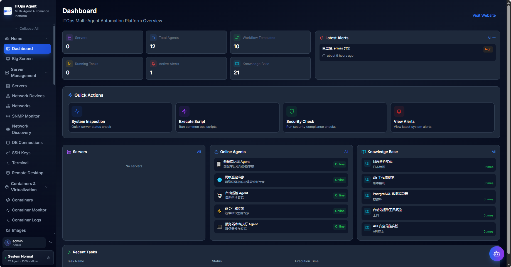

[English](README.md) | [中文](README.zh.md) | [繁體中文](README.tw.md) | [한국어](README.ko.md) | [日本語](README.ja.md) | [Deutsch](README.de.md) | [Français](README.fr.md)

---

**本项目正基于 4A 架构框架与 DDD 领域驱动设计进行全面重构。本次重构旨在彻底解耦业务逻辑与技术实现，重塑架构合理性，在提升代码可维护性与规范性的同时，赋予系统更强的弹性扩展能力。重构工作量巨大，目前处于渐进式替换阶段。近期推送的代码和构建的 Docker 镜像为过渡态，未经验证依赖混乱，不建议直接拉取使用。建议普通用户等待稳定版本发布；具备源码调试修改能力的开发者可先行基于源码修改二开，并欢迎协助修复临时性缺陷。**

```bash
# 部署（推荐使用 Docker Compose）
docker compose up -d --build
```

---

**重要许可证变更通知（2026-05-27）**

本项目 2026 年 5 月 27 日之前提交的所有代码，依旧沿用 MIT 许可证，可按照 MIT 协议规则自由使用、修改、商用分发。
自 2026 年 5 月 27 日起，本项目所有新增、修改的代码，统一采用 Mozilla Public License 2.0（MPL-2.0）开源授权，使用者必须严格遵循 MPL-2.0 官方协议约束：
若对外分发包含本项目修改代码的二进制包、镜像、部署程序，必须开源所有修改过的源文件，同时完整保留原项目版权、许可证声明，不得抹除出处冒充自研产品；
允许企业内网私有化部署、内部二次改造自用；允许基于本项目提供部署调试、技术咨询、定制开发等人力类付费服务；
严禁仅对本项目源码简单封装后，闭源打包作为独立商业化软件、镜像产品对外售卖；严禁直接基于本项目搭建同类型竞品 SaaS 平台进行商业化运营。
本项目将永久开源，归属全体开源技术社区，不会被任何商业公司独占买断。我们鼓励合规前提下的技术交流、二次开发与开源生态建设。

---

## 🎯 谁在使用 / 谁适合用？

| 角色                  | 典型痛点                                   | 本平台如何解决                                 |
| --------------------- | ---------------------------------------- | --------------------------------------------- |
| **运维工程师**        | 半夜被告警吵醒，手动 SSH 排查           | AI 自动诊断根因 → 推送审批 → 手机一键修复   |
| **SRE / DevOps**      | 多套工具来回切换，信息孤岛              | 告警+诊断+执行+审批一站式闭环               |
| **IT 主管 / CTO**     | 运维全靠人，故障响应靠运气              | 自动化巡检 + 自愈策略，把人从重复劳动中解放 |
| **中小企业 IT**      | 买不起 PagerDuty/Rundeck 等商业软件       | 功能对标，开源免费，数据不出域              |
| **安全合规团队**      | 修复操作无审批、无审计                   | HITL 人工审批 + 全链路审计 + 命令安全过滤     |

---

## 为什么需要这个项目？

凌晨 3 点，服务器 CPU 飙到 99%。传统流程：

```
告警通知 → 被吵醒 → 登录 VPN → SSH 上去 → 敲命令排查 → 翻文档 → 修复 → 写报告 → 睡觉
```

**整个过程 30-60 分钟，而你本可以继续睡觉。**

ITOps Agent Platform 把这个流程变成：

```
告警触发 → AI 自动诊断根因 → 生成修复命令 → 推送手机审批 → 一键执行 → 自动验证 → 生成报告
```

**全程 3 分钟，你只需要在手机上点一下"同意"。**

---

## 🚀 运维的终极形态：从自动化到自主化

ITOps Agent Platform 不只是一个运维工具，它瞄准的是 **IT 运维的终极演进方向** — AI 全自主运维。

```
手工运维  →  脚本自动化  →  平台化  →  AI 
  2000s           2010s                2020s               2024+              now & future
```

| 阶段                 | 特点                                                     | 人的角色         |
| --------------------- | -------------------------------------------------------- | ---------------- |
| 手工运维              | 敲命令，登录服务器                                       | 执行者           |
| 脚本自动化           | Shell / Python 半自动化                                 | 脚本维护者       |
| 平台化               | Ansible / Prometheus / Terraform                         | 平台运维者       |
| AI 辅助               | Copilot 建议，告警分析                                   | 决策者           |
| **AI 自主运维**       | **全自动：感知 → 诊断 → 决策 → 执行 → 验证**         | **监督者**       |

### 为什么是终极形态？

| 维度          | 传统方式                          | ITOps Agent Platform            |
| ------------- | --------------------------------- | ------------------------------ |
| 事件响应      | 人：检测 → 定位 → 修复 (30-60 分钟) | AI：自动感知 → 诊断 → 修复 (< 3 分钟) |
| 运维规模      | 1 人管 20-50 台机器               | **1 人管 500+ 台，AI 承担 80%+ 工作** |
| 知识保留      | 散落在资深员工头脑中               | **知识库 + RAG，从不丢失**     |
| 决策质量      | 取决于个人经验，不稳定               | **多代理推理，可审计**         |
| 边际成本      | 机器越多，人力越多               | **机器越多，代理越多，成本趋近于零** |

> **这不是一个运维工具，这是下一代运维操作系统。** 当 AI 能够自主完成告警感知、根因诊断、决策制定、命令执行、结果验证时，运维就不再是 "人盯系统"，而是 "人定规则，AI 执行”。

### 行业趋势：自主 AI 运维是不可逆的

- **Gartner** 列出 AIOps 为战略性技术趋势，预测 AI 驱动的自主运维将成为标准
- **CNCF**：云原生 + AI 融合是下一代基础设施的核心方向
- 运维人力成本不断上升 — **AI 代理是支持 10 倍业务增长的唯一方式，不需要 10 倍人力**
- **开源 + 多代理协作** 是打破商业垄断的关键路径

### 我们的定位

**ITOps Agent Platform 是唯一一个开源 AIOps 项目，真正实现了 "告警 → 诊断 → 决策 → 执行 → 验证" 的全自主闭环。**

长期目标：让 AI 代理承担 80% 常规运维工作，让工程师专注于架构、政策、创造力工作。**这不仅仅是一个开源项目，这是运维解放运动的起点。**

---

## ⏰ 为什么是现在？

三个趋势在此时此刻汇聚，自主 AI 运维从 "概念" 成为 "必然"：

| 趋势              | 解释                                                                                               |
| ----------------- | -------------------------------------------------------------------------------------------------- |
| **LLM 能力跨越临界点** | GPT-4o / DeepSeek / Doubao / Qwen 已具备生产级推理能力，能够故障诊断和命令生成 |
| **运维人力成本上升不可逆** | 10 倍 IT 增长无法靠 10 倍人力跟上，AI 必须承担 80%+ 常规工作 |
| **开源生态已成熟** | Docker / K8s / React / TypeScript / Node.js 已能支撑企业产品，开源已不再是 "原始"           |

> **2026 年是自主 AI 运维的一年。** LLM 能力 + 运维痛点 + 成熟开源生态三者汇聚，ITOps Agent Platform 恰好站在这个历史节点。错过这个窗口，就是错过一个时代。>

### 一个 4000 亿美元的市场正在被 AI 重写规则

全球 IT 运维市场：**4000 亿美元 (2025 年)**，预计 2030 年突破 7000 亿美元。每个范式变革都会诞生一个新王者：

- 云原生转变 → AWS ($2 万亿市值)
- 监控转变 → Datadog ($400 亿美元市值)
- Dev 工具转变 → GitLab ($140 亿美元 IPO)
- **运维转变 → ？**

> **问题不是 "会不会发生"，而是 "谁成为这个轨迹上的 GitLab"。** 开源 AIOps 领导者位置空缺 — 赢家通吃。

| GitLab 当年                     | ITOps Agent Platform 今天                    |
| -------------------------------- | --------------------------------------------- |
| 开源替代 GitHub                  | 开源替代 PagerDuty + Rundeck + Portainer    |
| 初期仅基础 CI/CD                | 12 个 AI 代理 + 68 个 API 路由              |
| 无人相信代码托管值 100 亿美元   | **无人相信运维平台值 100 亿美元**           |

> ITOps Agent Platform 站在一个比 GitLab 时代更大规模的轨迹上。

### 三条不可逆的发展趋势

| 趋势               | 为什么不可逆                                                                    |
| ------------------ | ------------------------------------------------------------------------------- |
| **AI 能力爆炸式增长** | LLM 从 "玩具" 成长到 "生产级"，2 年内完成；下一步是 "自主决策”           |
| **运维人才缺口**   | 资深员工退休潮 + 年轻人不愿上 24 小时班，AI 是唯一的出路               |
| **开源吞噬商业**   | GitLab, Confluence, Grafana, HashiCorp 等 5 个开源 IPO 证明，开源能商业化   |

> **不是要不要选择，而是选谁。** 当三条曲线相交，自主 AI 运维就是数学必然性。




---

## 体验完整的闭环，5 分钟入门

```bash
# 1. 部署（需要 Docker）
docker compose up -d --build

# 2. 打开 http://localhost:8080，默认帐户 admin/admin
# 3. 添加一台服务器 → 系统自动发现主机的容器和资源
# 4. 配置一个告警 Webhook → 触发测试告警 → 观察 AI 分析
# 5. 点击"自动修复" → 手机上同意 → 完成！
```

**5 分钟从零到完整的 AI 运维闭环。**

---

## 平台能做什么？

### 路径 1️⃣  智能告警 → AI 诊断 → 自动修复

```
Prometheus / Zabbix 告警 → webhook 接收
  → AI 根因分析（自然语言诊断报告）
    → 自动生成修复命令 + 风险评估
      → 企业微信 / 钉钉 推送审批 → 手机一键同意
        → SSH 自动执行修复 → 验证结果 → 生成报告
```

<details>
<summary><b>扩展：这个流程解决了哪些痛点</b></summary>

| 传统方式                     | 这个平台                              |
| --------------------------- | ------------------------------------ |
| 告警风暴，半夜被吵醒       | AI 去重 + 聚类 + 抑制                 |
| 手动 SSH 调试，猜测         | AI 分析日志 + 指标，提供自然语言诊断 |
| 翻文档找修复步骤             | 自动生成结构化修复命令 (JSON)         |
| 修复无审批，没责任         | 人工审批节点，手机一键审批           |
| 怕修复失败没回滚           | 自动验证，失败立刻告警               |

</details>

### 路径 2️⃣  可视化工作流 → 自动化巡检

```
拖放工作流编辑器（代理 + 审批 + 条件分支）
  → 配置 Cron 触发器
    → 自动巡检多台服务器
      → 生成合规报告
        → 异常产生告警 → 进入路径 1️⃣
```

### 路径 3️⃣  统一容器与虚拟机管理

```
一步添加 Docker 主机 / VMware vCenter / Proxmox VE / KVM 节点
  → 自动发现所有容器和虚拟机
    → 实时 CPU / 内存 / 网络监控 (WebSocket 推送)
      → 容器日志流式输出
        → 可视化 Docker Compose 编排
          → K8s 集群导入管理 (kubeconfig 导入 + 状态)
            → 镜像仓库集成 (Harbor / ACR / Docker Hub)
```

### 路径 4️⃣  数据中心和网络基础设施管理

```
子网规划 → IP 子网 / VLAN 管理 → 自动 IP 分配 / 预留 / 释放
  → 数据中心建模 (机架 / PDU / 设备生命周期 / 电源管理)
    → 3D 数字孪生房间监控 (WebGL 实时渲染)
      → 自动网络拓扑发现 (SNMP / LLDP / ARP)
```

---

## 比其他开源项目有什么不同？

| 能力                         | ITOps Agent | GrafanaOnCall | Portainer | UptimeKuma | Rundeck | Coolify |
| ---------------------------- | :---------: | :-----------: | :-------: | :--------: | :-----: | :-----: |
| 告警接入 + 噪音抑制         |     ✅      |      ✅       |    ❌     |     ✅     |   ❌    |   ❌    |
| **AI 多代理协作**           |   **✅**    |      ❌       |    ❌     |     ❌     |   ❌    forensic|   ❌    |
| **告警 → 自动修复闭环**     |   **✅**    |      ❌       |    ❌     |     ❌     |   ❌    |   ❌    |
| **人工审批 (HITL)**         |   **✅**    |      ❌       |    ❌     |     ❌     |   ❌    |   ❌    |
| Docker/VM 可视化管理       |     ✅      |      ❌       |    ✅     |     ❌     |   ❌    |   ✅    |
| K8s 集群管理                |     ✅      |      ❌       |    ✅     |     ❌     |   ❌    |   ❌    |
| IP 子网 / VLAN 管理        |     ✅      |      ❌       |    ❌     |     ❌     |   ❌    |   ❌    |
| 数据中心房间管理            |     ✅      |      ❌       |    ❌     |     ❌     |   ❌    |   ❌    |
| 3D 房间数字孪生            |     ✅      |      ❌       |    ❌     |     ❌     |   ❌    |   ❌    |
| 拖放工作流编辑器           |     ✅      |      ✅       |    ❌     |     ❌     |   ✅    |   ❌    |
| Web SSH 终端                |     ✅      |      ❌       |    ✅     |     ❌     |   ❌    |   ❌    |
| 知识库 + RAG                |     ✅      |      ❌       |    ❌     |     ❌     |   ❌    |   ❌    |
| 定时任务 + 自动报告        |     ✅      |      ❌       |    ❌     |     ❌     |   ✅    |   ❌    |
| 成本分析 + 自动扩缩容     |     ✅      |      ❌       |    ❌     |     ❌     |   ❌    |   ❌    |
| **本地 AI · 数据不出域**   |   **✅**    |      ❌       |    ❌     |     ❌     |   ❌    |   ❌    |

> **一言以蔽之**：现有的开源工具各覆盖一片 — OnCall 负责告警，Portainer 负责容器。ITOps Agent 将它们连接起来，并增加一个 **AI 多代理大脑**，实现真正的 "告警 → 修复完成"。

### vs 商业化产品

免费开源不仅仅是优势。比肩付费产品：

| 能力                     | PagerDuty+Rundeck | ServiceNow ITOM  | **ITOps Agent (免费)**       |
| ------------------------ | :---------------: | :--------------: | :-------------------------: |
| 年费 (100 节点)         |    $50,000+       |    $100,000+     |           **$0**            |
| 自主 AI 诊断            |    ❌ 告警路由仅 | ⚠️ 额外模块     | **✅ 多代理推理**           |
| 自动修复闭环            |    ❌ 手动        | ⚠️ 需定制开发   |      **✅ 内置**            |
| 人工审批 (HITL)         |         ❌        |    ⚠️ 需定制    |   **✅ 原生手机推送**       |
| Container/VM/K8s 管理  |         ❌        |        ❌        |      **✅ 内置**            |
| 数据留在本地            |  ❌ SaaS 型       | ❌ SaaS 型      |    **✅ 100% 本地**          |
| 开源可控                |     ❌ 闭源       |   ❌ 闭源      |     **✅ MPL-2.0**            |
| 社区驱动                |         ❌        |        ❌        |           **✅**             |

> **一个开源项目做到了三个商业产品的合资都无法实现。**

---

## 架构概览

```mermaid
graph TB
    %% ===== Client layer =====
    subgraph Client["🖥️ Client layer"]
        Browser["🌐 Browser<br/>React 18 + Vite + Ant Design<br/>474 .tsx components · 23 DDD modules"]
    end

    %% ===== Edge layer =====
    subgraph Edge["🚪 Edge layer"]
        Nginx["Nginx reverse proxy<br/>static assets · gzip · HTTPS termination"]
    end

    %% ===== Technology layer =====
    subgraph Tech["4️⃣ Technology layer (core/)"]
        DI["DI container<br/>serviceContainer.ts<br/>topological init"]
        MW["Middleware<br/>auth(JWT+RBAC) · errorHandler<br/>rateLimiter · validation(Zod) · trace"]
        WS["WebSocket service<br/>Socket.IO 4.7<br/>realtime push · VNC proxy"]
    end

    %% ===== Application layer =====
    subgraph App["2️⃣ Application layer (modules/)"]
        direction TB

        subgraph AIMcp["🤖 AI & tool protocol domain"]
            AiMod["ai/<br/>multi-agent · RCA · knowledge base<br/>agentToolRegistry 24 tools"]
            McpMod["mcp/<br/>MCP protocol · 6-layer securityGate<br/>toolRegistry 13+ platform + external server"]
            Bridge["agentMcpAdapter<br/>bridge (mcp ↔ agent)"]
        end

        subgraph AlertMon["🚨 Alerting & monitoring domain"]
            AlertsMod["alerts/<br/>ingest→filter→correlate→dedupe→notify<br/>AlertProcessor state machine"]
            MonMod["monitor/<br/>dashboard · big screen · reports · cost<br/>Prometheus · Zabbix"]
            LinkMod["linkage/<br/>linkage stats · patrol center<br/>(backend only)"]
        end

        subgraph InfraDom["🛠️ Infrastructure domain"]
            ServersMod["servers/<br/>SSH · remote desktop · terminal"]
            ContainersMod["containers/<br/>Docker multi-host · VMware/Proxmox/KVM<br/>three adapters + snapshot/migration"]
            K8sMod["kubernetes/<br/>K8sContext · Pod · Node"]
            NetworkMod["network/<br/>17 vendor adapters · SNMP · topology · VNC"]
            DcMod["dc/<br/>room · rack · device · power<br/>3D visualization · 5s realtime push"]
        end

        subgraph AutoDom["⚙️ Ops automation domain"]
            WfMod["workflow/<br/>WorkflowEngine state machine · task scheduling"]
            AutoMod["auto/<br/>remediation policy · autoscaling<br/>container/vm/k8s_deployment"]
            CfgMod["config-management/<br/>config templates · config repair · Compose"]
            ChgMod["change-management/<br/>change approval · ApprovalTicket"]
            ScriptsMod["scripts/<br/>scripts · terminal · AI commands"]
        end

        subgraph SysDom["🔐 System support domain"]
            AuthMod["auth/<br/>JWT + RBAC + login rate limit"]
            SettingsMod["settings/<br/>system settings · AI provider config<br/>replaces .env"]
            BackupMod["backup/<br/>auto backup · encryption · manual restore"]
            AuditMod["audit/<br/>audit log"]
            DBMod["database/<br/>DB connection management"]
            NotifyMod["notification/<br/>6 channels · templates · delivery"]
            ImpMod["import-export/<br/>CSV/JSON import export"]
            TLMod["tool-links/<br/>toolbox CRUD"]
        end
    end

    %% ===== Business layer =====
    subgraph Biz["1️⃣ Business layer (state machines/rules/permissions)"]
        BizRules["workflow state machine · alert rules<br/>approval permissions · aggregate-root protection<br/>(never hardcoded in routes/repository)"]
    end

    %% ===== Data layer =====
    subgraph Data["3️⃣ Data layer (repositories/)"]
        SQLite[("SQLite<br/>better-sqlite3 + WAL mode<br/>AES-256 encryption · 60 migrations<br/>31 top-level repos + 90 subdirs")]
    end

    %% ===== External integrations =====
    subgraph Ext["🌍 External integration layer"]
        LLM["🤖 LLM model pool<br/>Doubao · DeepSeek · Qwen<br/>OpenAI · Zhipu · local models<br/>(providerAdapters functional abstraction)"]
        SSH["🖥️ SSH servers<br/>ssh2 · shell-quote"]
        Docker["🐳 Docker Engine API<br/>dockerode"]
        VMware["💻 VMware vSphere / KVM"]
        Prometheus["📊 Prometheus / Zabbix / Grafana<br/>alert webhooks"]
        K8sExt["☸️ Kubernetes API"]
        SnmpExt["📡 SNMP / NetFlow devices<br/>17 vendor adapters · net-snmp"]
        Notify["📬 Notification channels<br/>WeCom · Feishu · DingTalk<br/>Telegram · Email · Webhook"]
        McpExt["🔌 External MCP servers<br/>SSE / stdio transport"]
    end

    %% ===== Edges =====
    Browser --> Nginx
    Nginx --> App
    Browser <-->|"WebSocket realtime<br/>alerts · VNC · dc:status"| WS
    WS -.inject into DI.-> DI

    App --> Biz
    App --> Data
    App --> Tech

    AIMcp --> LLM
    AIMcp -.SSE/stdio.-> McpExt
    AlertsMod --> Prometheus
    MonMod --> Prometheus
    NetworkMod --> Prometheus
    DcMod --> Prometheus
    NotifyMod --> Notify
    ServersMod --> SSH
    ContainersMod --> Docker
    ContainersMod --> VMware
    K8sMod --> K8sExt
    NetworkMod --> SnmpExt
    AiMod --> LLM
    WfMod --> ScriptsMod
    AutoMod --> ContainersMod
    AutoMod --> K8sMod
    ScriptsMod --> ServersMod

    classDef biz fill:#fff4e1,stroke:#d2691e,stroke-width:2px;
    classDef tech fill:#e1f0ff,stroke:#1e5aa8,stroke-width:2px;
    classDef data fill:#e8f5e9,stroke:#2e7d32,stroke-width:2px;
    class BizRules biz
    class DI,MW,WS tech
    class SQLite data
```



> 📐 [完整架构图 →](./docs/ARCHITECTURE_DIAGRAM.md)

---

| 护城优势                | 描述                                                          |
| ----------------------- | ------------------------------------------------------------ |
| **12 代理编排**       | 非单 API 调用，而是一个分布式代理角色协作仲裁系统       |
| **全链路状态机**       | 告警 → 诊断 → 决策 → 审批 → 执行 → 验证，7 节点闭环强化 |
| **命令安全引擎**     | 7 类危险命令策略 + 角色权限矩阵，保持 AI 生成命令安全       |
| **多模型容灾**         | 自动故障切换到备用模型，AI 服务不怕单点失败         |
| **60 个数据库迁移**   | 几十次演化，工程成熟度远超 demo 项目                         |

### 规模经济：为什么开源赢

| 指标               | 传统 SaaS 运维                | ITOps Agent 开源模型                        |
| ------------------ | :---------------------------: | :-----------------------------------------: |
| 客户获取           | 销售驱动，1 个客户 $10,000+   | **≈ $0 (社区 + 开发者口碑)**               |
| 边际成本          | 线性增长                      | **近零 (自托管)**                          |
| 网络效应           | 弱                            | **强 (更多代理 → 更强平台 → 更大社区)** |
| 锁定效应           | 可迁移                          | **知识库 + 代理市场 + 工作流模板**       |
| 商业灵活性         | 订阅型仅                   | **企业版 / 托管云 / 支持 / 市场 / 培训** |

> 开源的核心优势是获取效率和规模，已被主流项目证明。其是长期可持续性的坚实基础。

---

## 🗺️ 路线图

| 阶段                   | 核心目标                                                          |
| ----------------------- | ---------------------------------------------------------------- |
| **v3.x 工程化** (现在) | 多主机容器/VM/K8s 管理，告警 → 修复闭环                    |
| **v4.x 智能化**       | 多代理自主协商，跨系统相关性，自学习策略                   |
| **v5.x 自主化**        | 零接触操作，AI 驱动的能力和成本规划                           |
| **v6.x 生态化**       | 代理市场，多集群联邦，运维数字孪生                       |

> **路线图不是计划表；它是未来蓝图。** 项目持续迭代，朝着自主 AI 运维不断推进。

---

## 核心功能

### 🤖 AI 驱动的运维

- **12 个预设代理**：告警处理，故障诊断，日志分析，系统巡检，变更执行，文档生成，合规检查，命令执行，自巡检，命令生成专家，网络巡检专家，数据库运维
- **AI 修复闭环**：告警 → AI 分析 → 修复命令生成 → 审批 → 执行 → 验证
- **根因分析**：AI 驱动的告警分析，自然语言诊断报告 + 完整推理链
- **AI Copilot**：自然语言运维助手，自动感知系统状态
- **知识库 + RAG**：21 个预设条目，语义检索注入 LLM 上下文

### 🔧 可视化管理

- **工作流编辑器**：拖放，序列/并行/条件分支，10 个预设模板
- **Web SSH 终端**：xterm.js 交互式，自动调整， sessão 管理
- **容器管理**：多主机 Docker 可视化 (启动/停止/日志/监控/Compose)
- **VM 管理**：VMware vSphere / Proxmox VE / KVM，快照，实时迁移
- **K8s 管理**：通过 kubeconfig 导入集群，完整的 Pod/Deployment/Service/Node 生命周期
- **子网管理**：IP 子网 / VLAN 规划，自动 IP 池，分配/预留/释放，批量操作
- **数据中心管理**：房间和机架建模，设备生命周期跟踪，PDU/UPS 电源管理
- **3D 房间监控**：Three.js WebGL 数字孪生，实时设备状态
- **大屏仪表板**：全屏 NOC 监控中心

### 🏢 企业级能力

- **HITL 审批**：工作流中的人工审批节点，企业微信/钉钉 推送，手机审批
- **告警降噪**：智能去重 + 抑制 + 相关性
- **自动扩缩容**：CPU/内存驱动，冷却窗口，扩缩历史
- **成本分析**：容器/VM 成本估算 + 优化建议
- **定时任务**：Cron 表达式自动运行工作流
- **报告系统**：自动生成的 Markdown 报告

### 🔒 安全与合规

- **AES-256-GCM 加密**：服务器密码和 SSH 密钥银行级加密
- **JWT 双 token 认证**：访问 token (24h) + 刷新 token (7d) 自动刷新
- **SSH 命令安全过滤**：7 类危险命令策略 (rm -rf / mkfs / iptables -F …)，按角色拦截
- **登录保护**：5 次失败后 30 分钟锁定，强制密码复杂度
- **审计日志**：所有操作可追溯
- **非根运行**：Docker 容器最小权限
- **本地 AI**：Ollama / LM Studio / vLLM 支持，数据不出域

---

## 支持的 AI 模型

通过统一模型池管理，提供主备回退链和独立熔断器，每个提供商一个。

| 类型             | 提供商/模型                          | 集成  | 推荐场景            |
| ---------------- | ----------------------------------- | ---- | ------------------ |
| **中国云**     | 火山引擎 · 豆包                      | 原生 API | 中国区稳定、快速    |
| **中国云**     | 阿里云 · 通义                          | OpenAI 兼容 | 企业级负载      |
| **中国云**     | 深思 · DeepSeek                      | OpenAI 兼容 | 代码生成、推理     |
| **中国云**     | 智谱 · GLM-4                         | OpenAI 兼容 | 强大的中文理解   |
| **中国云**     | 月之光 · Kimi                         | OpenAI 兼容 | 长文本处理       |
| **中国云**     | 百度 · ERNIE                         | OpenAI 兼容 | 中国企业        |
| **中国云**     | 01.AI / 百川                         | OpenAI 兼容 | 开源模型       |
| **全球云**     | OpenAI / Anthropic Claude           | 原生 API | 中国以外网络      |
| **本地部署**     | Ollama / LM Studio / vLLM           | OpenAI 兼容 | **数据 100% 本地** |

> ✅ 统一模型池   ✅ 回退链   ✅ 独立熔断   ✅ 拖放排序   ✅ 连通性测试

---

## 快速入门

### 选项 1：Docker Compose

```bash
docker compose up -d --build
# 前端：http://localhost:8080
# 健康检查：http://localhost:3001/health
```

### 选项 2：本地开发（热重载）

```bash
npm run dev
# 前端：http://localhost:3000
# 后端：http://localhost:3001
```

**默认管理员**：`admin` / `admin` (首次登录强制修改密码)

---

## 技术栈

| 层级              | 技术                                      |
| ------------------ | ------------------------------------------- |
| 前端              | React 18 + TypeScript + Vite 5 + Tailwind CSS 3 |
| 状态管理          | Zustand + React Query                       |
| 工作流编辑器      | @xyflow/react                               |
| 后端              | Node.js + Express 4 + TypeScript            |
| 数据库            | SQLite (better-sqlite3, WAL 模式)           |
| 实时              | Socket.io 4                                 |
| 远程连接          | SSH2                                        |
| 容器操作          | Dockerode                                    |
| 部署              | Docker + Docker Compose + Nginx              |

---

## 项目结构

```
├── backend/src/
│   ├── app.ts                    # Express 入口
│   ├── routes/                   # 68 个 API 路由模块
│   ├── services/                 # 72 个业务服务
│   ├── models/                   # 数据库 + 60 个迁移
│   ├── presets/                  # 预设数据 (代理 / 工作流 / 知识)
│   ├── middleware/               # 6 个中间件 (认证 / 限流 / 验证 …)
│   ├── websocket/                # Socket.io 实时
│   └── utils/                    # 工具
├── frontend/src/
│   ├── pages/                    # 63 个页面组件
│   ├── components/               # 共享组件 (DataRoom3D / 工作流编辑器 …)
│   ├── contexts/                 # React 上下文 (认证 / 主题 / 提示)
│   └── lib/                      # axios 包装 / 辅助
├── docker/                       # 生产 Docker 配置 + Nginx
├── docs/                         # 技术文档
├── .github/workflows/            # CI (docker-build.yml)
├── docker-compose.yml            # 生产编排
└── package.json                  # 工作区脚本
```

---

## 文档

| 文档                                          | 描述              |
| --------------------------------------------- | ------------------------ |
| [部署指南](./docs/DEPLOYMENT.md)          | 详细部署步骤             |
| [API 参考](./docs/API.md)                    | 完整 API 表面         |
| [架构](./docs/ARCHITECTURE.md)            | 系统架构                |
| [开发指南](./docs/DEVELOPMENT.md)        | 本地搭建                |
| [工作流指南](./docs/WORKFLOW_GUIDE.md)    | 工作流编排             |
| [自动修复设计](./docs/AUTO_REMEDIATION_DESIGN.md) | 告警自动修复 |
| [网络设备检测](./docs/NETWORK_DEVICE_INSPECTION.md) | 网络设备功能 |
| [测试指南](./docs/TEST_GUIDE.md)         | 功能测试               |
| [项目愿景](./项目愿景与社区共建.md)          | 愿景与共建             |

---

## 作者

**Tan Ce** — 独立开发者 | AIOps 探索者

- 🌐 网站：[ITOpsAgentinfo](https://www.zjzwfw.cloud/ITOpsAgentinfo)
- 📝 博客：[zjzwfw.cloud](https://www.zjzwfw.cloud/)
- 📧 邮箱：<huawei_network@foxmail.com>
- 💬 微信公众号：**IT Online**

<p align="left">
  
</p>

---

## 🙏 贡献者

|                                                              头像                                                              |   姓名 / 账户    | 角色      | 贡献 |
| :---------------------------------------------------------------------------------------------------------------------------: | :--------------: | :-------: | :--- |
|  | **热心市民高先生** | 微信贡献者 | 测试反馈 |
|  |      **@林**       | 微信贡献者 | 测试反馈 |
|                              |     **尔东辰**     | 微信贡献者 | 测试 |
|           | **xiezhiliang89**  | GitHub 贡献者 | 测试 |

<a href="https://github.com/qinshihu/itops-agent-platform/graphs/contributors">
  
</a>

---

## 🌍 社区愿景：不止代码，更是一个运动

ITOps Agent Platform 不只是一个开源项目；这是 **运维工程师解放运动**。

我们相信：

- **运维不应该成为 24 小时体力劳动** — 应该是政策设计和架构创新
- **AI 不应该取代工程师** — 应该取代工程师不愿意做的事情
- **开源社区** 能造出比商业软件更好的产品
- **每个运维工程师都应该有解放的一天** — 能和家人团聚，能追求真正热爱的事情

> 如果你也相信运维的未来是 AI 自主，你也加入我们。**星星是开源项目的最大认可，每一个星星都让愿景更近。**

---

## 🔭 长期愿景

> **"我们正在构建运维领域的自主操作系统。"**

> 5000 万运维工程师管理着 4000 亿美元的 IT 基础设施。今天他们还得 3 点起床手工修复服务器。

> 我们正在做的事情是把运维从 "人操作工具" 转变为 "人定规则，AI 执行”。不是功能增强 — 是一个范式转变。

> 项目持续演进；跟进。每个星星都是对未来的投票。

---

## 🤝 贡献指南

欢迎所有形式的贡献！

- 🐛 [报告 Bug](https://github.com/qinshihu/itops-agent-platform/issues/new?template=bug_report.yml)
- 💡 [功能建议](https://github.com/qinshihu/itops-agent-platform/issues/new?template=feature_request.yml)
- 📝 [改进文档](https://github.com/qinshihu/itops-agent-platform/issues/new?template=docs_update.yml)
- 🔒 [安全问题](SECURITY.md)

查看 [CONTRIBUTING.md](CONTRIBUTING.md) 获取详细信息。

---

## ⭐ 支持项目

如果本项目对您有帮助，请给我们一个 **Star** ⭐，让更多人发现它！

<p align="center">
  <a href="https://github.com/qinshihu/itops-agent-platform">
    
  </a>
  &nbsp;&nbsp;
  <a href="https://github.com/qinshihu/itops-agent-platform/fork">
    
  </a>
</p>

> 🌟 **更多星星 → 更可能进入 GitHub 热点 → 更多开发者加入构建。每个星星都是最大的鼓励！**

---

## 📄 许可证

[MPL-2.0](./LICENSE) © Tan Ce
